# AlgoTrade - Long Cash Equity Intraday Platform
### Institutional-Grade Quantitative Trading & Real-Time Risk Execution Engine

[](https://go.dev/)
[](https://nextjs.org/)
[](https://kite.trade/)
[](#part-5-concurrency-model-black-box-diagnostics--eod-engine)
[](#license--attribution)

---

> [!CAUTION]
> ### ⚠️ FINANCIAL DISCLAIMER & RISK WARNING
> **Algorithmic trading and capital markets involve substantial risk of complete financial loss.**
> 1. **Do Your Own Research (DYOR)**: This software is designed, maintained, and distributed strictly for academic, educational, and quantitative research purposes. It is not financial advice or investment advisory.
> 2. **Execution & Microstructure Risks**: Automated execution is subject to hardware latency, internet dropouts, exchange matching engine halts, broker API rate limits, and market slippage.
> 3. **Zero Liability**: The author and contributors assume **NO RESPONSIBILITY OR LIABILITY** for any financial losses or brokerage costs incurred through the direct or indirect use of this codebase.

---

## 📖 Table of Contents
1. [Overview & High-Level Philosophy](#overview--high-level-philosophy)
2. [PART 1: Real-Time Stock Selection Engine](#part-1-real-time-stock-selection-engine)
   - [Universe Source: Why the F&O Filter is Mandatory](#1-universe-source-why-the-fo-filter-is-mandatory)
   - [Real-Time Tick Ingestion & In-Memory Metrics](#2-real-time-tick-ingestion--in-memory-metrics)
   - [The 5-Factor Quant Ranking Algorithm](#3-the-5-factor-quant-ranking-algorithm)
   - [Market Breadth & 3-State Regime Classifier](#4-market-breadth--3-state-regime-classifier)
3. [PART 2: Intraday Playbook & Pre-Trade Gatekeeping](#part-2-intraday-playbook--pre-trade-gatekeeping)
   - [Session Clocks (6 Algorithmic Time Phases)](#1-session-clocks-6-algorithmic-time-phases)
   - [The 3 Core Institutional Entry Setups](#2-the-3-core-institutional-entry-setups)
   - [Pre-Trade Rejection & Safety Matrix](#3-pre-trade-rejection--safety-matrix)
4. [PART 3: Risk Management, Position Sizing & Trailing Stop-Loss](#part-3-risk-management-position-sizing--trailing-stop-loss)
   - [4-Constraint Position Sizing Engine](#1-4-constraint-position-sizing-engine)
   - [Mandatory Net-Profitability Gate](#2-mandatory-net-profitability-gate)
   - [Continuous Portfolio Heat Engine (2.0% Cap)](#3-continuous-portfolio-heat-engine-20-cap)
   - [Initial Protective Stop-Loss Calculation](#4-initial-protective-stop-loss-calculation)
   - [4-Gear Dynamic Trailing Stop Engine (NSE 25-Mod Limit)](#5-4-gear-dynamic-trailing-stop-engine-nse-25-mod-limit)
   - [4-Stage Bulletproof Emergency Flatten](#6-4-stage-bulletproof-emergency-flatten)
5. [PART 4: Complete End-to-End System Architecture Diagram](#part-4-complete-end-to-end-system-architecture-diagram)
6. [PART 5: Concurrency Model, Black Box Diagnostics & EOD Engine](#part-5-concurrency-model-black-box-diagnostics--eod-engine)
7. [PART 6: Quickstart & Deployment](#part-6-quickstart--deployment)

---

## Overview & High-Level Philosophy

Most retail intraday traders blow up their accounts within 90 days due to emotional errors: chasing green candles, moving stop losses wider, cutting winners too early, and trading during sideways chop.

**AlgoTrade** replaces human emotional bias with an **institutional, unemotional single-writer execution system**:
- Scans liquid Indian equities to detect where institutional participants are actively deploying capital.
- Enforces a **strictly calculated risk budget per trade** based on structural volatility.
- Protects open positions tick-by-tick using **hardware-level atomic trailing stops**.
- Automatically closes positions via an **escalating emergency sweep ladder** during adverse events.

---

## PART 1: Real-Time Stock Selection Engine

```
[200+ NSE Equities] ──> [F&O Liquidity Filter] ──> [Binary Tick Parser] ──> [Contiguous Metrics] ──> [Top-Ranked Outliers]
```

### 1. Universe Source: Why the F&O Filter is Mandatory

AlgoTrade tracks the **NSE Futures & Options (F&O) eligible universe** (approx. 200+ large-cap and high-liquidity mid-cap equities).

**Why were non-F&O cash stocks intentionally excluded?**
1. **Zero Circuit Lock Traps**: Non-F&O stocks in India are subject to strict $5\%$ or $10\%$ circuit bands. When bad news hits, a non-F&O stock hits a lower circuit limit where all bids disappear, making it mathematically impossible to exit and trapping capital overnight. F&O stocks have dynamic circuit bands with cooling periods, guaranteeing continuous liquidity.
2. **Sub-Paise Bid-Ask Spreads**: Non-F&O stocks often carry wide bid-ask spreads ($0.20\% - 0.50\%$). Crossing the spread on entry and exit immediately burns the trade's edge in slippage. F&O stocks trade with high tick density where the spread is almost always 1 single tick (₹0.05).
3. **5x Intraday MIS Margin Support**: Indian broker regulations (SEBI / Zerodha RMS) grant guaranteed 5x leverage only on high-liquidity F&O securities.
4. **Institutional Order-Flow Visibility**: Large domestic institutions (DIIs) and foreign portfolio investors (FPIs) execute their block orders and VWAP algorithms primarily in F&O names.

---

### 2. Real-Time Tick Ingestion & In-Memory Metrics

* **Binary Wire Ingestion**: Ingests Zerodha Kite Connect WebSocket Level-2 binary frames (184 bytes per packet) into a 65,536-capacity ring buffer.
* **Contiguous Cache Alignment**: Dispatches packets to a Single-Writer Actor goroutine that updates a contiguous in-memory array (`[512]StockMetrics`) with zero heap allocations and $< 250\text{ns}$ latency per tick.
* **Continuous Feature Generation**: Calculates real-time Exchange VWAP, 5-minute OHLCV bars, running 9 EMA (seeded strictly from finalized 5m closes), and Lee-Ready Aggressor Order Flow ratios.

---

### 3. The 5-Factor Quant Ranking Algorithm

Every second, the system calculates a multi-factor **Bullish Score ($0 - 100$)** across active instruments:

$$\text{BullishScore} = w_1 S_{\text{VWAP}} + w_2 S_{\text{RVOL}} + w_3 S_{\text{OrderBook}} + w_4 S_{\text{Aggressor}} + w_5 S_{\text{RS}} - \text{Penalties}$$

| Factor | Metric Name | Weight | What It Measures |
| :--- | :--- | :---: | :--- |
| **Gaussian VWAP** | $S_{\text{VWAP}}$ | $25\%$ | Proximity to the institutional VWAP sweet spot ($+0.15\text{ ATR}$ to $+0.45\text{ ATR}$ above VWAP). Rejects overextended prices. |
| **Paced Relative Volume** | $S_{\text{RVOL}}$ | $25\%$ | Volume pace compared strictly to the historical time-matched 5-minute bucket: $\text{RVOL}_{\text{pace}} = \frac{V_{5\text{m}}(t)}{\text{AvgHistoricalVolume}(t)}$. |
| **Order Book Imbalance** | $S_{\text{OrderBook}}$ | $20\%$ | Depth ratio across Top 5 bids vs asks with distance-decay weighting. |
| **Aggressor Flow** | $S_{\text{Aggressor}}$ | $15\%$ | Fast EMA ($\alpha=0.35$) of market orders crossing the spread to hit the ask (active institutional buying). |
| **Relative Strength** | $S_{\text{RS}}$ | $15\%$ | Price performance relative to the Nifty 50 benchmark index since session open. |

Candidates are penalized for wide spreads, heavy overhead ask walls, and exhausted daily volatility ranges. Indices are sorted in $\sim 2\mu\text{s}$ to identify the top 5 bullish outliers.

---

### 4. Market Breadth & 3-State Regime Classifier

Before any setup is evaluated, AlgoTrade measures the overall market tide using bottom-up universe breadth:

$$\text{Breadth Ratio} = \frac{\sum_{i=1}^{N_{\text{active}}} \mathbb{I}(\text{LTP}_i > \text{VWAP}_i)}{N_{\text{active}}}$$

```
Breadth Ratio:
 0% ──────────── 20% ────────────── 40% ──────────────── 58% ───────────── 100%
 [ FLASH SHOCK ]   [ BEARISH REGIME ]   [ SIDEWAYS CHOP ]    [ BULLISH EXPANSION ]
 Locked Out         New Longs Blocked    Score >= 82 Only     Full Trading Active
```

* **Bullish Expansion ($> 58\%$)**: Market tide is bullish. Standard long entries permitted.
* **Sideways Chop ($40\% - 58\%$)**: High risk of chop. Only elite setups with Bullish Score $\ge 82.0$ permitted.
* **Bearish Regime ($20\% - 40\%$)**: Capital preservation mode. All new long entries blocked.
* **Macro Flash Shock ($\le 20\%$)**: Catastrophic liquidation active. Engages system-wide safety lockout.

---

## PART 2: Intraday Playbook & Pre-Trade Gatekeeping

```
[Session Clock Gate] ──> [Setup Validation (1 of 3)] ──> [14 Safety Filters] ──> [Approved Candidate]
```

### 1. Session Clocks (6 Algorithmic Time Phases)

Intraday edge changes throughout the day. AlgoTrade segments the Indian market day into **6 distinct phases**:

| Time Window (IST) | Phase Name | Status | Rationale |
| :--- | :--- | :---: | :--- |
| **09:15 – 09:30** | `OPENING_NOISE_BLACKOUT` | ❌ **LOCKED** | Absorbs opening auction volatility and wide spreads. Forms the initial 15-minute Opening Range ($\text{ORH} / \text{ORL}$). |
| **09:30 – 11:30** | `MORNING_DISCOVERY_DRIVE` | ✅ **ACTIVE** | Peak institutional liquidity and trend establishment. Full risk sizing (1.0x). |
| **11:30 – 13:30** | `MIDDAY_COMPRESSION` | ❌ **LOCKED** | Volume dries up ahead of European open. Blocks trades to avoid random stop-out chop (unlocks at 0.5x risk only if Breadth $\ge 70\%$). |
| **13:30 – 14:45** | `EUROPE_OVERLAP_EXPANSION`| ✅ **ACTIVE** | European market open injects fresh institutional liquidity. Continuation trends active (1.0x). |
| **14:45 – 15:14** | `EXIT_ONLY_LOCKOUT` | ❌ **LOCKED** | Zero new trades. Manages trailing stops and pre-close risk reduction. |
| **15:14 – 15:30** | `AUTO_SQUAREOFF_SWEEP` | ❌ **LOCKED** | Flattens all intraday positions before Zerodha RMS auto-square-off at 15:20 IST. |

---

### 2. The 3 Core Institutional Entry Setups

AlgoTrade executes long entries exclusively on 3 structural patterns:

#### Setup 1: VWAP Pullback Reclaim (`VWAP_PULLBACK_RECLAIM`)
* **Concept**: In strong trending stocks, institutions accumulate on shallow pullbacks to VWAP.
* **Trigger**: Stock was established above VWAP $\to$ pulls back within $0.05 - 0.45\text{ ATR}$ of VWAP $\to$ active buyers absorb sellers and print a bullish reclaim candle with Aggressor Buy Ratio $\ge 0.58$.

#### Setup 2: Failed Breakdown Bear Trap Spring (`FAILED_BREAKDOWN_SPRING`)
* **Concept**: Market makers push price briefly below a key support level or VWAP to trigger retail stop-loss market orders, absorbing that liquidity for institutional accumulation.
* **Trigger**: Previous candle sweeps below VWAP by up to $0.45\text{ ATR} \to$ live price violently springs back above VWAP with high relative volume ($\text{CompositeRVOL} \ge 1.5\times$).

#### Setup 3: 15-Minute Opening Range Retest Reclaim (`ORB_RETEST_RECLAIM`)
* **Concept**: Retail traders buy the first breakout of the 15m high ($\text{ORH}$) and get trapped ($80\%$ failure rate). AlgoTrade waits for a completed 5m bar close above $\text{ORH}$, followed by a successful pullback retest confirming $\text{ORH}$ as support.
* **Trigger**: Retest low holds $\text{ORH}$ support boundary $\to$ subsequent bar resumes expansion with $\text{RVOL} \ge 1.8\times$.

---

### 3. Pre-Trade Rejection & Safety Matrix

Before an approved setup moves to position sizing, it must pass an exhaustive 14-point safety gate:

```
[Candidate] ──> Sector Circuit? ──> RVOL >= 1.5x? ──> Ask Wall? ──> Spread <= 0.10%? ──> No-Chase? ──> Heat Free?
                     │                    │                 │                │               │               │
                  [BLOCK]              [BLOCK]           [BLOCK]          [BLOCK]         [BLOCK]         [BLOCK]
```

* **Ask Wall Detection**: Rejects if $\text{Ask1Qty} > 4 \times (\text{Bid1Qty} + \text{Bid2Qty})$ (an institutional sell wall or iceberg is overhead).
* **Spread Penalty**: Rejects if $\frac{\text{Ask1} - \text{Bid1}}{\text{LTP}} > 0.10\%$ (crossing the spread incurs unacceptable slippage).
* **No-Chase Rule**: Rejects if entry price is $> 1.25 \times \Delta_{\max}$ away from the structural stop loss (buying overextended candles destroys risk-to-reward).
* **Symbol Cooldown**: Algorithmic 15-minute post-exit lockout prevents revenge trading on the same symbol.

---

## PART 3: Risk Management, Position Sizing & Trailing Stop-Loss

```
[Approved Setup] ──> [4 Sizing Constraints] ──> [Tax Profit Gate] ──> [Order Placed] ──> [4-Gear Trailing Stop]
```

### 1. 4-Constraint Position Sizing Engine

Position sizing is never arbitrary. It calculates the exact number of shares allowed by taking the **minimum of 4 institutional safety constraints**:

$$\text{Allocated Quantity} = \min(Q_{\text{risk}}, Q_{\text{margin}}, Q_{\text{concentration}}, Q_{\text{liquidity}})$$

1. **Constraint 1: Risk Budget ($Q_{\text{risk}}$)**
   * Calibrates trade risk budget based on account equity (e.g. $1.0\%$ of capital).
   * $$Q_{\text{risk}} = \left\lfloor \frac{\text{RiskBudgetRupees}}{\text{OneR} + \text{FrictionPerShare}} \right\rfloor$$
   * Where $\text{OneR} = \text{EntryPrice} - \text{InitialStop}$. If the stop loss hits, you lose strictly the budgeted amount.
2. **Constraint 2: Broker Margin Limit ($Q_{\text{margin}}$)**
   * Evaluates available free cash collateral with **5x intraday MIS leverage** and a $5\%$ RMS buffer:
   * $$Q_{\text{margin}} = \left\lfloor \frac{0.95 \times \text{FreeMargin} \times \text{MISLeverage}}{\text{EntryLimitPrice}} \right\rfloor$$
3. **Constraint 3: Single-Stock Concentration Cap ($Q_{\text{concentration}}$)**
   * Caps exposure in a single stock at **$35\%$ of total equity** on normal accounts, preventing concentration vulnerability.
4. **Constraint 4: Order Book Liquidity Cap ($Q_{\text{liquidity}}$)**
   * Caps order size at **$20\%$ of visible Top-3 ask depth** in Zerodha's Level-2 book to guarantee near-zero execution impact.

---

### 2. Mandatory Net-Profitability Gate

Before placing an order, the system calculates exact Indian statutory taxes (STT, GST, Stamp Duty, Exchange Turnover fees) and Zerodha flat ₹20 brokerage using `CalculateRoundTripCharges()`.

* **The Gate**: Projected net profit at $+1.0R$ must be **$\ge 1.5\times$ total round-trip taxes & brokerage**.
* If government and broker fees consume more than $40\%$ of a $+1.0R$ target, the setup is **firmly rejected**.

---

### 3. Continuous Portfolio Heat Engine (2.0% Cap)

Account equity is protected by a global **$2.0\%$ Portfolio Heat Cap**:
$$\text{Portfolio Heat} = \frac{\sum_{i=1}^{N} \text{OpenDownsideRiskRupees}_i}{\text{NetEquity}} \le 2.0\%$$

* **Breakeven Heat Release**: Once an active winning position moves into profit and ratchets its stop loss to **Tax-Free Breakeven**, its open downside risk drops to **₹0.00**.
* This releases portfolio heat capacity, allowing the engine to safely spawn new trades during the session without compounding risk.

---

### 4. Initial Protective Stop-Loss Calculation

Governed by `CalculateInitialStopLoss()` in [`internal/trading/stoploss.go`](file:///Users/ajaynegi/Downloads/AlgoTrade/algotrade-backend/internal/trading/stoploss.go):
1. **Structural Low Anchor**: Stop is placed 2 ticks below the signal candle's lower wick:
   $$\text{RawStop} = \text{SignalBarLow} - (2 \times \text{TickSize})$$
2. **Non-Inverting Bounds**: Clamped between $[\Delta_{\min}, \Delta_{\max}]$ to ensure the stop is neither unrealistically tight nor dangerously wide.
3. **Protective Limit Below Trigger**: When placing an NSE Stop-Loss Limit (SL-L) sell order, the execution limit is set **4 ticks below the trigger price** via `CalculateProtectiveLimitPriceBelowStop()`, preventing the order from being skipped (gapped through) during fast crashes.

---

### 5. 4-Gear Dynamic Trailing Stop Engine (NSE 25-Mod Limit)

The National Stock Exchange of India (NSE) enforces a strict **maximum of 25 order modifications per day**. AlgoTrade manages this with 4 Mechanical Gears:

```
[ Mod 1 to 18 ] ──> Gear 1: Agile (350ms cooldown; moves quickly out of danger zone)
[ Mod 19 to 24] ──> Gear 3: Coarse (1500ms cooldown; anchors to completed 5m candle lows)
[ Mod 24 ]      ──> Gear 4: Virtual Shadow Stop in RAM (Zero exchange edits!)
[ Mod 25 ]      ──> RESERVED EXCLUSIVELY FOR EMERGENCY MARKET EXIT
```

* **Gear 1: Agile Dynamic Trail (Mods 1–18)**: 350ms cooldown. Moves the stop quickly behind price based on real-time order flow $M_{\text{flow}}$.
* **Tax-Free Breakeven Ratchet (+1.00R)**: Once the trade reaches $+1.00R$, the stop loss ratchets to **Tax-Free Breakeven** (`CalculateTaxCoveringBreakevenStop`), covering entry price plus all statutory taxes for ₹0 risk.
* **Gear 3: Coarse Structural Trail (Mods 19–24)**: 1500ms cooldown. Anchors trailing defense strictly to completed 5-minute candle lows, completely ignoring intra-candle noise.
* **Gear 4: Virtual Shadow Stop (Mod $\ge 24$)**: Modifying the exchange order stops completely. The stop trails in computer memory (RAM).
* **Parabolic Climax Tightener**: If a stock surges vertically ($>2.2R$ and $>1.8\text{ ATR}$ above VWAP), the algorithm tightens the stop directly behind the tape to capture the explosive top.

---

### 6. 4-Stage Bulletproof Emergency Flatten

If a stop-loss is breached, a circuit breaker trips, or the 15:14 IST close arrives, `EmergencySellAllAndClosePosition()` executes an escalating exit ladder:
* **Stage A (Mutate to Market)**: Uses reserved modification #25 to convert the resting stop directly into a Market order. Waits 900ms.
* **Stage B & C (Escalating LPP Limit Sweeps)**: If unfilled, cancels the stop and sends escalating limit sweep orders ($0.75\% \to 1.50\% \to 2.50\% \to 3.50\%$ below market).
* **Stage D (Anti-Orphan Recovery Loop)**: If buyers vanish (lower circuit freeze), enters a **persistent 2.0-second recovery loop** probing order book liquidity until 100% of shares are closed.

---

## PART 4: Complete End-to-End System Architecture Diagram

```mermaid
flowchart TD
    subgraph MarketDataLayer ["1. Market Data Ingestion & Single-Writer Actor"]
        WS["Zerodha Kite Ticker (WebSocket)"] -->|Binary Frames 184B| BP["kite_tick_parser.go (L2 Unpacker)"]
        BP -->|Parsed Ticks| RB["market_hub.go (65,536 Ring Buffer)"]
        RB -->|Sequential Dispatch| ACT["Actor.runLoop() (<250ns/tick)"]
        ACT -->|In-Memory Array| SM["[512]StockMetrics Array"]
    end

    subgraph QuantRankingLayer ["2. 1-Second Quant Ranking & Market Regime"]
        SM -->|Every 1.0s| SP["snapshot_publisher.go"]
        SP -->|Breadth Formula| REG["3-State Regime Classifier (>=58% Bullish)"]
        SP -->|Sector Health| SEC["11 Granular Sector Circuit Breakers"]
        SP -->|Multi-Factor Sort| RNK["ranking_algorithm.go (Top 5 Bullish Outliers)"]
    end

    subgraph GatekeeperLayer ["3. Pre-Trade Gatekeeping & Playbook Entries"]
        RNK -->|Execution Hook| MGR["execution_manager.go: OnSecondTick()"]
        MGR --> CLK["session_clock.go (6 Intraday Phases)"]
        CLK -->|If Window Active| GK["entry_gatekeeper.go: PickBestLongCandidate()"]
        GK -->|Validate Setup 1, 2, or 3| CHK{"Pre-Trade Filters Passed?<br/>Spread • RVOL • Ask Wall • No-Chase"}
        CHK -->|Rejected| SHD["shadow_tracker.go (Logged to SQLite)"]
        CHK -->|Approved| PS["position_sizer.go: ComputePositionSize()"]
    end

    subgraph RiskSizingLayer ["4. Risk Budgeting & Sizing Engine"]
        PS --> C1["Constraint 1: Risk Budget (1R + Taxes)"]
        PS --> C2["Constraint 2: Margin Limit (5x MIS)"]
        PS --> C3["Constraint 3: Concentration Cap (35%)"]
        PS --> C4["Constraint 4: Order Book Depth Cap (20%)"]
        C1 & C2 & C3 & C4 --> MINQ["Allocated Qty = Min(C1, C2, C3, C4)"]
        MINQ --> NPG{"Net Profit Gate<br/>Profit @ +1R >= 1.5x Taxes?"}
        NPG -->|No| REJ["Reject Setup (Unviable Friction)"]
        NPG -->|Yes| HEAT{"Portfolio Heat Check<br/>Open Risk < 2.0% Equity?"}
        HEAT -->|Exhausted| REJ
        HEAT -->|Available| SPAWN["Spawn Autonomous PositionWorker"]
    end

    subgraph ExecutionLayer ["5. Position Worker & 4-Gear Trailing Engine"]
        SPAWN --> ORD["Place Limit Buy Order @ Ask1 + 1 Tick"]
        ORD -->|Filled| SLP["Place Initial SL-L Order on Exchange"]
        SLP --> TRK["PositionWorker.UpdateTrailingStopLossOnPriceTick()"]
        TRK --> HWM["Update High-Water Mark (HWM)"]
        HWM --> BE{"+1.0R Reached?"}
        BE -->|Yes| RAT["Raise SL to Tax-Free Breakeven (0 Risk)"]
        RAT --> GEAR["4 Mechanical Gears (Preserve 25 Mods)"]
        GEAR -->|Mods 1-18| G1["Gear 1: Agile (350ms Cooldown)"]
        GEAR -->|Mods 19-24| G3["Gear 3: Coarse 5m Bar (1500ms Cooldown)"]
        GEAR -->|Mod >= 24| G4["Gear 4: Virtual Shadow Stop in RAM"]
        TRK --> CLX["Parabolic Climax Tightener (>2.2R)"]
    end

    subgraph ExitLayer ["6. Bulletproof Exit Ladder"]
        G4 & CLX & TRK -->|Stop Breach / 15:14 Close| EXIT["EmergencySellAllAndClosePosition()"]
        EXIT --> STGA["Stage A: Mutate SL to Market (Mod #25)"]
        STGA -->|Unfilled 900ms| STGB["Stage B/C: Escalating LPP Sweeps (4 Attempts)"]
        STGB -->|Unfilled| STGD["Stage D: 2.0s Anti-Orphan Recovery Loop"]
        STGD --> FLT["Position Closed (100% Shares Swept)"]
    end

    subgraph DiagnosticsLayer ["7. Black Box Diagnostics & EOD Reporting"]
        ACT & MGR & SPAWN -.->|Trace Ring Buffer| BBOX["Go Runtime Flight Recorder (8MB RAM)"]
        BBOX -.->|Latency Spike >10ms| DUMP["Auto-Dump trace.trace File"]
        FLT --> REC["collector.go (Trade History SQLite WAL)"]
        REC -->|15:45 IST Scheduler| EOD["EOD Optimization Engine (MFE/MAE & Email Report)"]
    end
```



---

## PART 5: Concurrency Model, Black Box Diagnostics & EOD Engine

### 1. Single-Writer Actor Pattern & Hot-Path Invariants
* Zero mutex contention on tick ingestion: incoming market packets are processed sequentially by a single dedicated goroutine (`market.Actor`).
* Hot-path reads utilize lock-free atomic IEEE-754 bitcasts (`atomic.Uint64` storing float bits via `math.Float64bits`).
* Concurrency between workers and broker adapters is managed via bounded, non-blocking Go channels.

### 2. Go Runtime Tracer Flight Recorder
* An in-memory flight recorder retains execution trace events in an **8MB circular ring buffer** in RAM.
* If any operation exceeds its latency threshold (e.g. market snapshot $> 10\text{ms}$, emergency flatten $> 800\text{ms}$), the black box automatically snapshots the trace to disk:
  ```bash
  go tool trace data/traces/trace_market_snapshot_broadcast.trace
  ```
  Opens an interactive timeline in Google Chrome displaying every goroutine, thread context switch, lock contention point, and GC phase.

### 3. End-of-Day (EOD) Optimization Engine
At 15:45 IST on every trading day, the automated monitoring engine executes:
* **MFE vs MAE Excursion Analysis**: Evaluates whether stop losses were set too wide or if profits were given back.
* **Counterfactual Shadow Tracking**: Analyzes rejected candidate setups across subsequent bars to detect filter miscalibration.
* **Execution Slippage Audit**: Computes exact slippage between intended prices and actual exchange fills.
* **Executive Email Briefing**: Formats metrics into an HTML executive report and dispatches it to the trader via Resend.

---

## PART 6: Quickstart & Deployment

### 1. Prerequisites
* **Go**: Version 1.22 or higher (`go version`)
* **Node.js**: Version 18 or higher (`node -v`)
* **Zerodha Kite Connect Account**: API Key and API Secret ([Kite Developer Portal](https://developers.kite.trade/))

### 2. Installation & Setup
```bash
git clone https://github.com/ajaynegi45/Old-School-Game.git algotrade
cd algotrade
```

#### Backend Setup
```bash
cd algotrade-backend

# Copy environment configuration
cp .env.example .env

# Run automated tests to verify environment
go test -race ./...

# Start the Go Backend Server
go run ./cmd/api
```

#### Frontend Setup
```bash
cd ../algotrade-frontend

# Install dependencies
npm install

# Start Next.js development server
npm run dev
```

Open [http://localhost:3000](http://localhost:3000) in your browser. Log in, authorize your Zerodha session, and monitor live execution.

---

## License & Attribution
Distributed under the MIT License with Attribution. Developed by **Ajay Negi**.
