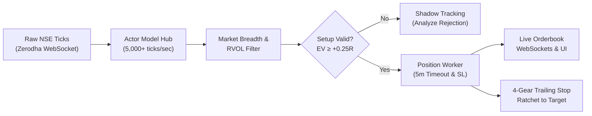
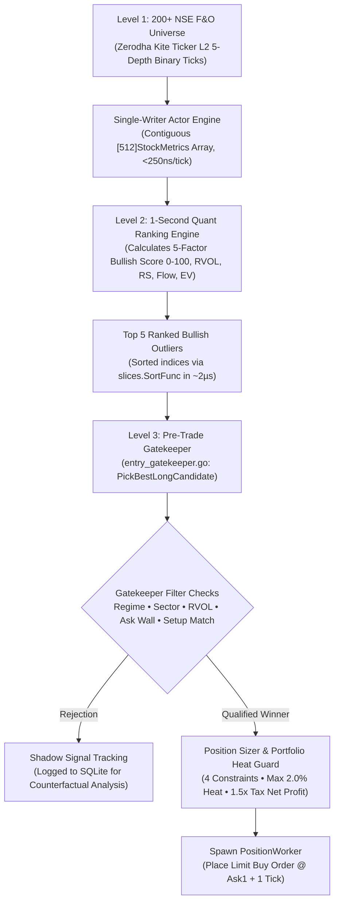
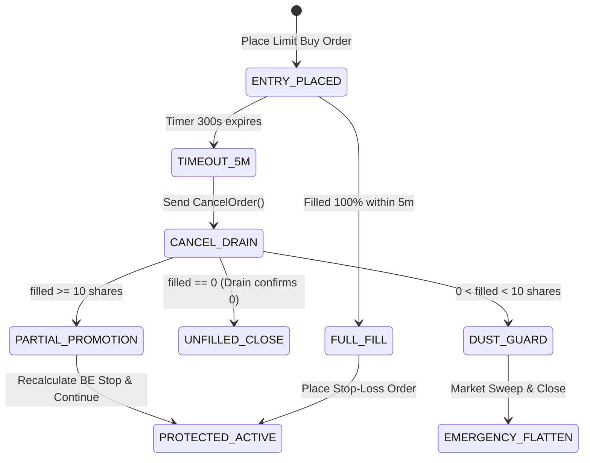

# AlgoTrade - Long cash equity intraday
### Institutional-Grade Quantitative Trading & Real-Time Risk Execution Platform

[](https://go.dev/)
[](https://nextjs.org/)
[](https://kite.trade/)
[](#system-architecture)
[](#go-runtime-tracer-flight-recorder)
[](#license--attribution)

---

> [!CAUTION]
> ### ⚠️ CRITICAL FINANCIAL DISCLAIMER & RISK WARNING
>
> **Algorithmic trading and capital markets involve substantial risk of complete financial loss.**
> 
> 1. **Do Your Own Research (DYOR)**: This software is designed, maintained, and distributed **strictly for academic, educational, and experimental research purposes**. It is not financial advice, investment advisory, or a recommendation to buy or sell securities.
> 2. **No Profit Guarantees**: Market regimes can shift instantaneously. Historical backtests, simulated paper trading, and statistical mathematical models can—and will—fail during black swan events, volatile earnings announcements, sudden illiquidity, or structural changes in market microstructure.
> 3. **Execution & System Risks**: Automated execution systems are subject to hardware failures, software bugs, internet connectivity dropouts, exchange matching engine halts, broker API outages, and execution slippage. 
> 4. **Zero Liability**: The author (**Ajay Negi**) and contributors assume **NO RESPONSIBILITY OR LIABILITY** for any financial losses, capital depletion, lost profits, exchange penalties, or brokerage costs incurred through the direct or indirect use, deployment, or modification of this codebase. **Deploying this system with real capital is solely at your own risk.**

---

## 📖 Table of Contents
1. [What is AlgoTrade? (Intuitive Overview)](#what-is-algotrade-intuitive-overview)
2. [Why Retail Traders Lose Money & How AlgoTrade Solves It](#why-retail-traders-lose-money--how-algotrade-solves-it)
3. [The Trading Edge & Core Strategy Playbook](#the-trading-edge--core-strategy-playbook)
4. [Intraday Stock Selection, Playbook Timing & Pre-Trade Gatekeeping](#intraday-stock-selection-playbook-timing--pre-trade-gatekeeping)
5. [Mathematical Foundations & Formulas](#mathematical-foundations--formulas)
6. [System Architecture & Concurrency Model (For Engineers)](#system-architecture--concurrency-model-for-engineers)
7. [Risk Management & Safety Verification Checkpoints](#risk-management--safety-verification-checkpoints)
8. [Go Runtime Tracer Flight Recorder & Diagnostics](#go-runtime-tracer-flight-recorder--diagnostics)
9. [End-of-Day (EOD) Optimization Engine](#end-of-day-eod-optimization-engine)
10. [Quickstart & Setup Guide](#quickstart--setup-guide)
11. [License & Attribution](#license--attribution)

---

## 💡 What is AlgoTrade? (Intuitive Overview)

**AlgoTrade** is a high-performance quantitative trading engine and real-time execution monitor built specifically for the **National Stock Exchange of India (NSE)** via **Zerodha Kite Connect**.

Think of AlgoTrade as an **unemotional, institutional trading desk in a single binary**:
- It watches thousands of market ticks every second without fatigue.
- It scans the most liquid universe of Indian equities to spot where big institutions are quietly deploying capital.
- It refuses to take a trade unless the overall market tide is in your favor, the probability is mathematically backed ($\ge 55\%$), and the expected payout justifies the risk ($\text{Risk-to-Reward} \ge 1:2$).
- Once in a trade, it protects your capital tick-by-tick using a multi-gear automated trailing stop and an emergency safety circuit that will exit instantly if market conditions reverse.



---

## 🎯 Why Retail Traders Lose Money & How AlgoTrade Solves It

Most retail intraday traders lose their trading accounts within 90 days. Why?
1. **Chasing Green Candles (FOMO)**: Buying when a stock has already moved up 4%, right as institutions are looking to dump their shares onto retail buyers.
2. **Moving Stop Losses**: Letting a small $-1\%$ loss blow up into a disastrous $-8\%$ loss because "it might bounce back."
3. **Cutting Winners Early**: Closing a winning position at $+0.5\%$ out of panic, while holding losing positions for days.
4. **Overtrading During Market Chop**: Fighting a sideways, trendless market and getting chopped to pieces by brokerage fees and slippage.

### How AlgoTrade Changes the Game:
- **Patience Through Code**: It only buys on **Pullbacks to Institutional Reclaims**, entering when risk is minimal.
- **Hard Risk Limits**: Every trade is strictly sized to **1% of account equity**. If a trade is wrong, it exits with zero hesitation.
- **Runner Preservation**: The engine locks in initial profit, ratchets stop loss to break-even at $+1.0R$, and lets the winning runner ride until institutional volume dries up.
- **Market Chop Lockout**: If fewer than $58\%$ of stocks are trading above their intraday VWAP, the engine enters a defensive stance and blocks new long entries.

---

## 📈 The Trading Edge & Core Strategy Playbook

The core setup is the **Institutional Pullback Reclaim (VWAP & Order Block Confluence)**.

### The 4 Pillars of Every Entry:

1. **Top Universe Screening**:
   - The engine screens the liquid universe and ranks equities by **Composite Relative Strength (RS)** versus the Nifty 50 benchmark.
   - We only trade leaders that are outperforming the broader market.

2. **Market Regime Gate (Breadth Ratio)**:
   - Evaluates what percentage of active stocks are currently trading above their Volume Weighted Average Price (VWAP).
   - **Bullish Expansion ($> 58\%$)**: Aggressive long entries permitted.
   - **Sideways Chop ($40\% - 58\%$)**: Defensive mode. Only highest quality pullbacks with Bullish Score $\ge 82$ allowed.
   - **Bearish Expansion ($20\% - 40\%$)**: Capital preservation mode. All new long entries are strictly rejected.
   - **Macro Flash Shock ($\le 20\%$)**: Catastrophic market-wide liquidation active. Engages `LOCKED_MACRO_SHOCK` lockout and displays emergency warning across the Trader Cockpit.

3. **Institutional Pullback to Demand**:
   - Price must pull back towards the Volume Weighted Average Price (VWAP) or a freshly formed 5-minute candle low support.
   - The candle must print a decisive **Buyer Absorption Ratio** (buyers absorbing sell orders at the support zone).

4. **Multi-Timeframe Orderflow Alignment**:
   - 1-minute orderbook flow must align with the 5-minute structural trend.
   - Relative Volume Pace ($\text{RVOL}_{\text{pace}}$) must be $\ge 1.2\times$, proving that institutional volume is actively participating.

---

## ⏱️ Intraday Stock Selection, Playbook Timing & Pre-Trade Gatekeeping

AlgoTrade executes trades with surgical precision. It does not blindly enter whenever a green candle appears. Every buy order must pass through a strict **3-Tier Stock Selection Funnel**, satisfy the **Intraday Session Playbook**, trigger one of **Three Structural Institutional Setups**, and survive an exhaustive **Pre-Trade Gatekeeping Matrix**.

---

### 1. Intraday Timing Windows & The Session Playbook (When Buying Can Happen)

Intraday liquidity, institutional participation, and microstructure volatility shift drastically throughout the trading day. Trading during the opening cross is gambling against high-frequency market-making algorithms, while trading during midday lunch is chopping capital in random Brownian noise.

AlgoTrade partitions the Indian trading day into **6 distinct algorithmic phases** (governed by [`session_clock.go`](file:///Users/ajaynegi/Downloads/AlgoTrade/algotrade-backend/internal/trading/session_clock.go)):

| Time Window (IST) | Session Phase | New Entries? | Sizing Multiplier | Min Score & RVOL | Institutional Playbook Rationale |
| :--- | :--- | :---: | :---: | :---: | :--- |
| **09:15 – 09:30** | `OPENING_NOISE_BLACKOUT` | ❌ **LOCKED** | 0.0x | N/A | **Opening Auction Absorption**: Absorbs opening retail auction imbalances, wide bid-ask spreads, and fakeout spikes. Establishes the 15-minute Opening Range High ($\text{ORH}$) and Low ($\text{ORL}$). |
| **09:30 – 11:30** | `MORNING_DISCOVERY_DRIVE` | ✅ **ACTIVE** | **1.0x (Full)** | Score $\ge 75.0$<br/>RVOL $\ge 1.5\times$ | **Peak Domestic & Asia Overlap**: Peak morning liquidity. Institutional desks establish daily trend direction. All 3 strategy setups active (`VWAP_PULLBACK_RECLAIM`, `FAILED_BREAKDOWN_SPRING`, `ORB_RETEST_RECLAIM`). |
| **11:30 – 13:30** | `MIDDAY_COMPRESSION`<br/>*(Standard Mode)* | ❌ **LOCKED** | 0.0x | Score $\ge 85.0$<br/>RVOL $\ge 2.0\times$ | **Brownian Noise Lockout**: Domestic institutional flow dries up before European markets open. Trades entering here suffer severe stop-out chop without momentum follow-through. |
| **11:30 – 13:30** | `MIDDAY_COMPRESSION`<br/>*(Domestic Tape Override)* | ⚡ **ACTIVE** | **0.5x (Half)** | Score $\ge 80.0$<br/>RVOL $\ge 2.5\times$ | **Extreme Domestic Surge**: Unlocks *only* if Market Breadth $\ge 70.0\%$ (70% of universe above VWAP) AND candidate RVOL $\ge 2.5\times$. High-barrier entry with halved risk. |
| **13:30 – 14:45** | `EUROPE_OVERLAP_EXPANSION`| ✅ **ACTIVE** | **1.0x (Full)** | Score $\ge 76.0$<br/>RVOL $\ge 1.5\times$ | **European & London Desk Overlap**: Frankfurt and London institutions inject fresh volume into Indian equities. Unlocks second-wave trend continuation and clean VWAP reclaims. |
| **14:45 – 15:14** | `EXIT_ONLY_LOCKOUT` | ❌ **LOCKED** | 0.0x | N/A | **Pre-Close Trail Window**: Zero new positions allowed. Focus shifts exclusively to trailing active runner stops and tightening defense before market close. |
| **15:14 – 15:30** | `AUTO_SQUAREOFF_SWEEP` | ❌ **LOCKED** | 0.0x | N/A | **Mandatory MIS Flatten**: The 4-Stage Bulletproof Exit sweeps all open intraday positions at market before Zerodha RMS penalty auto-square-off at 15:20 IST. |
| **15:30 – 09:15** | `MARKET_CLOSED` | ❌ **LOCKED** | 0.0x | N/A | **Overnight Capital Safety**: Zero overnight exposure. Complete immunity to gap-down risks, international macro shocks, and overnight interest charges. |

---

### 2. The 3-Tier Stock Selection Funnel (From 200+ Equities to 1 Execution)



#### Tier 1: Real-Time Tick Ingestion & In-Memory Metrics
- The WebSocket stream pipes Level 2 binary tick packets (184 bytes each) into a 65,536-capacity ring buffer.
- The Single-Writer Actor parses ticks and continuously calculates:
  - Official Exchange VWAP and 5-minute OHLCV bars.
  - 9 EMA (Exponential Moving Average) smoothed with $\alpha = 0.20$ and seeded from first 9 completed 5m closes.
  - Aggressor Buy/Sell Volume using the Lee-Ready algorithm.
  - Dual-Alpha Smoothed Buyer Ratio ($0.20$ on trades, $0.03$ on passive book depth shifts).
  - Continuous Exponential Rolling Peak ($\tau = 20.0\text{s}$) to detect sudden tape crashes.

#### Tier 2: 1-Second Quant Scoring Engine
Every second, the system scores all active equities using the **5-Factor Institutional Composite Bullish Rank Score ($0 \dots 100$)**:
$$\text{Score} = (0.26 \times S_{\text{vwap}}) + (0.22 \times S_{\text{rvol}}) + (0.18 \times S_{\text{rs}}) + (0.20 \times S_{\text{flow}}) + (0.14 \times S_{\text{ev}})$$
- **Gaussian VWAP Sweet-Spot Curve ($S_{\text{vwap}}$)**: Peaks when price is between $+0.15\text{ ATR}$ and $+0.35\text{ ATR}$ above VWAP. Heavily penalizes stocks extended $> 1.5\text{ ATR}$ (chasing).
- **Sigmoidal RVOL ($S_{\text{rvol}}$)**: Compares current 5m volume to time-matched historical average.
- **Hyperbolic Tangent Relative Strength ($S_{\text{rs}}$)**: Outperformance vs Nifty 50 benchmark.
- **Order Flow Aggressor Score ($S_{\text{flow}}$)**: Buyer absorption from Level 2 depth.
- **Expected Value Score ($S_{\text{ev}}$)**: Mathematical expectancy after transaction friction.
The top 5 scoring stocks are extracted for gatekeeping.

#### Tier 3: Pre-Trade Gatekeeping & Structural Setup Verification
The candidate must pass all pre-trade safety gates and match one of three high-probability structural setups.

---

### 3. The 3 Qualified Strategy Setups (Why Buying Happens)

AlgoTrade enters *only* on confirmed institutional setups where retail participants are trapped or where smart money is actively defending key reference levels.

#### 📌 Setup 1: VWAP Pullback Reclaim (`VWAP_PULLBACK_RECLAIM`)
*Based on Richie Naso (NYSE Specialist) & Dr. Samir Varma Quant Principles*

```
Price
  ▲
  │               [Current Bar Reclaims High] ──> BUY ENTRY
  │                     ▲
  │                    ┌┴┐
  │         ┌─┐        │ │
  │         │ │        └┬┘
  │         └┬┘   ┌─┐   │ 
  │──────────┼────┴─┴───┼────────── 9 EMA (Rising, Slope ≥ -0.05 ATR)
  │          │          │
  │══════════╪══════════╪══════════ Exchange VWAP (Support)
  │          │   (Dip)
  │          ▼
  │       [Signal Bar Low - 0.20 ATR] ──> INITIAL STOP LOSS
  └──────────────────────────────────────────────────────────► Time
```

- **Core Concept**: Institutions execute large orders at VWAP. When a leading stock pulls back to VWAP in an uptrend, institutions absorb selling pressure and defend their average price.
- **9 EMA Confluence Law**: 9 EMA must be warm ($> 0$), trading above or at VWAP ($\text{EMA}_9 \ge \text{VWAP}$), and its ATR-normalized slope must be flat or rising:
  $$\frac{\Delta \text{EMA}_9}{\text{ATR}_{\text{safe}}} \ge -0.05$$
- **Price Pullback Zone**: Price must be within an optimal entry window above VWAP:
  $$0.05 \le \frac{\text{LTP} - \text{ExchangeVWAP}}{\text{ATR}_{\text{safe}}} \le 0.55$$
- **Dip Depth**: The previous 5-minute candle low must have tested the VWAP zone:
  $$\text{VWAP} - 0.15\text{ ATR} \le \text{PreviousBar.Low} \le \text{VWAP} + 0.35\text{ ATR}$$
- **Reclaim Confirmation**: Live price must surge above both the current bar's open and the prior bar's midpoint:
  $$\text{LTP} > \max\left(\text{CurrentBar.Open} + 2\text{ ticks}, \frac{\text{PreviousBar.Open} + \text{PreviousBar.Close}}{2.0}\right)$$
- **Aggressor Flow**: Close Location Value $\text{CLV} \ge 0.58$, $\text{AggressorBuyRatio} \ge 0.56$, $\text{FastAggressorEMA} \ge 0.55$, and $\text{SmoothedBuyerRatio} \ge 0.55$.
- **Volatility-Buffered Stop**: Placed below the swing low with a $0.20\text{ ATR}$ safety margin to prevent stop runs:
  $$\text{StopPrice} = \min(\text{PreviousBar.Low}, \text{CurrentBar.Low}) - 0.20 \times \text{ATR}_{\text{safe}}$$

---

#### 📌 Setup 2: Failed Breakdown Reclaim / Bear Trap Spring (`FAILED_BREAKDOWN_SPRING`)
*Based on Richie Naso & Rishi Narang Market Microstructure Laws*

- **Core Concept**: Market makers intentionally drive price below VWAP to trigger retail stop-loss market orders, providing the liquidity needed to fill large institutional buy orders. Once retail is shaken out, the stock snaps back above VWAP, trapping aggressive short sellers who are forced to buy to cover.
- **Dip Sweep**: Previous bar washes below VWAP by up to $0.45\text{ ATR}$:
  $$\text{ExchangeVWAP} - 0.45\text{ ATR} \le \text{PreviousBar.Low} < \text{ExchangeVWAP} - 0.05\text{ ATR}$$
- **Rapid Snapback Reclaim**: Live price violently surges back above VWAP and exceeds current bar open:
  $$\text{LTP} \ge \text{ExchangeVWAP} + 0.05\text{ ATR} \quad \land \quad \text{LTP} > \text{CurrentBar.Open} + 2\text{ ticks}$$
- **Trapped-Short Squeeze Flow**: $\text{CompositeRVOL} \ge 1.5\times$, $\text{CLV} \ge 0.60$, $\text{AggressorBuyRatio} \ge 0.58$, $\text{FastAggressorEMA} \ge 0.56$.
- **Volatility-Buffered Stop**: Placed safely below the sweep low:
  $$\text{StopPrice} = \text{PreviousBar.Low} - 0.20 \times \text{ATR}_{\text{safe}}$$

---

#### 📌 Setup 3: 15-Minute Opening Range Retest Reclaim (`ORB_RETEST_RECLAIM`)
*Abolishes Naive First-Breakout Traps (80% Failure Rate)*

- **Core Concept**: Academic literature and empirical evidence prove that buying the initial 15-minute high breakout fails up to $80\%$ of the time due to institutional fade algorithms. AlgoTrade **never buys the first breakout poke**. Instead, it waits for a completed 5-minute candle to close above the range high, followed by a pullback retest where previous resistance becomes confirmed support.
- **Range Compression**: The 15-minute range must not be overextended:
  $$\text{ORH} - \text{ORL} \le 1.8 \times \text{ATR}_{\text{safe}}$$
- **Confirmed Breakout Close**: At least one completed 5-minute candle in the session must have closed strictly above $\text{ORH}$:
  $$\exists \, b \in \text{CompletedBars}, \quad \text{Bar}[b].\text{Close} > \text{ORH}$$
- **Retest Support Hold**: Previous candle low tests and holds the $\text{ORH}$ support boundary:
  $$\text{ORH} - 0.35\text{ ATR} \le \text{PreviousBar.Low} \le \text{ORH} + 0.25\text{ ATR}$$
- **Reclaim Continuation**: Price holds above $\text{ORH}$ and current bar open without being overextended:
  $$\text{ORH} < \text{LTP} \le \text{ORH} + 0.45\text{ ATR} \quad \land \quad \text{LTP} > \text{CurrentBar.Open} + 1\text{ tick}$$
- **Institutional Surge**: $\text{CompositeRVOL} \ge 1.8\times$, $\text{CLV} \ge 0.62$, $\text{AggressorBuyRatio} \ge 0.58$, $\text{FastAggressorEMA} \ge 0.56$.
- **Volatility-Buffered Stop**: Placed below the retest pivot low:
  $$\text{StopPrice} = \min(\text{PreviousBar.Low}, \text{CurrentBar.Low}) - 0.20 \times \text{ATR}_{\text{safe}}$$

---

### 4. Comprehensive Pre-Trade Filter & Rejection Matrix (Why Trades Are Blocked)

Even if a stock looks bullish, it will be firmly rejected if it violates any safety condition. The Cockpit UI displays real-time diagnostic cards explaining the exact blocking reason:

| Gate Check | Inspected Condition | Exact Passing Threshold | Why It Blocks (Rejection Reason Code) |
| :--- | :--- | :--- | :--- |
| **Session Clock** | `sessionClock.IsNewEntryAllowed` | `== true` | `LOCKED_SESSION_WINDOW`: Outside trading hours, during 09:15-09:30 blackout, 11:30-13:30 midday lull, or post-14:45 exit window. |
| **Macro Shock**   | `pulse.MarketRegime` | `!= "FLASH_SHOCK"` (Breadth $> 20\%$) | `LOCKED_MACRO_SHOCK`: Universe breadth collapsed $\le 20.0\%$. Catastrophic market-wide liquidation active; new entries prohibited. |
| **Symbol Cooldown**| Active position or exit timer | Cooldown elapsed ($> 15\text{ min}$) | `POSITION_ACTIVE_OR_COOLDOWN`: Prevents overtrading, churn, and revenge-trading on the same symbol. |
| **Sector Health** | Granular Sector Circuit Breaker | Sector Breadth $\ge 40\%$ and Sector Avg Change $\ge -0.50\%$ | `SECTOR_RESTRICTED`: The entire sector (e.g., Nifty Bank, IT) is experiencing systemic selling pressure. |
| **Quant Score** | `stock.BullishScore` | $\ge 75.0$ (Morning) / $\ge 80.0$ (Midday) / $\ge 76.0$ (Europe) | `SCORE_BELOW_MIN`: Stock does not possess strong enough multi-factor momentum or institutional sponsorship. |
| **Expected Value**| `stock.EV` | $\ge +0.25R$ after transaction friction | `EV_BELOW_THRESHOLD`: Statistical win probability $\times$ reward does not mathematically justify the risk. |
| **Relative Volume**| `compositeRVOL` | $\ge 1.5\times$ (Morning) / $\ge 2.0\times$ (Midday) | `RVOL_INSUFFICIENT`: Stock is moving on light retail volume without institutional participation. |
| **Ask Wall Filter**| Depth Levels 1 & 2 vs Ask Level 1 | $\text{Ask1Qty} \le 4 \times (\text{Bid1Qty} + \text{Bid2Qty})$ | `ASK_WALL_DETECTED`: A massive institutional seller has placed a resting iceberg or sell wall directly overhead. |
| **Spread Penalty** | Bid-Ask Spread | $\frac{\text{Ask1} - \text{Bid1}}{\text{LTP}} \le 0.10\%$ | `PENALTY_WIDE_SPREAD`: Spread is too wide; crossing the book incurs excessive immediate slippage. |
| **Overextension** | Distance above VWAP | $\text{LTP} \le \text{ExchangeVWAP} + 1.50\text{ ATR}$ | `PENALTY_OVEREXTENDED`: Stock is overextended. Chasing here creates asymmetric downside risk. |
| **Trend Exhaustion**| Total session range vs ATR | $\text{High} - \text{Low} \le 2.50 \times \text{ATR}_{14}$ | `PENALTY_EXHAUSTED_TREND`: Stock has already consumed $> 250\%$ of its normal daily volatility budget. |
| **Iceberg Selling** | Hidden passive order dumping | No passive iceberg detected | `PENALTY_ICEBERG_SELL`: Large institutional participant is aggressively unloading inventory into retail bids. |
| **Structural Setup**| Pattern matching logic | Matches Setup 1, 2, or 3 | `AWAITING_SETUP`: Price is floating in no-man's land; neither at VWAP pullback, bear trap, nor ORB retest. |
| **Portfolio Heat** | Sum of all open positions' downside risk | $\sum \text{OpenRiskRupees} < 0.02 \times \text{NetEquity}$ | `HEAT_CAP_EXHAUSTED`: Maximum 2.0% portfolio heat capacity reached. Awaiting open positions to ratchet to Breakeven. |
| **Margin Limit** | Free cash collateral vs margin | $0.95 \times \text{FreeMargin} \times \text{Leverage} \ge \text{Cost}$ | `INSUFFICIENT_MARGIN`: Brokerage margin account cannot safely accommodate the required position size. |
| **Liquidity Cap** | Top-3 visible ask depth | $\text{OrderQty} \le 0.20 \times \sum_{i=1}^3 \text{AskQty}_i$ | Capped at $20\%$ of depth to guarantee zero market impact and near-zero slippage upon entry. |
| **Chase Cap** | Distance from entry limit to raw stop | $\text{Entry} - \text{RawStop} \le 1.25 \times \Delta_{\max}$ | `STOP_DISTANCE_CHASE_CAP`: Stop loss would be too far away, degrading risk-to-reward geometry. |
| **Net Profit Gate**| Projected net profit at $+1.0R$ vs statutory taxes | $\text{NetProfit}_{1R} \ge 1.50 \times \text{RoundTripTaxes}$ | `NET_PROFIT_UNVIABLE`: High government taxes (STT, GST, Stamp, SEBI) would eat more than $40\%$ of a $+1.0R$ gain. |

---

## 📐 Mathematical Foundations & Formulas

AlgoTrade does not use vague indicators. Everything is driven by closed-form quantitative mathematical formulas:

### 1. Expected Value (EV) Filter
A trade is rejected unless its statistical expectation is strongly positive after transaction friction:
$$\text{EV} = \left( P_{\text{win}} \times R_{\text{win}} \right) - \left( (1.0 - P_{\text{win}}) \times 1.0 \right) - \text{Friction}_R$$

- **Rule**: A setup must have $\text{EV} \ge +0.25R$ and $P_{\text{win}} \ge 55\%$.
- A trade risking ₹1,000 must mathematically yield an average return of $\ge ₹250$ across hundreds of iterations.

### 2. Relative Volume Pace ($\text{RVOL}_{\text{pace}}$)
Instead of comparing total session volume to yesterday, AlgoTrade compares the current 5-minute bar to the exact time-matched historical average:
$$\text{RVOL}_{\text{pace}}(t) = \frac{V_{5\text{m}}(t)}{\frac{1}{K} \sum_{d=1}^{K} V_{5\text{m}}(d, t)}$$
- An $\text{RVOL}_{\text{pace}} \ge 1.5\times$ at 10:15 AM means the stock is trading $150\%$ of its normal 10:15 AM institutional volume.

### 3. Universe Market Breadth Ratio
$$\text{Breadth Ratio} = \frac{\sum_{i=1}^{N_{\text{active}}} \mathbb{I}(P_{\text{LTP}, i} > \text{VWAP}_i)}{N_{\text{active}}}$$
Where $\mathbb{I}(\cdot)$ is the indicator function returning $1$ if true, $0$ if false.

### 4. Mathematical Position Sizing (1% Fixed Risk)
Position size is dynamically computed based on the volatility of the stop loss, ensuring no single trade ever risks more than 1% of capital:
$$\text{Quantity} = \left\lfloor \frac{\text{Account Capital} \times 0.01}{|P_{\text{entry}} - P_{\text{stop}}|} \right\rfloor$$

### 5. Excursion Analysis (MFE / MAE)
$$\text{MFE}_R = \frac{\text{HighWaterMark} - P_{\text{entry}}}{\text{OneR}}, \quad \text{MAE}_R = \frac{\text{LowWaterMark} - P_{\text{entry}}}{\text{OneR}}$$
- **MFE (Maximum Favorable Excursion)**: Measures how far the trade went into profit.
- **MAE (Maximum Adverse Excursion)**: Measures the maximum drawdown experienced before reaching the target.

---

## ⚙️ System Architecture & Concurrency Model (For Engineers)

AlgoTrade is engineered with a **Two-Tier Architecture**:
1. **Backend**: Ultra-low-latency Go service using the **Actor Model (Single-Writer Pattern)**.
2. **Frontend**: Next.js 14 real-time dashboard connected via persistent WebSockets.

```
algotrade/
├── algotrade-backend/
│   ├── cmd/api/                  # Application bootstrap, router & graceful shutdown
│   ├── internal/
│   │   ├── market/               # MarketHub Actor, tick parsing, VWAP & snapshot engine
│   │   ├── trading/              # PositionWorker, 4-gear trailing stop & broker adapters
│   │   ├── diagnostics/          # Go Runtime Tracer Flight Recorder & latency watchdog
│   │   ├── monitoring/           # Event collector, EOD scheduler, MFE/MAE metrics & reports
│   │   ├── screener/             # Universe ranking, RVOL pace & sector calculations
│   │   ├── kite/                 # Zerodha Kite Connect WebSocket ticker & OAuth client
│   │   ├── database/             # SQLite WAL connection management & migrations
│   │   └── ws/                   # Real-time WebSocket broadcasting hub
└── algotrade-frontend/           # Next.js 14 React client, TailwindCSS, lucide icons
```

### The Single-Writer Actor Pattern & Hot-Path Invariants
To avoid mutex lock contention on the market hot path (which processes thousands of ticks/sec), AlgoTrade enforces a **Single-Writer Concurrency Pattern**:
- All incoming tick packets from Zerodha Kite are sent to a single dedicated goroutine (`market.Actor`).
- The Actor updates in-memory contiguous `[512]StockMetrics` arrays sequentially without taking locks (<250ns per tick).
- **Two-Phase Hot Path Order Evaluation**: In Paper mode, `EvaluateTickForToken` executes an initial `RLock` read filter on resting orders and price boundaries. 99.99% of ticks exit in <20ns without acquiring an exclusive write lock, ensuring concurrent API order queries never stall the Actor tick ingestion thread.
- **Completed-Bar 9 EMA Seeding Invariant**: Historical seeder computes running EMA strictly across finalized 5-minute bars prior to the current forming bar (`activeSlot`), eliminating double-counting when live ticks roll over.
- Latency-sensitive reads utilize lock-free atomic bitcasts (`atomic.Uint64` storing float bits via `math.Float64bits`).
- Workers and risk management goroutines communicate through bounded, non-blocking Go channels.

---

## 🛡️ Risk Management & Safety Verification Checkpoints

The execution engine incorporates multi-layered safety mechanisms to protect capital against exchange halts, network drops, and illiquid spikes:

### 1. Pre-Trade Gatekeeper Rules
| Risk Gate | Threshold Limit | System Action on Violation |
| :--- | :--- | :--- |
| **Max Portfolio Heat** | $\sum \text{OpenRiskRupees} \le 2.0\% \times \text{NetEquity}$ | Rejects all new trades; max simultaneous open risk is strictly capped at $2.0\%$ of capital. Open risk drops to ₹0 once stop reaches Breakeven. |
| **Sector Exposure Cap**| Max $20\%$ of total capital | Prevents overconcentration in a single sector (e.g. Banking or IT). |
| **Max Daily Loss Limit**| $-2.0\%$ of account equity | Hard breaker: disables all entry gates and halts new trading for the day. |
| **Consecutive Losses** | $\ge 2$ consecutive losses | Daily circuit breaker: locks trading for the day. |
| **Symbol Cooldown Lock**| 15 minutes post-exit | Algorithmic lock prevents emotional revenge-trading or churn on the same symbol. |

### 2. In-Trade Order Lifecycle & 5-Minute Timeout
Resting limit orders left unattended can be front-run. AlgoTrade enforces an automated **5-Minute Entry Lifecycle**:



- **Cancellation Drain Window (500ms)**: After sending a cancellation to the exchange, the worker waits 500ms to absorb any late fills crossing the network.
- **Dynamic Dust Guard**: If filled shares $< \text{DustFloorQty}$ (dynamically calculated so expected profit at $+1.0R$ covers actual statutory taxes and flat ₹20 brokerage), it immediately triggers an emergency flatten to prevent tiny orphan positions with disproportionate friction.
- **Partial Fill Promotion**: If filled shares $\ge \text{DustFloorQty}$, it recalculates risk for the exact filled size and places a custom stop loss at break-even.

### 3. The 4-Gear Dynamic Trailing Stop Ratchet
As the trade moves in our favor, stop loss management shifts through four distinct algorithmic gears designed to respect the **NSE maximum 25 order modifications per day**:
- **Gear 1 (Agile Dynamic Trail)**: Mods 1–18. Minimum advance $\ge \max(2\text{ ticks}, 0.12 \times \text{BaseBuffer})$ with a 350ms cooldown. Moves the stop quickly out of the initial danger zone based on real-time order flow $M_{\text{flow}}$.
- **Early Breakeven Protection (+1.00R)**: Once the trade reaches $+1.00R$, the stop loss is automatically ratcheted to **Tax-Free Breakeven** ($P_{\text{entry}} + \text{Taxes} + 0.15\%$). Per Dr. Samir Varma & Rishi Narang, ratcheting at $+0.50R$ suffocates valid trends in normal Brownian noise; moving to BE at $+1.00R$ lets the trade breathe while locking in net profitability.
- **Tranche 1 Asymmetric Scale-Out (+1.50R)**: When the trade reaches $+1.50R$, the worker executes a 3-step race-free scale-out: shrinks resting SL quantity, places a marketable limit sell for 50%, and raises the runner SL to Tax-Free Breakeven. For 1-share positions (where halving is impossible), Tranche 1 is directly marked completed, and the single share ratchets immediately to Breakeven via `worker.ProposeStopRatchet`.
- **Gear 3 (Coarse 5m Bar Trail)**: Mods 19–24. Minimum advance $\ge \max(0.40 \times \text{BaseBuffer}, 0.35 \times \text{ATR})$ with a 1500ms cooldown. Anchors trailing defense to completed 5-minute candle lows.
- **Gear 4 (Virtual Shadow Stop in RAM)**: At modification 24, order modifications cease completely. The stop continues trailing virtually in RAM (`shadowStopBits`), strictly preserving **Modification #25** exclusively for emergency market exit.
- **In-Trade Alpha Decay Stagnation Guard**: If a trade stays active for $\ge 45\text{ minutes}$ and its peak excursion has not even reached $+0.50R$, the information edge has decayed into random walk friction; the worker exits immediately at market.

### 4. 4-Stage Bulletproof Emergency Flatten
If an emergency exit is triggered (circuit limit hit, stop-loss breached, or manual override):
1. **Stage A**: Mutate existing stop order directly to a `MARKET` order (consumes reserved Modification #25). Wait 900ms.
2. **Stage B & C**: If unfilled, cancel stop order and execute a 4-attempt escalating Liquidity Protection Price (LPP) sweep sell ($0.75\% \to 1.50\% \to 2.50\% \to 3.50\%$ / Market). Wait 900ms per attempt.
3. **Stage D (Persistent Anti-Orphan Recovery Loop)**: If the position remains open after 4 attempts (e.g., lower circuit freeze or network dropout), enters a persistent 2.0-second recovery loop retrying until `RemainingQty() == 0`.
4. **15:14 IST Auto Square-off**: Automatically sweeps and flattens all intraday MIS positions before Zerodha's RMS penalty square-off at 15:20 IST.

---

## 🔍 Go Runtime Tracer Flight Recorder & Diagnostics

To debug micro-stutters, GC pauses, and scheduler stalls, AlgoTrade includes an **in-memory Flight Recorder** built on Go standard library `runtime/trace`.

- **Zero Overhead in Normal Mode**: Keeps a moving window of execution trace data in an **8MB circular ring buffer** in RAM.
- **Watchdog Auto-Dump**: If any critical operation exceeds its latency threshold, the black box immediately snapshots the trace to `data/traces/trace_<timestamp>.trace`.

### Watchdog Latency Thresholds:
| Watchdog Probe | Normal Duration | Spike Threshold | What It Detects |
| :--- | :--- | :--- | :--- |
| **Market Snapshot Broadcast** | 0.2ms – 0.8ms | **> 10ms** | STW Garbage Collector pauses, CPU core contention. |
| **Zerodha Order REST Operations** | 150ms – 300ms | **> 1500ms** | Kite Gateway network latency, TLS renegotiation drops. |
| **Emergency Position Flatten** | 10ms – 50ms | **> 800ms** | Thread scheduler lag or network stalls during market exit. |
| **SQLite Monitoring Persist** | 1ms – 5ms | **> 50ms** | SQLite WAL sync stalls, disk checkpoint lock contention. |

### Visual Trace Inspection in Chrome:
Inspect any saved black box snapshot using Go's official trace tool:
```bash
go tool trace data/traces/trace_20261030_153012_market_snapshot_broadcast.trace
```
Opens an interactive timeline in Google Chrome displaying every goroutine, thread context switch, lock contention point, and GC phase.

---

## 📊 End-of-Day (EOD) Optimization Engine

At 15:45 IST every trading day, the automated monitoring engine executes a comprehensive post-market analysis:
1. **MFE vs. MAE Analysis**: Flags if stop losses were set too wide or if profits were given back unnecessarily.
2. **Counterfactual Shadow Tracking**: Evaluates every rejected signal across subsequent bars. If rejected setups are winning more than accepted setups, it flags filter miscalibration.
3. **Slippage & Friction Audit**: Calculates exact execution slippage:
   $$\text{SlippagePct} = \frac{\text{ActualFillPrice} - \text{IntendedPrice}}{\text{IntendedPrice}} \times 100\%$$
4. **Automated Trader Email**: Compiles formatted Markdown and HTML reports and emails them to the trader's inbox via Resend.

---

## 🚀 Quickstart & Setup Guide

### 1. Prerequisites
- **Go**: Version 1.22 or higher (`go version`)
- **Node.js**: Version 18 or higher (`node -v`)
- **Zerodha Kite Connect Account**: API Key and API Secret ([Kite Developer Portal](https://developers.kite.trade/))

### 2. Clone the Repository
```bash
git clone https://github.com/ajaynegi45/Old-School-Game.git algotrade
cd algotrade
```

### 3. Backend Setup
```bash
cd algotrade-backend

# Copy example environment configuration
cp .env.example .env

# Edit .env with your credentials:
# PORT=8080
# ENV=development
# JWT_SECRET=your_super_secret_hmac_sha256_key_at_least_32_characters_long
# FRONTEND_URL=http://localhost:3000
# AUTH_USER_EMAIL=trader@example.com
# AUTH_USER_PASSWORD=secure_password_123
# KITE_API_KEY=your_zerodha_api_key
# KITE_API_SECRET=your_zerodha_api_secret

# Run automated tests to verify your environment
go test -race ./...

# Start the Go Backend Server
go run ./cmd/api
```

### 4. Frontend Setup
```bash
cd ../algotrade-frontend

# Install dependencies
npm install

# Run the Next.js development server
npm run dev
```

Open [http://localhost:3000](http://localhost:3000) in your browser. Log in with your configured credentials, authorize your Zerodha session, and monitor live execution.
