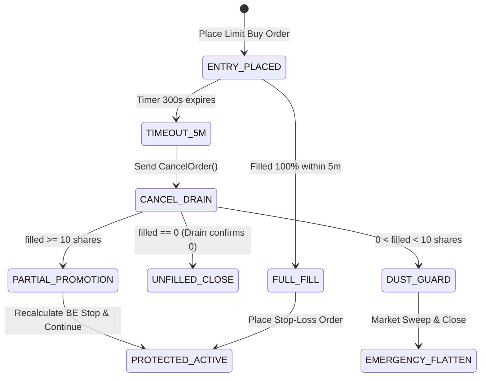

# AlgoTrade ⚡
### Institutional-Grade Quantitative Trading & Real-Time Risk Execution Platform

[](https://go.dev/)
[](https://nextjs.org/)
[](https://kite.trade/)
[](#system-architecture)
[](#go-runtime-tracer-flight-recorder)
[](#license--attribution)

---

> [!CAUTION]
> ### ⚠️ CRITICAL FINANCIAL DISCLAIMER & RISK WARNING
>
> **Algorithmic trading and capital markets involve substantial risk of complete financial loss.**
> 
> 1. **Do Your Own Research (DYOR)**: This software is designed, maintained, and distributed **strictly for academic, educational, and experimental research purposes**. It is not financial advice, investment advisory, or a recommendation to buy or sell securities.
> 2. **No Profit Guarantees**: Market regimes can shift instantaneously. Historical backtests, simulated paper trading, and statistical mathematical models can—and will—fail during black swan events, volatile earnings announcements, sudden illiquidity, or structural changes in market microstructure.
> 3. **Execution & System Risks**: Automated execution systems are subject to hardware failures, software bugs, internet connectivity dropouts, exchange matching engine halts, broker API outages, and execution slippage. 
> 4. **Zero Liability**: The author (**Ajay Negi**) and contributors assume **NO RESPONSIBILITY OR LIABILITY** for any financial losses, capital depletion, lost profits, exchange penalties, or brokerage costs incurred through the direct or indirect use, deployment, or modification of this codebase. **Deploying this system with real capital is solely at your own risk.**

---

## 📖 Table of Contents
1. [What is AlgoTrade? (Intuitive Overview)](#what-is-algotrade-intuitive-overview)
2. [Why Retail Traders Lose Money & How AlgoTrade Solves It](#why-retail-traders-lose-money--how-algotrade-solves-it)
3. [The Trading Edge & Core Strategy Playbook](#the-trading-edge--core-strategy-playbook)
4. [Mathematical Foundations & Verification Formulas](#mathematical-foundations--verification-formulas)
5. [System Architecture & Concurrency Model (For Engineers)](#system-architecture--concurrency-model-for-engineers)
6. [Risk Management & Safety Verification Checkpoints](#risk-management--safety-verification-checkpoints)
7. [Go Runtime Tracer Flight Recorder & Diagnostics](#go-runtime-tracer-flight-recorder--diagnostics)
8. [End-of-Day (EOD) Optimization Engine](#end-of-day-eod-optimization-engine)
9. [Quickstart & Setup Guide](#quickstart--setup-guide)
10. [License & Attribution](#license--attribution)

---

## 💡 What is AlgoTrade? (Intuitive Overview)

**AlgoTrade** is a high-performance quantitative trading engine and real-time execution monitor built specifically for the **National Stock Exchange of India (NSE)** via **Zerodha Kite Connect**.

Think of AlgoTrade as an **unemotional, institutional trading desk in a single binary**:
- It watches thousands of market ticks every second without fatigue.
- It scans the most liquid universe of Indian equities to spot where big institutions are quietly deploying capital.
- It refuses to take a trade unless the overall market tide is in your favor, the probability is mathematically backed ($\ge 55\%$), and the expected payout justifies the risk ($\text{Risk-to-Reward} \ge 1:2$).
- Once in a trade, it protects your capital tick-by-tick using a multi-gear automated trailing stop and an emergency safety circuit that will exit instantly if market conditions reverse.


---

## 🎯 Why Retail Traders Lose Money & How AlgoTrade Solves It

Most retail intraday traders lose their trading accounts within 90 days. Why?
1. **Chasing Green Candles (FOMO)**: Buying when a stock has already moved up 4%, right as institutions are looking to dump their shares onto retail buyers.
2. **Moving Stop Losses**: Letting a small $-1\%$ loss blow up into a disastrous $-8\%$ loss because "it might bounce back."
3. **Cutting Winners Early**: Closing a winning position at $+0.5\%$ out of panic, while holding losing positions for days.
4. **Overtrading During Market Chop**: Fighting a sideways, trendless market and getting chopped to pieces by brokerage fees and slippage.

### How AlgoTrade Changes the Game:
- **Patience Through Code**: It only buys on **Pullbacks to Institutional Reclaims**, entering when risk is minimal.
- **Hard Risk Limits**: Every trade is strictly sized to **1% of account equity**. If a trade is wrong, it exits with zero hesitation.
- **Runner Preservation**: The engine locks in initial profit, ratchets stop loss to break-even at $+1.0R$, and lets the winning runner ride until institutional volume dries up.
- **Market Chop Lockout**: If fewer than $58\%$ of stocks are trading above their intraday VWAP, the engine enters a defensive stance and blocks new long entries.

---

## 📈 The Trading Edge & Core Strategy Playbook

The core setup is the **Institutional Pullback Reclaim (VWAP & Order Block Confluence)**.

### The 4 Pillars of Every Entry:

1. **Top Universe Screening**:
   - The engine screens the liquid universe and ranks equities by **Composite Relative Strength (RS)** versus the Nifty 50 benchmark.
   - We only trade leaders that are outperforming the broader market.

2. **Market Regime Gate (Breadth Ratio)**:
   - Evaluates what percentage of active stocks are currently trading above their Volume Weighted Average Price (VWAP).
   - **Bullish Expansion ($> 58\%$)**: Aggressive long entries permitted.
   - **Sideways Chop ($40\% - 58\%$)**: Defensive mode. Only highest quality pullbacks with Bullish Score $\ge 82$ allowed.
   - **Bearish Expansion ($< 40\%$)**: Capital preservation mode. All new long entries are strictly rejected.

3. **Institutional Pullback to Demand**:
   - Price must pull back towards the Volume Weighted Average Price (VWAP) or a freshly formed 5-minute candle low support.
   - The candle must print a decisive **Buyer Absorption Ratio** (buyers absorbing sell orders at the support zone).

4. **Multi-Timeframe Orderflow Alignment**:
   - 1-minute orderbook flow must align with the 5-minute structural trend.
   - Relative Volume Pace ($\text{RVOL}_{\text{pace}}$) must be $\ge 1.2\times$, proving that institutional volume is actively participating.

---

## 📐 Mathematical Foundations & Formulas

AlgoTrade does not use vague indicators. Everything is driven by closed-form quantitative mathematical formulas:

### 1. Expected Value (EV) Filter
A trade is rejected unless its statistical expectation is strongly positive after transaction friction:
$$\text{EV} = \left( P_{\text{win}} \times R_{\text{win}} \right) - \left( (1.0 - P_{\text{win}}) \times 1.0 \right) - \text{Friction}_R$$

- **Rule**: A setup must have $\text{EV} \ge +0.20R$ and $P_{\text{win}} \ge 55\%$.
- A trade risking ₹1,000 must mathematically yield an average return of $\ge ₹200$ across hundreds of iterations.

### 2. Relative Volume Pace ($\text{RVOL}_{\text{pace}}$)
Instead of comparing total session volume to yesterday, AlgoTrade compares the current 5-minute bar to the exact time-matched historical average:
$$\text{RVOL}_{\text{pace}}(t) = \frac{V_{\text{current\_5m\_bar}}(t)}{\frac{1}{K} \sum_{d=1}^{K} V_{5m}(d, t)}$$
- An $\text{RVOL}_{\text{pace}} \ge 1.5\times$ at 10:15 AM means the stock is trading $150\%$ of its normal 10:15 AM institutional volume.

### 3. Universe Market Breadth Ratio
$$\text{Breadth Ratio} = \frac{\sum_{i=1}^{N_{\text{active}}} \mathbb{I}(P_{\text{LTP}, i} > \text{VWAP}_i)}{N_{\text{active}}}$$
Where $\mathbb{I}(\cdot)$ is the indicator function returning $1$ if true, $0$ if false.

### 4. Mathematical Position Sizing ($1\%$ Fixed Risk)
Position size is dynamically computed based on the volatility of the stop loss, ensuring no single trade ever risks more than $1\%$ of capital:
$$\text{Quantity} = \left\lfloor \frac{\text{Account Capital} \times 0.01}{|P_{\text{entry}} - P_{\text{stop\_loss}}|} \right\rfloor$$

### 5. Excursion Analysis (MFE / MAE)
$$\text{MFE}_R = \frac{\text{HighWaterMark} - P_{\text{entry}}}{\text{OneR}}, \quad \text{MAE}_R = \frac{\text{LowWaterMark} - P_{\text{entry}}}{\text{OneR}}$$
- **MFE (Maximum Favorable Excursion)**: Measures how far the trade went into profit.
- **MAE (Maximum Adverse Excursion)**: Measures the maximum drawdown experienced before reaching the target.

---

## ⚙️ System Architecture & Concurrency Model (For Engineers)

AlgoTrade is engineered with a **Two-Tier Architecture**:
1. **Backend**: Ultra-low-latency Go service using the **Actor Model (Single-Writer Pattern)**.
2. **Frontend**: Next.js 14 real-time dashboard connected via persistent WebSockets.

```
algotrade/
├── algotrade-backend/
│   ├── cmd/api/                  # Application bootstrap, router & graceful shutdown
│   ├── internal/
│   │   ├── market/               # MarketHub Actor, tick parsing, VWAP & snapshot engine
│   │   ├── trading/              # PositionWorker, 4-gear trailing stop & broker adapters
│   │   ├── diagnostics/          # Go Runtime Tracer Flight Recorder & latency watchdog
│   │   ├── monitoring/           # Event collector, EOD scheduler, MFE/MAE metrics & reports
│   │   ├── screener/             # Universe ranking, RVOL pace & sector calculations
│   │   ├── kite/                 # Zerodha Kite Connect WebSocket ticker & OAuth client
│   │   ├── database/             # SQLite WAL connection management & migrations
│   │   └── ws/                   # Real-time WebSocket broadcasting hub
└── algotrade-frontend/           # Next.js 14 React client, TailwindCSS, lucide icons
```

### The Single-Writer Actor Pattern
To avoid mutex lock contention on the market hot path (which processes thousands of ticks/sec), AlgoTrade enforces a **Single-Writer Concurrency Pattern**:
- All incoming tick packets from Zerodha Kite are sent to a single dedicated goroutine (`market.Actor`).
- The Actor updates in-memory arrays sequentially without taking locks.
- Latency-sensitive reads utilize lock-free atomic bitcasts (`atomic.Uint64` storing float bits via `math.Float64bits`).
- Workers and risk management goroutines communicate through bounded, non-blocking Go channels.

---

## 🛡️ Risk Management & Safety Verification Checkpoints

The execution engine incorporates multi-layered safety mechanisms to protect capital against exchange halts, network drops, and illiquid spikes:

### 1. Pre-Trade Gatekeeper Rules
| Risk Gate | Threshold Limit | System Action on Violation |
| :--- | :--- | :--- |
| **Max Portfolio Heat** | $\sum \text{OpenRisk}_R \le 3.0R$ | Rejects all new trades; max simultaneous open risk is strictly capped at $3.0R$. |
| **Sector Exposure Cap**| Max $20\%$ of total capital | Prevents overconcentration in a single sector (e.g. Banking or IT). |
| **Max Daily Loss Limit**| $-3.0\%$ of account equity | Hard breaker: disables all entry gates and halts new trading for the day. |
| **Symbol Cooldown Lock**| 15 minutes post-exit | Algorithmic lock prevents emotional revenge-trading or churn on the same symbol. |

### 2. In-Trade Order Lifecycle & 5-Minute Timeout
Resting limit orders left unattended can be front-run. AlgoTrade enforces an automated **5-Minute Entry Lifecycle**:



- **Cancellation Drain Window (500ms)**: After sending a cancellation to the exchange, the worker waits 500ms to absorb any late fills crossing the network.
- **Dust Guard**: If $< 10$ shares filled, it immediately triggers an emergency flatten to prevent tiny orphan positions with disproportionate brokerage fees.
- **Partial Fill Promotion**: If $\ge 10$ shares filled, it recalculates risk for the exact filled size and places the stop loss at break-even.

### 3. The 4-Gear Dynamic Trailing Stop Ratchet
As the trade moves in our favor, stop loss management shifts through four distinct algorithmic gears:
- **Gear 1 (Agile Break-Even)**: Once trade reaches $+1.0R$, stop loss is moved to $P_{\text{entry}} + 0.05\%$ (breakeven including broker fees). Minimum 350ms cooldown prevents spamming exchange rate limits.
- **Gear 2 (Locking First Profit)**: When $+1.5R$ is reached, scale out 50% position and lock in $+0.75R$ on the remaining runner.
- **Gear 3 (Candle-Low Trail)**: Trails the runner along the lows of confirmed 5-minute candles with a 1500ms stabilization window.
- **Gear 4 (Exchange Quota Guard)**: If modifications reach 24 (NSE order modification limit is 25), shifts to an in-memory **Shadow Stop** to protect order quota.

### 4. 3-Stage Bulletproof Emergency Flatten
If an emergency exit is triggered (circuit limit hit, stop-loss breached, or manual override):
1. **Stage A**: Mutate existing stop order directly to a `MARKET` order. Wait 900ms.
2. **Stage B**: If unfilled, cancel stop order and place a protective limit sweep order (down to $-1.5\%$ slippage). Wait 900ms.
3. **Stage C**: If still unfilled, place an aggressive deep limit order (down to $-3.5\%$ limit protection price) to guarantee execution without broker rejections.
4. **15:14 IST Auto Square-off**: Automatically sweeps and flattens all intraday positions before Zerodha's RMS penalty square-off at 15:15 IST.

---

## 🔍 Go Runtime Tracer Flight Recorder & Diagnostics

To debug micro-stutters, GC pauses, and scheduler stalls, AlgoTrade includes an **in-memory Flight Recorder** built on Go standard library `runtime/trace`.

- **Zero Overhead in Normal Mode**: Keeps a moving window of execution trace data in an **8MB circular ring buffer** in RAM.
- **Watchdog Auto-Dump**: If any critical operation exceeds its latency threshold, the black box immediately snapshots the trace to `data/traces/trace_<timestamp>.trace`.

### Watchdog Latency Thresholds:
| Watchdog Probe | Normal Duration | Spike Threshold | What It Detects |
| :--- | :--- | :--- | :--- |
| **Market Snapshot Broadcast** | 0.2ms – 0.8ms | **> 10ms** | STW Garbage Collector pauses, CPU core contention. |
| **Zerodha Order REST Operations** | 150ms – 300ms | **> 1500ms** | Kite Gateway network latency, TLS renegotiation drops. |
| **Emergency Position Flatten** | 10ms – 50ms | **> 800ms** | Thread scheduler lag or network stalls during market exit. |
| **SQLite Monitoring Persist** | 1ms – 5ms | **> 50ms** | SQLite WAL sync stalls, disk checkpoint lock contention. |

### Visual Trace Inspection in Chrome:
Inspect any saved black box snapshot using Go's official trace tool:
```bash
go tool trace data/traces/trace_20261030_153012_market_snapshot_broadcast.trace
```
Opens an interactive timeline in Google Chrome displaying every goroutine, thread context switch, lock contention point, and GC phase.

---

## 📊 End-of-Day (EOD) Optimization Engine

At 15:45 IST every trading day, the automated monitoring engine executes a comprehensive post-market analysis:
1. **MFE vs. MAE Analysis**: Flags if stop losses were set too wide or if profits were given back unnecessarily.
2. **Counterfactual Shadow Tracking**: Evaluates every rejected signal across subsequent bars. If rejected setups are winning more than accepted setups, it flags filter miscalibration.
3. **Slippage & Friction Audit**: Calculates exact execution slippage:
   $$\text{SlippagePct} = \frac{\text{ActualFillPrice} - \text{IntendedPrice}}{\text{IntendedPrice}} \times 100\%$$
4. **Automated Trader Email**: Compiles formatted Markdown and HTML reports and emails them to the trader's inbox via Resend.

---

## 🚀 Quickstart & Setup Guide

### 1. Prerequisites
- **Go**: Version 1.22 or higher (`go version`)
- **Node.js**: Version 18 or higher (`node -v`)
- **Zerodha Kite Connect Account**: API Key and API Secret ([Kite Developer Portal](https://developers.kite.trade/))

### 2. Clone the Repository
```bash
git clone https://github.com/ajaynegi45/Old-School-Game.git algotrade
cd algotrade
```

### 3. Backend Setup
```bash
cd algotrade-backend

# Copy example environment configuration
cp .env.example .env

# Edit .env with your credentials:
# PORT=8080
# ENV=development
# JWT_SECRET=your_super_secret_hmac_sha256_key_at_least_32_characters_long
# FRONTEND_URL=http://localhost:3000
# AUTH_USER_EMAIL=trader@example.com
# AUTH_USER_PASSWORD=secure_password_123
# KITE_API_KEY=your_zerodha_api_key
# KITE_API_SECRET=your_zerodha_api_secret

# Run automated tests to verify your environment
go test -race ./...

# Start the Go Backend Server
go run ./cmd/api
```

### 4. Frontend Setup
```bash
cd ../algotrade-frontend

# Install dependencies
npm install

# Run the Next.js development server
npm run dev
```

Open [http://localhost:3000](http://localhost:3000) in your browser. Log in with your configured credentials, authorize your Zerodha session, and monitor live execution.
