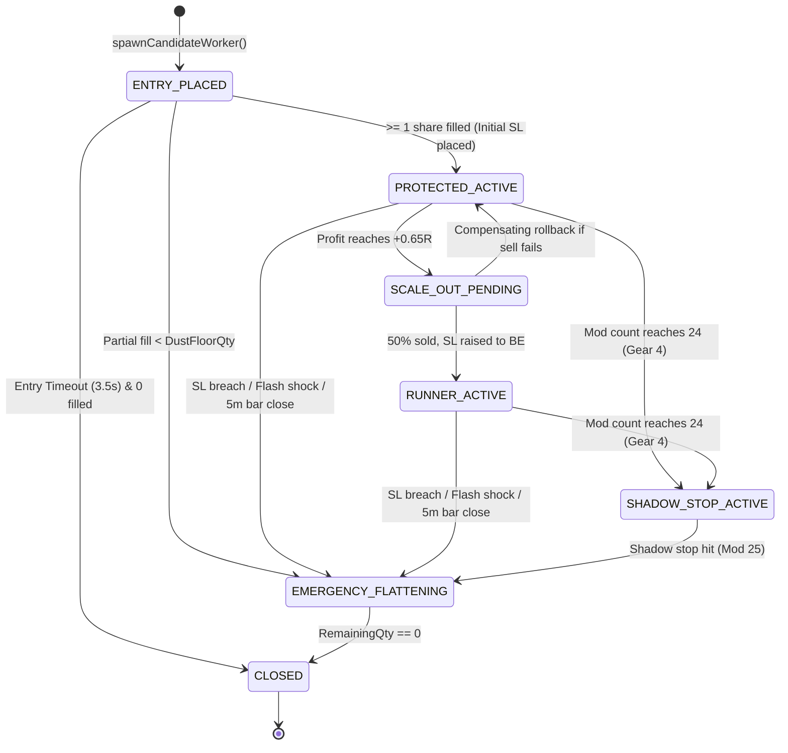

# AlgoTrade Execution Architecture & Deep Dive Flow

## 1. System Overview & Core Philosophy
The **AlgoTrade Backend** is an ultra-low-latency, single-writer algorithmic trading engine engineered in Go. It operates on real-time Level 2 (5-depth) market data from the **Zerodha Kite Connect WebSocket API (Kite Ticker)**, executing intraday cash equity trades on the **National Stock Exchange of India (NSE)**.

The system is designed with three core architectural pillars:
1. **Single-Writer Actor Model**: Eliminates read/write lock contention on tick ingestion. All tick processing, technical indicator calculation, and state updates occur inside a single goroutine running on a contiguous array of stock metrics (`[512]StockMetrics`) with **zero heap allocations** and **< 250ns** per-tick processing time.
2. **Lock-Free Atomic Hot Path**: Active position tracking and stop-loss monitoring (`OnTickHotPath`) are evaluated directly from the Actor's loop using hardware-level atomic operations (bit-cast IEEE-754 floats to `uint64`), executing without acquiring mutexes.
3. **Fail-Safe Autonomous Execution**: Position workers run on dedicated goroutines, managing order lifecycles with strict bounds on exchange modification limits (NSE max 25 modifications per order), multi-gear stop ratchets, 3-step race-free scale-outs, and anti-orphan exit recovery loops.

---

## 2. High-Level Architecture Flowchart

```mermaid
flowchart TB
    subgraph MarketDataIngestion ["1. Market Data Ingestion"]
        KT["Zerodha Kite Ticker (WebSocket)"] -->|Binary Ticks| BP["Binary Parser (5-depth L2 data)"]
        BP -->|Parsed Ticks| AC["Engine Actor (tickChan: 65,536 buffer)"]
    end

    subgraph SingleWriterEngine ["2. Single-Writer Quant Engine Actor"]
        AC -->|Single Goroutine| SW["Actor.runLoop"]
        SW -->|Update <250ns| SM["[512]StockMetrics In-Memory Array"]
        SW -->|Every 1.0s| SNAP["computeAndBroadcastSnapshot()"]
        SNAP -->|Market Breadth & Regime| REG["6-State Market Regime Classifier"]
        SNAP -->|10-Factor Ranking| SCR["Bullish & Bearish Sorting (~2µs)"]
        SNAP -->|O(1) Hot Path| HP["worker.OnTickHotPath()"]
        SNAP -->|Hook: 1.0s Tick| MGR["Manager.OnSecondTick()"]
    end

    subgraph PreTradeGates ["3. Pre-Trade Gatekeeping & Signal Selection"]
        MGR --> GC["EvaluateGlobalSessionClocks()"]
        GC -->|Playbook Window| PB["NSE Intraday Session Clock"]
        MGR --> PBK["PickBestLongCandidate()"]
        PBK -->|Gate 0| G0["Macro Flash Shock & Bearish Gate"]
        PBK -->|Gate 1| G1["Top 5 Bullish Outliers Filter"]
        PBK -->|Gate 2| G2["Order Book Microstructure & Ask Wall Filter"]
        PBK -->|Gate 3| G3["Structural Pattern Recognition: VWAP Pullback Reclaim / 15-Minute ORB Breakout"]
        PBK -->|Gate 4| G4["ComputePositionSize() (4 Institutional Constraints)"]
        PBK -->|Gate 5| G5["Mandatory Net-Profitability Gate at +1.0R (1.5x Taxes)"]
    end

    subgraph ExecutionSubsystem ["4. Autonomous Execution Subsystem"]
        PBK -->|Qualified Setup| SPW["Manager.spawnCandidateWorker()"]
        SPW --> PW["PositionWorker (Dedicated Goroutine)"]
        PW -->|1. Place Entry Limit| BRK["ExecutionBroker (Live / Paper)"]
        PW -->|2. Register Order| REC["OrderReconciler (Deduplication)"]
        PW -->|3. On Order Fill| SL["Ensure Initial SL Order Placed"]
        PW -->|4. Active Management| WL["PositionWorker.workerLoop()"]
    end

    subgraph OrderLifecycleManagement ["5. Active Trailing & Exit Management"]
        WL -->|Mod 1–18| G1R["Gear 1: Agile Ratchet (min 2 ticks / 0.12 BaseBuffer)"]
        WL -->|Mod 19–24| G3R["Gear 3: Coarse 5m Bar Trail (min 0.40 BaseBuffer)"]
        WL -->|Mod >= 24| G4S["Gear 4: Virtual Shadow Stop (Mod 25 Reserved for Exit)"]
        WL -->|+0.65R Trigger| SO3["3-Step Race-Free Scale-Out (50% Banked + Tax-Free BE)"]
        WL -->|Breach / Flash Shock| FLT["3-Stage Bulletproof Exit Protocol"]
        FLT -->|Stage A| MA["Mutate SL to Market (Mod 25)"]
        FLT -->|Stage B & C| LPP["Cancel SL -> Escalating LPP Sweep (0.75% to 3.5%)"]
        FLT -->|Stage D| REC_LOOP["Persistent Anti-Orphan Recovery Loop (Every 2s)"]
    end

    subgraph FeedbackAndReconciliation ["6. Multi-Channel Feedback & State Persistence"]
        BRK -->|REST / Postback / WS| REC
        REC -->|Incremental Fill Deltas| DELTA["PositionWorker.OnOrderDelta()"]
        DELTA --> DB[("SQLite Database (WAL Mode)")]
        DELTA --> CM["CapitalManager (Ledger & Circuit Breakers)"]
    end
```
---

## 3. End-to-End Execution Pipeline (Step-by-Step)

### Step 1: Market Data Ingestion & Single-Writer Processing
- **Files**:
  - `cmd/api/main.go`
  - `internal/kite/ticker.go`
  - `internal/engine/actor.go`
  - `internal/engine/binary_parser.go`
  - `internal/engine/types.go`

#### Data Flow & Mechanics:
1. `kite.TickerClient` connects to Zerodha's WebSocket server at `wss://ws.kite.trade`.
2. Binary packets arrive in `full` mode (184 bytes per packet for NSE equity depth).
3. `binary_parser.go:ParseBinaryPacket()` unpacks raw bytes into:
   - `InstrumentToken` (uint32)
   - `LTP` (Last Traded Price, float64)
   - `Volume` (Cumulative day volume)
   - `Ask1Price` to `Ask5Price`, `Ask1Qty` to `Ask5Qty`
   - `Bid1Price` to `Bid5Price`, `Bid1Qty` to `Bid5Qty`
   - `ExchangeVWAP` (Official Zerodha intraday VWAP)
4. The unpacked tick is posted non-blockingly into `Actor.tickChan` (buffered capacity: 65,536).
5. `Actor.runLoop()` runs on a **single dedicated goroutine**. Inside `processTick()`:
   - Index lookup in `tokenMap[token] -> uint16` (O(1)).
   - Modifies `a.stocks[idx]` directly in memory with **no mutex lock**.
   - Calculates bar index: `barIdx = (tick.ExchangeTime - 09:15:00) / 300` (75 five-minute bars per session).
   - Updates `RollingPeak`: Exponentially decayed peak ($e^{-\Delta t / 20\text{s}}$) used for micro-crash detection.
   - Updates `AggressorBuyRatio` and `FastAggressorEMA`: Estimates buyer aggression from uptick vs downtick trade prints.
   - Updates `SmoothedBuyerRatio`: Normalized depth bid-ask imbalance.
   - Computes `ATR14`: 14-period True Range on 5-minute bars.
6. **Flash Shock Detector**:
   - Monitored on Nifty 50 token (`256265`).
   - If Nifty drops $\le -0.18\%$ from its 20s `RollingPeak`, `a.inMacroShock.Store(true)` activates with a 180-second freeze window.
7. **Position Worker Hot Path Dispatch**:
   - If a `PositionWorker` is bound to `a.workers[idx]`, the actor invokes:
     ```go
     w.OnTickHotPath(stock, a.inMacroShock.Load())
     ```
     This executes in **< 250ns** with **0 heap allocations**.

---

### Step 2: 1-Second Snapshot & Macro Regime Classification
- **Files**:
  - `internal/engine/actor.go:computeAndBroadcastSnapshot()`
  - `internal/engine/math_ranking.go`

#### Logic & Filters:
1. Ticker triggers every 1.0 second.
2. Computes **Market Breadth**:
   $$\text{BreadthAboveVWAP} = \frac{\sum [ \text{LTP}_i > \text{ExchangeVWAP}_i ]}{N_{\text{active}}} \times 100\%$$
3. Classifies market into **6 Dynamic Regimes**:
   - `FLASH_SHOCK`: Macro shock active or breadth drop $\ge 12\%$ in 5 seconds.
   - `INTRADAY_DISTRIBUTION`: Nifty Close-Location-Value (CLV) $< 0.35$, 15-minute velocity $\le -0.18\%$, breadth $< 48\%$.
   - `BEARISH_EXPANSION`: Breadth $\le 42\%$, Nifty day change $< -0.35\%$, CLV $< 0.40$.
   - `V_RECOVERY_BULLISH`: Nifty change $< 0$, but intraday return $\ge +0.25\%$, CLV $\ge 0.65$, breadth $\ge 58\%$.
   - `BULLISH_EXPANSION`: Breadth $\ge 58\%$, intraday return $\ge +0.15\%$, CLV $\ge 0.55$.
   - `SIDEWAYS_CHOP`: Default sideways market state.
4. Computes Sector Performance:
   - Tracks 11 sectors (Auto, Bank, Energy, FMCG, IT, Media, Metal, Pharma, Realty, Infra).
   - Identifies Top 2 leading sectors (`leaderMap`).
5. **Bullish Scoring** (`CalculateBullishScore`):
   - Computes composite score ($0 \dots 100$) using Gaussian VWAP curve, order book depth imbalance, aggressor buyer ratio, sector leadership bonus (+12), relative strength vs Nifty, and penalties (wide spread, overextended $> 2.5\text{ ATR}$, iceberg sells).
6. Sorts `bullishSorted` slice using `slices.SortFunc` (~2 microseconds).
7. Invokes the execution hook:
   ```go
   execState = a.execHook.OnSecondTick(&a.stocks, a.activeIndices, bullishSorted, leaderMap, pulseDTO, a.inMacroShock.Load())
   ```

---

### Step 3: Global Session Clocks & Candidate Selection
- **Files**:
  - `internal/execution/session_clock.go`
  - `internal/execution/manager.go`

#### Logic & Filters:
1. `EvaluateGlobalSessionClocks()` maps DST-aware global trading hours and selects the active NSE playbook:
   - `09:15–09:20`: **OPENING_NOISE_BLACKOUT** (`AllowNewEntries = false`).
   - `09:20–11:30`: **MORNING_DISCOVERY_DRIVE** (`AllowNewEntries = true`, `MinScore = 75`, `MinRVOL = 1.5`, `SizeMultiplier = 1.0`).
   - `11:30–13:30`: **MIDDAY_COMPRESSION** (Europe pre-market):
     - If Breadth $\ge 60\%$ and top RVOL $\ge 2.2$, activates **Domestic Tape Override** (`MinScore = 78`, `SizeMultiplier = 0.90`).
     - Otherwise, strict compression guard (`MinScore = 82`, `SizeMultiplier = 0.65`, 15-Minute ORB locked).
   - `13:30–14:45`: **EUROPE_OVERLAP_EXPANSION** (`AllowNewEntries = true`, `MinScore = 76`, `SizeMultiplier = 1.0`).
   - `14:45–15:14`: **EXIT_ONLY_LOCKOUT** (`AllowNewEntries = false`).
   - `15:14–15:30`: **AUTO_SQUAREOFF_SWEEP** (`AllowNewEntries = false`). Emergency flattens all open MIS positions.
2. `PickBestLongCandidate()` iterates through the top 5 sorted bullish leaders:
   - **Gate 0 (Macro Gate)**: Rejects candidate if regime is `FLASH_SHOCK`, `BEARISH_EXPANSION`, or `INTRADAY_DISTRIBUTION`.
   - **Gate 1 (Cooldown Gate)**: Rejects candidate if symbol is already open or in 15-minute post-exit lockout (`symbolCooldowns`).
   - **Gate 2 (Sector Leadership Gate)**: In `SIDEWAYS_CHOP` or `V_RECOVERY_BULLISH`, stock must belong to a Top 2 leading sector.
   - **Gate 3 (Score & RVOL Gate)**: Requires `BullishScore >= MinScore`, `EV >= 0.25R`, and `CompositeRVOL >= MinRVOL`.
   - **Gate 4 (Order Book & Ask Wall Gate)**:
     - Disqualifying bitmask must have no penalties.
     - Ask Wall check: Rejects if $\text{Ask1 Qty} > 4 \times (\text{Bid1 Qty} + \text{Bid2 Qty})$.
   - **Gate 5 (Structural Pattern Recognition)**:
     - **VWAP Pullback Reclaim Setup**:
       - Price is within $0.05 \dots 0.55\text{ ATR}$ above VWAP.
       - Previous 5m candle low dipped near VWAP ($\le \text{VWAP} + 0.35\text{ATR}$).
       - Current price reclaimed previous bar's midpoint and candle open $+ 2\text{ ticks}$.
       - $\text{CLV} \ge 0.58$, $\text{AggressorBuyRatio} \ge 0.56$, $\text{FastAggressorEMA} \ge 0.55$.
     - **15-Minute Opening Range Breakout (ORB) Setup**:
       - Session bar $\ge 3$ ($\ge 09:30\text{ IST}$).
       - 15m opening range width $\le 1.8\text{ ATR}$.
       - $\text{LTP} > \text{ORH} + 1\text{ tick}$, extension $\le 0.35\text{ ATR}$.
       - $\text{CompositeRVOL} \ge 1.8$, $\text{CLV} \ge 0.65$, $\text{AggressorBuyRatio} \ge 0.60$.

---

### Step 4: Position Sizing & Net-Profitability Gate
- **Files**:
  - `internal/execution/sizer.go`
  - `internal/execution/stoploss.go`
  - `internal/execution/taxes.go`

#### Mathematical Formulas & Sizing Constraints:
1. **Entry Limit Price**:
   $$\text{EntryLimitPrice} = \text{RoundUpToTick}(\text{Ask1Price} + \text{TickSize})$$
2. **Stop Loss Specification** (`ComputeStopAndBufferSpec`):
   - $\text{ATR}_{\text{safe}} = \max(\text{ATR14}, \text{LTP} \times 0.0025)$
   - Non-inverting Delta bounds:
     $$\Delta_{\min} = \max(4\text{ ticks}, \max(0.35\% \times \text{LTP}, \min(0.35 \times \text{ATR}_{\text{safe}}, 0.80\% \times \text{LTP})))$$
     $$\Delta_{\max} = \max(\Delta_{\min} + 4\text{ ticks}, \min(1.15 \times \text{ATR}_{\text{safe}}, \max(1.50\% \times \text{LTP}, 0.85 \times \text{ATR}_{\text{safe}})))$$
   - Breathing Buffer:
     $$\text{BaseBuffer} = \text{RoundToTick}(\text{clamp}(\Delta_{\min}, \Delta_{\max}, \max(0.75 \times \text{ATR}_{\text{safe}}, 0.0075 \times \text{LTP})))$$
   - Structural Stop:
     $$\text{RawStop} = \text{SignalBarLow} - 2\text{ ticks}$$
   - **No-Chase Rule**:
     $$\text{If } (\text{EntryLimitPrice} - \text{RawStop}) > 1.25 \times \Delta_{\max} \implies \text{REJECT}$$
   - Clamped Stop and $1\text{R}$ Risk per Share:
     $$\text{OneR} = \text{RoundUpToTick}(\text{clamp}(\Delta_{\min}, \Delta_{\max}, \text{EntryLimitPrice} - \text{RawStop}))$$
     $$\text{InitialStop} = \text{RoundDownToTick}(\text{EntryLimitPrice} - \text{OneR})$$
3. **Adaptive Scale-Invariant Risk Curve** (`EffectiveRiskPerTradePct`):
   - Net Equity $\le \text{₹}15,000$: $1.25\%$ risk (utilizes 5x MIS leverage)
   - Net Equity $\le \text{₹}50,000$: $1.00\%$ risk
   - Net Equity $\le \text{₹}2,00,000$: $0.75\%$ risk
   - Net Equity $\le \text{₹}50,00,000$: $0.50\%$ risk
   - Institutional ($> \text{₹}50\text{L}$ to ₹100Cr): $0.35\%$ risk
4. **The 4 Institutional Sizing Constraints**:
   - $Q_{\text{risk}} = \lfloor \frac{\text{RiskBudget}}{\text{OneR} + \text{PerShareFriction}} \rfloor$
   - $Q_{\text{margin}} = \lfloor \frac{0.95 \times \text{FreeMargin} \times \text{Leverage}}{\text{EntryLimitPrice}} \rfloor$
   - $Q_{\text{conc}} = \lfloor \frac{\text{ConcRatio} \times \text{NetEquity} \times \text{Leverage}}{\text{EntryLimitPrice}} \rfloor$ ($35\%$ standard, $95\%$ micro $< \text{₹}25\text{k}$)
   - $Q_{\text{liq}} = \lfloor 0.20 \times (\text{Ask1Qty} + \text{Ask2Qty} + \text{Ask3Qty}) \rfloor$ (Capped at 20% visible top-3 ask depth)
   - Final Quantity:
     $$Q = \min(Q_{\text{risk}}, Q_{\text{margin}}, Q_{\text{conc}}, Q_{\text{liq}})$$
5. **Mandatory Net-Profitability Gate at $+1.0\text{R}$**:
   - Target price at $+1.0\text{R} = \text{EntryLimitPrice} + \text{OneR}$.
   - Calculates itemized round-trip statutory charges (`CalculateRoundTripCharges`):
     - Buy Brokerage: $\min(\text{₹}20, 0.03\% \times \text{Turnover}_{\text{buy}})$
     - Sell Brokerage: $\min(\text{₹}20, 0.03\% \times \text{Turnover}_{\text{sell}})$
     - STT: $0.025\%$ on sell turnover
     - Exchange Txn Fee: $0.00297\%$ on total turnover
     - SEBI Turnover Fee: $0.0001\%$ on total turnover
     - Stamp Duty: $0.003\%$ on buy turnover
     - GST: $18\%$ on (Brokerage + Exchange + SEBI)
   - Net Profit at $+1.0\text{R}$:
     $$\text{GrossProfit}_{1\text{R}} = Q \times \text{OneR}$$
     $$\text{NetProfit}_{1\text{R}} = \text{GrossProfit}_{1\text{R}} - \text{TotalTaxes}$$
     $$\text{Condition: } \text{NetProfit}_{1\text{R}} \ge 1.50 \times \text{TotalTaxes} \quad (\text{otherwise REJECT})$$

---

### Step 5: Position Lifecycle, Multi-Gear Trailing, & Order Management
- **Files**:
  - `internal/execution/position_worker.go`
  - `internal/execution/broker.go`
  - `internal/execution/reconciler.go`



#### Detailed Operations:
1. **Entry Order & Timeout**:
   - `Start()` sends `broker.PlaceLimitBuy`.
   - Starts a 3500ms `entryTimeout` timer.
   - If not filled within 3.5s, cancels remaining quantity.
   - If filled quantity $< \text{DustFloorQty}$, immediately flattens (`PARTIAL_FILL_DUST_GUARD`).
   - Otherwise, recalculates Breakeven Stop for the filled quantity and places the initial SL.
2. **Initial SL Order Placement**:
   - `broker.PlaceSLOrder` places an exchange Stop-Loss Limit (SL-L) order:
     - Trigger Price: `InitialStop`
     - Limit Price: `computeSellSLLimitPrice(InitialStop, TickSize)` ($0.40\%$ or 4 ticks below trigger).
3. **Multi-Gear Stop-Loss Ratchet**:
   - **Gear 1 (Agile Trail, Mods 1–18)**:
     - Ratchets whenever price advances by $\ge \max(2\text{ ticks}, 0.12 \times \text{BaseBuffer})$.
     - Minimum cooldown: $350\text{ms}$.
   - **Gear 3 (Coarse Trail, Mods 19–24)**:
     - Ratchets only on structural 5-minute candle low advances: $\ge \max(0.40 \times \text{BaseBuffer}, 0.35 \times \text{ATR})$.
     - Minimum cooldown: $1500\text{ms}$.
   - **Gear 4 (Virtual Shadow Stop, Mod $\ge 24$)**:
     - **Exchange Modification Invariant**: NSE permits a maximum of 25 modifications per order.
     - Modification #25 is **strictly preserved** for emergency market exit!
     - At `modCount == 24`, the worker ceases sending exchange PUT modifications.
     - The stop continues trailing virtually in RAM (`shadowStopBits`).
     - If LTP breaches `shadowStopBits` with 2 consecutive tick hits or order flow deterioration, it consumes Modification #25 to convert the resting SL directly to MARKET.
4. **Race-Free 3-Step Scale-Out Protocol** (`executeThreeStepScaleOut`):
   - At $+0.65\text{R}$ MFE, triggers partial profit-taking:
     - **Step 1**: Shrink resting SL order quantity from $Q_{\text{full}} \to Q_{\text{runner}}$ while keeping trigger price unchanged.
     - **Step 2**: Place marketable limit sell for $Q_{\text{scale}} = Q_{\text{full}} / 2$.
     - **Compensating Rollback**: If Step 2 fails, immediately re-expand resting SL quantity back to $Q_{\text{full}}$.
     - **Step 3**: Once fill is confirmed (or 800ms timer expires), raise remaining runner SL trigger to **Tax-Free Breakeven**:
       $$\text{BreakevenStop} = \text{EntryPrice} + \frac{\text{TotalTaxesOnEntireTrade}}{Q_{\text{runner}}} + \max(2\text{ ticks}, 0.15\% \times \text{EntryPrice})$$
5. **3-Stage Bulletproof Exit Protocol** (`executeEmergencyFlatten`):
   - **Stage A**: Mutate resting SL order directly into `MARKET` (consumes reserved Modification #25).
   - **Stage B & C**: Cancel resting SL $\to$ Coalesced Reconcile $\to$ 4-attempt escalating Liquidity Protection Price (LPP) sweep sell:
     - Attempt 1: $0.75\%$ slippage band
     - Attempt 2: $1.50\%$ slippage band
     - Attempt 3: $2.50\%$ slippage band
     - Attempt 4: $3.50\%$ slippage band / Market order
   - **Stage D (Persistent Anti-Orphan Recovery Loop)**: If position remains open after 4 attempts (e.g. circuit freeze or network partition), enters a persistent 2-second retry loop until `RemainingQty() == 0`.

---

### Step 6: Order Reconciliation, Capital Management & Circuit Breakers
- **Files**:
  - `internal/execution/reconciler.go`
  - `internal/execution/capital_manager.go`

#### Data Flow & Reconciliation:
1. Reconciles fills across WebSocket, Webhook postbacks, and REST polling.
2. `pendingUntracked[orderID]` buffers early fills that arrive before `broker.PlaceOrder` finishes registering.
3. Computes positive incremental fill deltas: $\Delta_{\text{filled}} = \max(0, \text{ev.FilledQuantity} - \text{lastFilledByOrd}[\text{orderID}])$.
4. Dispatches deltas to `PositionWorker.OnOrderDelta`.
5. On position closure, `CapitalManager.RecordClosedTrade()` updates the daily risk ledger and checks **3 Institutional Circuit Breakers**:
   - **Max Daily Loss**: CumNet $\le -2.0\%$ of capital (or $-3.0\text{R}$).
   - **2 Consecutive Losses**: Locks trading for the day.
   - **Profit-Giveback Lock**: If PeakNetPnL reached $\ge +2.0\text{R}$ and current net profit drops below $55\%$ of peak, locks trading to protect banked green days.

---

## 4. Concurrency Architecture & Lock Hierarchy

```
┌────────────────────────────────────────────────────────────────────────┐
│ TIER 1: Lock-Free Atomic Hot Path (<250ns, Zero Heap Allocations)      │
│ Called directly by Single-Writer Actor: worker.OnTickHotPath()         │
│ - Reads/Writes: latestLTPBits, highWaterMarkBits, confirmedStopBits,   │
│   shadowStopBits, proposedStopBits via atomic.Uint64 bitcasts          │
│ - Ratchets in-memory shadow stops via CAS loops                        │
│ - Signals worker goroutine via non-blocking wakeCh send                │
└────────────────────────────────────┬───────────────────────────────────┘
                                     │ Non-blocking signal
┌────────────────────────────────────▼───────────────────────────────────┐
│ TIER 2: Dedicated Worker Goroutine (Event Loop)                        │
│ go worker.workerLoop()                                                 │
│ - Coordinates all network operations, timers, and order mutations      │
│ - Listens on:                                                          │
│   * wakeCh (order modification requests)                               │
│   * emergReasonCh (emergency exit triggers)                            │
│   * fillNotifyCh (order fill notifications from reconciler)            │
│   * entryTimeout (3.5s limit order fill timeout)                       │
│   * watchdogTicker (500ms gapped-through SL watchdog)                  │
└────────────────────────────────────┬───────────────────────────────────┘
                                     │ State locks
┌────────────────────────────────────▼───────────────────────────────────┐
│ TIER 3: Mutex Protected State Machine (w.mu sync.RWMutex)              │
│ - Protects: state, order IDs (entryOrderID, slOrderID), PnL totals,    │
│   closedAt, exitReason                                                 │
│ - Acquired during order transitions, DTO serialization, and DB sync    │
└────────────────────────────────────────────────────────────────────────┘
```

### Goroutine Topology:
- **WebSocket Ingestion**: Reads binary Kite Ticker packets and pushes to `tickChan`.
- **Single-Writer Actor Goroutine** (`Actor.runLoop`): Consumes `tickChan`, computes metrics, and calls `OnTickHotPath`.
- **Manager Maintenance Goroutine**: Runs 10s coalesced order sync and 30s margin refresh.
- **Worker Goroutines**: Exactly 1 goroutine per open position (`worker.workerLoop`).
- **SQLite Async Writer Goroutines**: Flushes 5m bars and position state asynchronously.

### Data Race Prevention Principles:
- **No mutex in hot path**: `OnTickHotPath` uses `math.Float64bits` and `atomic.Uint64`.
- **Channel send with default**: Never blocks the Actor tick loop:
  ```go
  select {
  case w.wakeCh <- struct{}{}:
  default:
  }
  ```
- **Exactly-once closure**: `closedNotified.CompareAndSwap(false, true)` ensures `onClosed` callbacks fire exactly once.

---

## 5. Function & File Cross-Reference Table

| File | Function / Method | Invoked By | Purpose & Logic |
| :--- | :--- | :--- | :--- |
| `cmd/api/main.go` | `main()` | OS Runtime | Initializes DB, KiteService, Actor, TickerClient, ExecutionManager, Handlers. |
| `internal/engine/actor.go` | `processTick()` | `Actor.runLoop` | Ingests L2 depth tick, updates OHLCV, RollingPeak, Aggressors, checks Flash Shock. |
| `internal/engine/actor.go` | `OnTickHotPath()` | `processTick()` | O(1) lock-free dispatch to active worker (<250ns). |
| `internal/engine/actor.go` | `computeAndBroadcastSnapshot()` | `Actor.runLoop` (1s ticker) | Computes breadth, 6-state regime, sector ranks, sorts bullish stocks, invokes execution hook. |
| `internal/execution/manager.go` | `OnSecondTick()` | `Actor.computeAndBroadcastSnapshot` | Evaluates session clock, checks active positions, triggers candidate picking, handles 15:14 square-off. |
| `internal/execution/session_clock.go` | `EvaluateGlobalSessionClocks()` | `Manager.OnSecondTick` | Computes DST-aware global clocks and selects 1 of 6 NSE intraday phases. |
| `internal/execution/session_clock.go` | `PickBestLongCandidate()` | `Manager.OnSecondTick` | Executes Gates 0–5, evaluates VWAP Pullback Reclaim & 15-Minute ORB Breakout, outputs top candidate. |
| `internal/execution/sizer.go` | `ComputePositionSize()` | `PickBestLongCandidate` | Computes 4 constraints (Risk, Margin, Concentration, Liquidity) and enforces 1.5x tax net profit gate. |
| `internal/execution/stoploss.go` | `ComputeStopAndBufferSpec()` | `ComputePositionSize` | Calculates non-inverting stop bounds [DeltaMin, DeltaMax], BaseBuffer, and checks No-Chase rule. |
| `internal/execution/stoploss.go` | `BreakevenTriggerPrice()` | `sizer.go`, `position_worker.go` | Computes exact SL price covering round-trip statutory taxes on entire trade + cushion. |
| `internal/execution/manager.go` | `spawnCandidateWorker()` | `Manager.OnSecondTick` | Spawns worker goroutine, binds to actor, and starts position lifecycle. |
| `internal/execution/position_worker.go` | `Start()` | `Manager.spawnCandidateWorker` | Places limit buy order via broker and starts `go workerLoop()`. |
| `internal/execution/position_worker.go` | `OnTickHotPath()` | `Actor.processTick` | High-frequency HWM update, SL breach watchdog, Gear 4 shadow stop, ProposeStopRatchet. |
| `internal/execution/position_worker.go` | `ProposeStopRatchet()` | `OnTickHotPath` | Enforces Mod 1–18 agile, Mod 19–24 coarse, and Gear 4 shadow stop rules. |
| `internal/execution/position_worker.go` | `workerLoop()` | `PositionWorker.Start` | Dedicated goroutine event loop managing timers, order mutations, scale-out, and exits. |
| `internal/execution/position_worker.go` | `executeThreeStepScaleOut()` | `workerLoop` | Executes race-free 3-step scale-out at +0.65R with compensating rollback. |
| `internal/execution/position_worker.go` | `executeEmergencyFlatten()` | `workerLoop`, `TriggerEmergencyExit` | 3-stage exit protocol: Mutate to Market -> Escalating LPP sweeps -> 2s anti-orphan recovery. |
| `internal/execution/reconciler.go` | `ProcessOrderEvent()` | Broker / WebSocket / Webhook | Deduplicates fills, updates `lastFilledByOrd`, computes positive incremental fill deltas. |
| `internal/execution/capital_manager.go` | `ComputeCapitalSummary()` | `Manager.OnSecondTick` | Computes NetEquity, FreeMargin, BuyingPower5x, DrawdownMult, and checks 3 circuit breakers. |
| `internal/execution/broker.go` | `walkAskBook()` / `walkBidBook()` | `PaperBroker` | High-fidelity 5-level depth walking for realistic paper slippage simulation. |

---

## 6. Concrete Opportunities for Improvement

1. **Dynamic Kite Ticker Token Subscriptions**:
   - *Current*: Subscribes to all scanned universe tokens on startup.
   - *Improvement*: Implement dynamic subscription pooling—subscribe only to the Top 30 scanned universe leaders and active position tokens to minimize network bandwidth and garbage collection overhead.
2. **Externalize Hardcoded Strategy Tunables**:
   - *Current*: Parameters like `StopMinTickMultiplier (4.0)`, `StopBaseBufferLTPRatio (0.0075)`, `StopMaxChaseMultiplier (1.25)` are hardcoded constants.
   - *Improvement*: Expose a `strategy_tunables` configuration table in SQLite, allowing risk parameters and ATR multipliers to be tuned live from the frontend without recompilation.
3. **Anchored VWAP (AVWAP) from Signal Origin**:
   - *Current*: Uses session-wide VWAP (`s.ExchangeVWAP`).
   - *Improvement*: Compute an Anchored VWAP starting from the 15-minute Opening Range breakout bar or the morning high/low bar to provide cleaner support/resistance during afternoon trends.
4. **Intraday Short Selling Extension**:
   - *Current*: Executes Long setups (`AT26LONG`).
   - *Improvement*: Extend `PickBestCandidate` to support Short setups during `BEARISH_EXPANSION` regimes (SL placed above signal candle high, covering borrow and statutory charges).
5. **Observability & Execution Telemetry**:
   - *Improvement*: Add sub-millisecond execution telemetry histograms (order submission latency, broker OMS ACK roundtrip, and slippage vs Ask1 price) to track broker fill quality over time.
