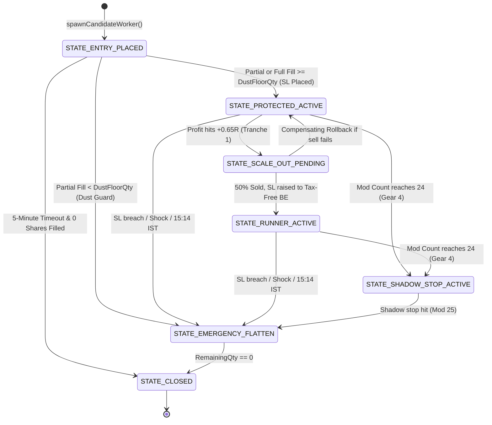

# AlgoTrade Execution Architecture & Deep Dive Engine Manual

## 1. System Overview & Core Philosophy

The **AlgoTrade Backend** is an ultra-low-latency, single-writer algorithmic trading engine engineered in Go. It operates on real-time Level 2 (5-depth) market data streamed via the **Zerodha Kite Connect WebSocket API (Kite Ticker)**, executing intraday cash equity trades on the **National Stock Exchange of India (NSE)**.

The engine is engineered around four core architectural pillars:

1. **Single-Writer Actor Model (`internal/market`)**: Eliminates read/write mutex contention on tick ingestion. All tick processing, technical indicator calculation, and state updates occur inside a single goroutine running on a contiguous array of stock metrics (`[512]StockMetrics`) with **zero heap allocations** and **< 250ns** per-tick processing time.
2. **Lock-Free Atomic Hot Path (`internal/trading/trailing_stop.go`)**: Active position monitoring, high-water mark tracking, and stop-loss breach detection (`OnTickHotPath`) are executed directly from the Actor's tick loop using hardware-level atomic operations (bit-cast IEEE-754 floats to `uint64`), running with **zero mutex locks** and zero heap allocations.
3. **Fail-Safe Autonomous Execution (`internal/trading`)**: Each active position runs on its own dedicated worker goroutine (`PositionWorker`), managing order lifecycles with strict bounds on exchange modification limits (NSE maximum 25 modifications per order), 5-minute limit order timeouts with viable partial-fill promotion, 3-step race-free scale-outs, and a 4-stage anti-orphan exit recovery protocol.
4. **Continuous Portfolio Heat Engine & EOD Optimization Engine (`internal/trading`, `internal/monitoring`)**: Account equity is guarded by a hard $2.0\%$ Portfolio Heat Cap. Once a winning position ratchets its stop to Breakeven (or above), its open downside risk drops to ₹0.00, releasing portfolio heat and allowing the engine to spawn new continuous trades during the day. All signals—both filled trades and rejected candidate setups—are logged asynchronously via a ring buffer to compute Maximum Favorable Excursion (MFE), Maximum Adverse Excursion (MAE), shadow outcomes, and automated 15:45 IST diagnostic reports emailed via Resend.

---

## 2. High-Level Architecture Flowchart

```mermaid
flowchart TB
    subgraph MarketDataIngestion ["1. Market Data Ingestion"]
        KT["Zerodha Kite Ticker (WebSocket)"] -->|Binary Ticks (184B)| BP["kite_tick_parser.go (L2 5-Depth Unpacker)"]
        BP -->|Parsed Ticks| AC["market_hub.go (tickChan: 65,536 buffer)"]
    end

    subgraph SingleWriterEngine ["2. Single-Writer Quant Engine Actor"]
        AC -->|Single Goroutine| SW["Actor.runLoop()"]
        SW -->|Update <250ns| SM["[512]StockMetrics Contiguous Array"]
        SW -->|Every 1.0s| SNAP["snapshot_publisher.go: computeAndBroadcastSnapshot()"]
        SNAP -->|Market Breadth & Regime| REG["Bottom-Up F&O Breadth Classifier (>=58% / <=40%)"]
        SNAP -->|11 Sectors| SEC["Granular Sector Health & Circuit Breakers"]
        SNAP -->|Quant Ranking| SCR["Quicksort Active Indices by BullishScore (~2µs)"]
        SW -->|O(1) Lock-Free Dispatch| HP["worker.OnTickHotPath()"]
        SNAP -->|Execution Hook (1.0s)| MGR["execution_manager.go: OnSecondTick()"]
    end

    subgraph PreTradeGates ["3. Pre-Trade Gatekeeping & Signal Selection"]
        MGR --> GC["session_clock.go: EvaluateGlobalSessionClocks()"]
        GC -->|Playbook Window| PB["NSE Intraday Session Clock (6 Phases)"]
        MGR --> PBK["entry_gatekeeper.go: PickBestLongCandidate()"]
        PBK -->|Gate 0| G0["Warmup & Active Cooldown Check (15m lockout)"]
        PBK -->|Gate 1| G1["Granular Sector Circuit Breaker (Restricted Sector Check)"]
        PBK -->|Gate 2| G2["Bullish Score & Pre-Trade EV Gate (Score >= 75, EV >= +0.25R)"]
        PBK -->|Gate 3| G3["Order Book Microstructure & Ask Wall Filter (Ask1 <= 4x Top-2 Bid)"]
        PBK -->|Gate 4| G4["Structural Setup: VWAP Pullback Reclaim OR 15m ORB Breakout"]
        PBK -->|Gate 5| G5["position_sizer.go: ComputePositionSize() (4 Constraints + Heat Cap)"]
        PBK -->|Gate 6| G6["Mandatory Net-Profitability Gate at +1.0R (Net >= 1.5x Taxes)"]
    end

    subgraph ExecutionSubsystem ["4. Autonomous Execution Subsystem"]
        PBK -->|Qualified Setup| SPW["Manager.spawnCandidateWorker()"]
        SPW --> PW["PositionWorker (Dedicated Goroutine)"]
        PW -->|1. Place Entry Limit| BRK["BrokerAdapter (Live Zerodha / Paper)"]
        PW -->|2. Register Order| REC["order_reconciler.go (Deduplication)"]
        PW -->|3. 5m Timeout / Fill| SL["Ensure Initial SL-L Order Placed"]
        PW -->|4. Event Loop| WL["position_worker.go: workerLoop()"]
    end

    subgraph ActiveManagement ["5. Trailing Gears, Scale-Out & Bulletproof Exits"]
        WL -->|Gear 1: Mods 1–18| G1R["Agile Dynamic Trail (min 2 ticks / 0.12 BaseBuffer, cooldown 350ms)"]
        WL -->|Gear 3: Mods 19–24| G3R["Coarse 5m Bar Trail (min 0.40 BaseBuffer, cooldown 1500ms)"]
        WL -->|Gear 4: Mod >= 24| G4S["Virtual Shadow Stop in RAM (Mod 25 Reserved for Exit)"]
        WL -->|+0.65R MFE| SO3["3-Step Race-Free Scale-Out (50% Banked + Tax-Free BE)"]
        WL -->|Breach / Shock / 15:14| FLT["position_exit.go: 4-Stage Bulletproof Exit Protocol"]
        FLT -->|Stage A| MA["Mutate SL to Market (Consumes Reserved Mod 25)"]
        FLT -->|Stage B & C| LPP["Cancel SL -> Escalating LPP Limit Sweeps (0.75% to 3.50%)"]
        FLT -->|Stage D| REC_LOOP["Persistent Anti-Orphan Recovery Loop (Every 2.0s)"]
    end

    subgraph FeedbackAndMonitoring ["6. Reconciliation, Capital & EOD Optimization"]
        BRK -->|REST / Postback / WS| REC
        REC -->|Incremental Fill Deltas| DELTA["PositionWorker.OnOrderDelta()"]
        DELTA --> DB[("SQLite Database (WAL Mode)")]
        DELTA --> CM["risk_manager.go: CapitalManager (Ledger & 3 Circuit Breakers)"]
        PBK -->|Rejections & Trades| EVT["monitoring/collector.go: EventCollector (Ring Buffer)"]
        EVT --> SHAD["monitoring/shadow_tracker.go: Shadow Tracking of Rejected Setups"]
        EVT --> SCHED["monitoring/scheduler.go: EOD Scheduler (15:45 IST)"]
        SCHED --> REP["monitoring/reporter.go: Diagnostic Report Generator"]
        REP --> EML["monitoring/email_resend.go: Resend Transactional Email"]
    end
```

---

## 3. End-to-End Execution Pipeline (Step-by-Step)

### Step 1: Market Data Ingestion & Single-Writer Processing
- **Files**:
  - `cmd/api/main.go`
  - `internal/kite/ticker.go`
  - `internal/market/kite_tick_parser.go`
  - `internal/market/market_hub.go`
  - `internal/market/tick_ingestion.go`
  - `internal/market/stock_metrics.go`

#### Data Flow & Mechanics:
1. `kite.TickerClient` maintains a resilient WebSocket connection to Zerodha's ticker gateway (`wss://ws.kite.trade`).
2. Binary packets arrive in `full` mode (184 bytes per NSE equity depth packet).
3. `kite_tick_parser.go:ParseBinaryPacket()` unpacks the raw bytes into a `ParsedTick`:
   - `InstrumentToken` (`uint32`)
   - `LTP` (Last Traded Price, `float64`)
   - `Volume` (Cumulative day volume, `uint64`)
   - `BidLevels` [5] Depth (`BidPrice`, `BidQty`, `OrdersCount`)
   - `AskLevels` [5] Depth (`AskPrice`, `AskQty`, `OrdersCount`)
   - `VWAP` (Official Zerodha exchange intraday volume-weighted average price)
4. The unpacked tick is posted non-blockingly to `Actor.tickChan` (buffered capacity: 65,536). If full, the newest tick drops rather than stalling ingestion.
5. `Actor.runLoop()` runs on a **single dedicated goroutine**. Inside `processTick()`:
   - Performs an $O(1)$ index lookup in `actor.stockIndexByToken[tick.Token] -> uint16`.
   - Modifies `actor.stocks[stockIndex]` directly in memory with **zero mutex locks**.
   - **Calendar Day Rollover**: If `tick.ExchangeTime > actor.today0915Epoch + 64800`, resets intraday bars, pullback counts, and baseline slot volumes for the new day.
   - **Continuous Rolling Peak**:
     Updates an exponential time-decaying peak ($\tau = 20\text{s}$) used for flash crash and adverse tape detection:
     $$\Delta t = \text{ExchangeTime} - \text{LastUpdatedUnix}$$
     $$\text{RollingPeak} = \text{LTP} + (\text{RollingPeak} - \text{LTP}) \times e^{-\Delta t / 20.0}$$
   - **5-Minute Bar Rollover**:
     $$\text{BarIndex} = \lfloor \frac{\text{ExchangeTime} - \text{today0915Epoch}}{300} \rfloor \quad (0 \le \text{BarIndex} < 75)$$
     When `barIdx` advances, the previous 5m bar is finalized and queued non-blockingly to `actor.barFlushChan` for background SQLite batch insertion.
   - **Lee-Ready Quote & Tick Aggressor Classification**:
     Compares current `LTP` against saved `prevAsk1`, `prevBid1`, and `prevLTP`:
     - If $\text{LTP} \ge \text{prevAsk1} \implies \text{Aggressive Buyer Print}$.
     - If $\text{LTP} \le \text{prevBid1} \implies \text{Aggressive Seller Print}$.
     - Otherwise, uses quote midpoint and tick-direction tie-breaker.
   - **Dual-Alpha EMA Smoothing**:
     Updates order book buyer imbalance using fast volume-weighted alpha ($\alpha = 0.20$ on traded volume, $\alpha = 0.03$ on quote changes):
     $$\text{SmoothedBuyerRatio} = \alpha \times \text{RawBuyerRatio} + (1.0 - \alpha) \times \text{SmoothedBuyerRatio}$$
   - **O(1) Lock-Free Position Worker Dispatch**:
     If an active position worker is listening on this stock index:
     ```go
     if listener := actor.positionTickListeners[stockIndex]; listener != nil {
         listener.OnTickHotPath(stock, false)
     }
     ```
     This hot path executes in **< 250ns** with **0 heap allocations**.

---

### Step 2: 1-Second Snapshot, Market Breadth & Sector Health
- **Files**:
  - `internal/market/snapshot_publisher.go`
  - `internal/market/ranking_algorithm.go`
  - `internal/market/stock_metrics.go`
  - `internal/screener/sector_registry.go`

#### Logic & Filters:
1. `snapshotTicker` fires every **1.0 second**.
2. Computes **Market Breadth** across all actively quoted F&O equities:
   $$\text{BreadthRatio} = \frac{\sum [\text{LTP}_i > \text{ExchangeVWAP}_i]}{\text{TotalActiveQuoted}}$$
3. Classifies market into **3 Dynamic Regimes**:
   - `BULLISH_EXPANSION`: $\text{BreadthRatio} \ge 0.58$ ($\ge 58\%$ of stocks holding above VWAP).
   - `BEARISH_EXPANSION`: $\text{BreadthRatio} \le 0.40$ ($\le 40\%$ of stocks holding above VWAP).
   - `SIDEWAYS_CHOP`: Default sideways state ($0.40 < \text{BreadthRatio} < 0.58$).
4. Computes **Granular Bottom-Up Sector Performance** (Sectors 2 to 12 across 11 sectors: Auto, Bank, Energy, Financial, FMCG, IT, Media, Metal, Pharma, Realty, Infra):
   - Computes sector breadth (% > VWAP) and average price change (%):
     $$\text{SectorBreadth} = \frac{\text{SectorAboveVWAPCount}}{\text{SectorTotalCount}} \times 100\%$$
     $$\text{SectorAvgChange} = \frac{\sum \text{StockChangePct}_i}{\text{SectorTotalCount}}$$
   - **Granular Sector Circuit Breaker**:
     If a sector has $\ge 2$ constituents and fails either condition:
     - $\text{SectorBreadth} < 40.0\%$ (Weak Breadth) OR
     - $\text{SectorAvgChange} < -0.50\%$ (Heavy Selling Pressure)
     $\implies \text{SectorHealth.IsRestricted} = \text{true}$.
     *(Note: This restricts stocks belonging to that specific sector only, without killing valid setups in thriving leading sectors!)*
   - Sorts sectors deterministically: Top 2 sectors with positive returns are tagged `IsLeader = true`.
5. **Quant Score Ranking** (`ranking_algorithm.go`):
   - Runs `CalculateBullishScore` and `CalculateBearishScore` across all equities ($0 \dots 100$).
   - Bullish components: Gaussian VWAP sweet-spot proximity ($+0.05 \dots +0.55\text{ ATR}$), order book bid depth ratio, aggressor buyer ratio, sector leadership bonus (+12), relative strength, and structural penalties (wide spread, overextended $> 2.5\text{ ATR}$, exhausted trend, iceberg dumping).
6. Quicksorts active stock indices into `bullishSorted` using `slices.SortFunc` (~2 microseconds).
7. Invokes the execution hook:
   ```go
   execState = actor.execHook.OnSecondTick(
       &actor.stocks,
       actor.activeStockIndices,
       bullishSorted,
       actor.sectorHealthMap,
       pulseDTO,
   )
   ```

---

### Step 3: Global Session Clocks & Candidate Pre-Trade Gatekeeping
- **Files**:
  - `internal/trading/session_clock.go`
  - `internal/trading/execution_manager.go`
  - `internal/trading/entry_gatekeeper.go`

#### Logic & Filters:
1. `EvaluateGlobalSessionClocks()` maps DST-aware global trading hours and selects the active NSE playbook:
   - `09:15–09:20`: **OPENING_NOISE_BLACKOUT** (`IsNewEntryAllowed = false`). Blocks entries during opening auction volatility.
   - `09:20–11:30`: **MORNING_DISCOVERY_DRIVE** (`IsNewEntryAllowed = true`, `MinBullishScore = 75`, `MinRVOL = 1.5`, `SizeMultiplier = 1.0`). Prime institutional morning trend window.
   - `11:30–13:30`: **MIDDAY_COMPRESSION** (Europe pre-market):
     - If Breadth $\ge 60\%$ and top RVOL $\ge 2.2$, activates **Domestic Tape Override** (`MinBullishScore = 78`, `SizeMultiplier = 0.90`).
     - Otherwise, strict compression guard (`MinBullishScore = 82`, `SizeMultiplier = 0.65`, 15-Minute ORB locked).
   - `13:30–14:45`: **EUROPE_OVERLAP_EXPANSION** (`IsNewEntryAllowed = true`, `MinBullishScore = 76`, `SizeMultiplier = 1.0`). Afternoon breakout window.
   - `14:45–15:14`: **EXIT_ONLY_LOCKOUT** (`IsNewEntryAllowed = false`). New entries locked to prevent overnight carry risk.
   - `15:14–15:30`: **AUTO_SQUAREOFF_SWEEP** (`IsNewEntryAllowed = false`). Emergency flattens all open MIS positions before Zerodha RMS penalty at 15:15 IST.
2. `PickBestLongCandidate()` scans the top 5 ranked bullish outliers through sequential gates:
   - **Gate 0 (Warmup & Cooldown Gate)**:
     - Stock must have `IsTradeable = true`, `IsWarm = true`, `LTP > 0`, `ExchangeVWAP > 0`, and `CurrentBarIdx >= 1`.
     - Stock must not be currently open or in a **15-minute post-exit lockout** (`symbolCooldowns`).
   - **Gate 1 (Sector Circuit Breaker Gate)**:
     - Stock is rejected if its specific sector is flagged `IsRestricted = true` in `sectorHealthMap`.
   - **Gate 2 (Score & RVOL Gate)**:
     - Requires $\text{BullishScore} \ge \text{MinBullishScore}$, Pre-trade $\text{EV} \ge +0.25R$, and $\text{CompositeRVOL} \ge \text{MinRVOL}$.
     - Composite RVOL is defined as:
       $$\text{CompositeRVOL} = \max(\text{RVOLSession}, 0.85 \times \text{RVOLPace5m})$$
   - **Gate 3 (Order Book Microstructure & Ask Wall Filter)**:
     - Disqualifying bitmask must be zero (no wide spread, no overextension $> 1.5\text{ ATR}$, no red pullback bar, no iceberg sells).
     - **Toxic Ask Wall Check**:
       $$\text{If } \text{Ask1Qty} > 4 \times (\text{Bid1Qty} + \text{Bid2Qty}) \implies \text{REJECT}$$
   - **Gate 4 (Structural Pattern Recognition)**:
     - **Pattern 1: VWAP Pullback Reclaim (`VWAP_PULLBACK_RECLAIM`)**:
       - Price is within $0.05 \dots 0.55\text{ ATR}$ above VWAP.
       - Previous 5m candle dipped near VWAP ($\text{Low} \le \text{VWAP} + 0.35\text{ATR}$ and $\ge \text{VWAP} - 0.15\text{ATR}$).
       - Current price reclaimed previous bar midpoint and candle open $+ 2\text{ ticks}$.
       - $\text{CLV} \ge 0.58$, $\text{AggressorBuyRatio} \ge 0.56$, $\text{FastAggressorEMA} \ge 0.55$, $\text{SmoothedBuyerRatio} \ge 0.55$.
       - Signal Bar Low: $\min(\text{prevBar.Low}, \text{currBar.Low})$.
     - **Pattern 2: 15-Minute Opening Range Breakout (`ORB_15M_BREAKOUT`)**:
       - Bar index $\ge 3$ ($\ge 09:30\text{ IST}$) and allowed by session clock.
       - 15m opening range width $\le 1.8\text{ ATR}$.
       - $\text{LTP} > \text{ORH} + 1\text{ tick}$ and extension $\le 0.35\text{ ATR}$.
       - $\text{CompositeRVOL} \ge 1.8$, $\text{CLV} \ge 0.65$, $\text{AggressorBuyRatio} \ge 0.60$, $\text{FastAggressorEMA} \ge 0.58$.
       - Signal Bar Low: $\max(\text{currBar.Low}, \text{ORH} - 0.85\text{ATR})$.
   - **Gate 5 (Position Sizing & Portfolio Heat Validation)**: Evaluates `ComputePositionSize` (see Step 4).
   - **Shadow Logging**: Any candidate that fails Gate 5 or gets preempted by a higher-ranked leader is immediately logged via `monitoring.GetCollector().EmitShadowSignal()` to track hypothetical counterfactual PnL.

---

### Step 4: Position Sizing, 4 Institutional Constraints & Continuous Portfolio Heat
- **Files**:
  - `internal/trading/position_sizer.go`
  - `internal/trading/stoploss.go`
  - `internal/trading/tax_calculator.go`

#### Mathematical Formulas & Sizing Constraints:
1. **Entry Limit Price**:
   $$\text{EntryLimitPrice} = \text{RoundUpToTick}(\max(\text{Ask1Price}, \text{LTP}) + \text{TickSize})$$
2. **Stop Loss Specification** (`ComputeStopAndBufferSpec`):
   - $\text{ATR}_{\text{safe}} = \max(\text{ATR14}, \text{LTP} \times 0.0025)$
   - Non-inverting Delta bounds:
     $$\Delta_{\min} = \max(4\text{ ticks}, \max(0.35\% \times \text{LTP}, \min(0.35 \times \text{ATR}_{\text{safe}}, 0.80\% \times \text{LTP})))$$
     $$\Delta_{\max} = \max(\Delta_{\min} + 4\text{ ticks}, \min(1.15 \times \text{ATR}_{\text{safe}}, \max(1.50\% \times \text{LTP}, 0.85 \times \text{ATR}_{\text{safe}})))$$
   - Breathing Buffer:
     $$\text{BaseBuffer} = \text{RoundToTick}(\text{clamp}(\Delta_{\min}, \Delta_{\max}, \max(0.75 \times \text{ATR}_{\text{safe}}, 0.0075 \times \text{LTP})))$$
   - Structural Stop:
     $$\text{RawStop} = \text{SignalBarLow} - 2\text{ ticks}$$
   - **No-Chase Rule**:
     $$\text{If } (\text{EntryLimitPrice} - \text{RawStop}) > 1.25 \times \Delta_{\max} \implies \text{REJECT}$$
   - Clamped Stop and $1\text{R}$ Risk per Share:
     $$\text{OneR} = \text{RoundUpToTick}(\text{clamp}(\Delta_{\min}, \Delta_{\max}, \text{EntryLimitPrice} - \text{RawStop}))$$
     $$\text{InitialStop} = \text{RoundDownToTick}(\text{EntryLimitPrice} - \text{OneR})$$
3. **Scale-Invariant Adaptive Risk Curve** (`EffectiveRiskPerTradePct`):
   - Net Equity $\le \text{₹}15,000$: $1.25\%$ risk (utilizes 5x MIS buying power on ₹10k)
   - Net Equity $\le \text{₹}50,000$: $1.00\%$ risk
   - Net Equity $\le \text{₹}2,00,000$: $0.75\%$ risk
   - Net Equity $\le \text{₹}50,00,000$: $0.50\%$ risk
   - Institutional ($> \text{₹}50\text{L}$ to ₹100Cr+): $0.35\%$ risk
4. **Continuous Portfolio Heat Ceiling**:
   $$\text{MaxPortfolioHeatRupees} = 0.02 \times \text{NetEquity} \quad (2.0\% \text{ Hard Ceiling})$$
   $$\text{TotalOpenRiskRupees} = \sum_{w \in \text{workers}} w.\text{GetOpenRiskRupees}()$$
   $$\text{RemainingHeatBudgetRupees} = \max(0.0, \text{MaxPortfolioHeatRupees} - \text{TotalOpenRiskRupees})$$
   $$\text{RiskBudget} = \min(\text{NetEquity} \times \text{RiskPct} \times \text{SizeMult} \times \text{DrawdownMult}, \text{RemainingHeatBudgetRupees})$$
   *(Note: Small accounts $\le \text{₹}25,000$ have a floor of $\max(\text{RiskBudget}, \text{NetEquity} \times 0.0075)$ to avoid starvation).*
5. **The 4 Institutional Sizing Constraints**:
   - $Q_{\text{risk}} = \lfloor \frac{\text{RiskBudget}}{\text{OneR} + \text{PerShareFriction}} \rfloor$
   - $Q_{\text{margin}} = \lfloor \frac{0.95 \times \text{FreeMargin} \times \text{Leverage}}{\text{EntryLimitPrice}} \rfloor$ (with 5% RMS safety buffer)
   - $Q_{\text{conc}} = \lfloor \frac{\text{ConcRatio} \times \text{NetEquity} \times \text{Leverage}}{\text{EntryLimitPrice}} \rfloor$ ($35\%$ standard, $95\%$ micro $< \text{₹}25\text{k}$)
   - $Q_{\text{liq}} = \max(1, \lfloor 0.20 \times (\text{Ask1Qty} + \text{Ask2Qty} + \text{Ask3Qty}) \rfloor)$ (Capped at 20% visible top-3 ask depth)
   - Micro Capital Allowance: If $Q_{\text{risk}} == 0$ on accounts $< \text{₹}25\text{k}$, allow 1 share if margin covers it and max loss $\le 2.0\%$ of Net Equity.
   - Final Quantity:
     $$Q = \min(Q_{\text{risk}}, Q_{\text{margin}}, Q_{\text{conc}}, Q_{\text{liq}})$$
6. **Mandatory Net-Profitability Gate at $+1.0\text{R}$**:
   - Computes exact Zerodha + NSE statutory charges (`tax_calculator.go:CalculateRoundTripCharges`):
     - Buy Brokerage: $\min(\text{₹}20, 0.03\% \times \text{Turnover}_{\text{buy}})$
     - Sell Brokerage: $\min(\text{₹}20, 0.03\% \times \text{Turnover}_{\text{sell}})$
     - STT: $0.025\%$ on sell turnover
     - Exchange Txn Fee: $0.00297\%$ on total turnover
     - SEBI Charges: $0.0001\%$ on total turnover
     - Stamp Duty: $0.003\%$ on buy turnover
     - GST: $18\%$ on (Brokerage + Exchange + SEBI)
   - Net Profit at $+1.0\text{R}$:
     $$\text{GrossProfit}_{1\text{R}} = Q \times \text{OneR}$$
     $$\text{NetProfit}_{1\text{R}} = \text{GrossProfit}_{1\text{R}} - \text{TotalCharges}$$
     $$\text{Condition: } \text{NetProfit}_{1\text{R}} \ge 1.50 \times \text{TotalCharges} \quad (\text{otherwise REJECT})$$
7. **Viable Dust Floor & Target Projections**:
   - Dust Floor Quantity: $\min(\max(1, \lceil 25.0 / \text{OneR} \rceil), \max(1, \lfloor 0.15 \times Q \rfloor))$.
   - Target $R_1$: $\text{RoundUpToTick}(\text{Entry} + 0.65 \times \text{OneR})$ (Tranche 1 harvest).
   - Target $R_2$: $\text{RoundUpToTick}(\text{Entry} + 1.65 \times \text{OneR})$ (Runner expansion).
   - Breakeven Win Rate: $\frac{\text{OneR}}{\text{OneR} + (R_2 - \text{Entry})} \times 100\%$.

---

### Step 5: Autonomous Position Lifecycle, 5-Minute Timeout & Partial Fill Promotion
- **Files**:
  - `internal/trading/position_worker.go`
  - `internal/trading/position_exit.go`
  - `internal/trading/broker_adapters.go`
  - `internal/trading/order_reconciler.go`



#### Detailed Operations & Timers:
1. **Entry Order Placement**:
   - `Start()` submits `broker.PlaceLimitBuy` with `EntryLimitPrice` and `InitialQty`.
   - Registers order with `OrderReconciler`.
   - Spawns `go worker.workerLoop()` and starts a **5-Minute Timeout Timer** (`time.NewTimer(300 * time.Second)`).
2. **5-Minute Entry Timeout & Drain Window**:
   - If unfilled after 300 seconds, calls `broker.CancelOrder(entryOrderID)`.
   - **500ms Exchange Drain Window**:
     `time.Sleep(500 * time.Millisecond)` followed by `reconciler.SyncOrdersCoalesced()`.
     *Why? Absorbs any in-flight execution match packets racing across the network from the exchange.*
   - If `filledEntry == 0`: marks position `StateClosed` (`ENTRY_TIMEOUT_UNFILLED`) and exits.
   - If `filledEntry < DustFloorQty`: triggers emergency exit (`PARTIAL_FILL_DUST_GUARD`) because post-tax friction on tiny share counts is mathematically negative expectancy.
   - If `filledEntry >= DustFloorQty`: **promotes partial fill to active trade!**
     - Recalculates `runnerQty = max(1, filled - filled/2)`.
     - Recalculates `BreakevenStop` for the exact filled shares.
     - Resizes or places initial SL-L order for `filledEntry` shares.
     - Transitions to `StateProtectedActive`.

---

### Step 6: Trailing Stop Loss Gears, Scale-Out & Bulletproof Exits
- **Files**:
  - `internal/trading/trailing_stop.go`
  - `internal/trading/position_exit.go`
  - `internal/trading/stoploss.go`

#### The 4 Trailing Stop Loss Gears:
- **Gear 1 (Agile Trail, Mods 1–18)**:
  - Trails behind High-Water Mark with breathing buffer:
    $$\text{CandidateStop} = \text{HWM} - (\text{BaseBuffer} \times M_{\text{flow}} \times C_{\text{climax}})$$
  - Ratchets when advance $\ge \max(2\text{ ticks}, 0.12 \times \text{BaseBuffer})$.
  - Minimum Cooldown: **350ms** (prevents bursting exchange modifications on tick noise).
- **Gear 3 (Coarse 5m Bar Trail, Mods 19–24)**:
  - Trailing switches to structural 5m candle lows:
    $$\text{CandidateStop} = \max(\text{CandidateStop}, \text{prev5mLow} - 2\text{ ticks})$$
  - Ratchets when advance $\ge \max(0.40 \times \text{BaseBuffer}, 0.35 \times \text{ATR})$.
  - Minimum Cooldown: **1500ms** (allows 5m candle structure to develop).
- **Gear 4 (Virtual Shadow Stop, Mod $\ge 24$)**:
  - **Exchange Modification Invariant**: NSE permits a maximum of 25 modifications per order.
  - Modification #25 is **strictly preserved** for emergency market exit!
  - At `modCount == 24`, the worker ceases sending exchange PUT modifications.
  - The stop continues trailing virtually in RAM (`shadowStopBits`).
  - If LTP breaches `shadowStopBits` with 2 consecutive tick hits or order flow deterioration, it consumes Modification #25 to convert the resting SL directly to MARKET.

#### Dynamic Multipliers:
- **Order Flow Multiplier $M_{\text{flow}}$**:
  $$\text{FlowScore} = 0.50 \times \text{AggressorBuy} + 0.35 \times \text{SmoothedBuyerRatio} + 0.15 \times \text{CLV}$$
  - Strong flow ($\ge 0.56$): expands buffer ($0.85 \dots 1.10$) to let winners breathe.
  - Weak flow: tightens buffer ($0.40 \dots 0.65$) to bank gains.
- **Parabolic Climax Factor $C_{\text{climax}}$**:
  When runner $\ge +2.2R$ and extended $> 1.8\text{ ATR}$ above VWAP, scales down buffer to $0.35$ to lock blow-off tops.
- **Early Profit Protection**: Once trade reaches $+0.50R$, locks Tax-Free Breakeven immediately.

#### Race-Free 3-Step Scale-Out Protocol (`executeThreeStepScaleOut`):
Triggered when unrealized profit reaches $+0.65R$ (Target R1):
1. **Step 1**: Shrink resting SL order quantity from $Q \to Q_{\text{runner}}$ while keeping trigger price unchanged.
2. **Step 2**: Place marketable limit sell for $Q_{\text{scale}} = Q / 2$.
   - **Compensating Rollback**: If Step 2 fails, immediately re-expands resting SL quantity back to $Q$.
3. **Step 3**: Awaits fill confirmation for up to **800ms** (`time.NewTimer(800 * time.Millisecond)`). Cancels any unfilled remainder, reconciles, and raises remaining runner SL trigger to **Tax-Free Breakeven**:
   $$\text{BreakevenStop} = \text{EntryPrice} + \frac{\text{TotalTaxesEntireTrade}}{Q_{\text{runner}}} + \max(2\text{ ticks}, 0.15\% \times \text{EntryPrice})$$

#### 4-Stage Bulletproof Exit Protocol (`executeEmergencyFlatten`):
- **Stage A**: Mutate resting SL order directly into `MARKET` (consumes reserved Modification #25). Awaits fill for up to **900ms**.
- **Stage B & C**: Cancel resting SL $\to$ Coalesced Reconcile $\to$ 4-attempt escalating Liquidity Protection Price (LPP) sweep sell:
  - Attempt 1: $0.75\%$ slippage band (waits up to **900ms**)
  - Attempt 2: $1.50\%$ slippage band (waits up to **900ms**)
  - Attempt 3: $2.50\%$ slippage band (waits up to **900ms**)
  - Attempt 4: $3.50\%$ slippage band / Market order (waits up to **900ms**)
- **Stage D (Persistent Anti-Orphan Recovery Loop)**: If position remains open after 4 attempts (e.g. lower circuit freeze or network partition), enters a persistent **2.0-second recovery loop** (`time.NewTicker(2 * time.Second)`) retrying until `RemainingQty() == 0`.

---

### Step 7: Multi-Channel Order Reconciliation, Capital Management & Circuit Breakers
- **Files**:
  - `internal/trading/order_reconciler.go`
  - `internal/trading/risk_manager.go`

#### Data Flow & Reconciliation:
1. Reconciles fills across WebSocket text frames, webhook postbacks, and REST polling.
2. `pendingUntracked[orderID]` buffers early fills that arrive before `broker.PlaceOrder` finishes registering.
3. Computes positive incremental fill deltas:
   $$\Delta_{\text{filled}} = \max(0, \text{ev.FilledQuantity} - \text{lastFilledByOrd}[\text{orderID}])$$
4. Dispatches deltas to `PositionWorker.OnOrderDelta`.
5. On position closure, `CapitalManager.RecordClosedTrade()` updates the daily risk ledger and checks **3 Institutional Circuit Breakers**:
   - **Max Daily Loss**: $\text{CumNet} \le -2.0\%$ of capital (or $-3.0R$).
   - **2 Consecutive Losses**: Locks trading for the day to preserve capital.
   - **Profit-Giveback Lock**: If $\text{PeakNetPnL} \ge +2.0R$ and current net profit drops $\le 55\%$ of peak, locks trading to protect banked green days.
6. **Dynamic Drawdown Multiplier**:
   - 1 loss $\implies \text{DrawdownMult} = 0.85$ (15% size cut).
   - 2+ losses $\implies \text{DrawdownMult} = 0.50$ (50% size cut).

---

### Step 8: Monitoring, Logging & End-of-Day (EOD) Optimization Engine
- **Files**:
  - `internal/monitoring/collector.go`
  - `internal/monitoring/metrics.go`
  - `internal/monitoring/shadow_tracker.go`
  - `internal/monitoring/scheduler.go`
  - `internal/monitoring/reporter.go`
  - `internal/monitoring/email_resend.go`

#### Diagnostics & Metrics:
1. **Asynchronous Ring-Buffered Collector**:
   Trading goroutines emit signals and trade events via non-blocking channels (`chan any, 2048`). A dedicated background worker flushes batches to SQLite every **500ms** or when batch size reaches **100 items**, preventing disk I/O lock contention on the trading hot path.
2. **MFE vs. MAE Analysis**:
   - **Maximum Adverse Excursion (MAE)**: Measures how far into the red each winning trade dipped before turning profitable. If winners routinely exceed $-0.6R$, initial stops are calibrated too wide.
   - **Maximum Favorable Excursion (MFE)**: Measures peak unrealized gain reached versus realized exit price. Quantifies trailing stop giveback efficiency.
3. **Shadow Tracking of Rejected Trades**:
   Tracks hypothetical outcomes of candidates rejected by Portfolio Heat, Score filters, or Ask Walls. Simulates whether the setup would have reached $+1R / +2R$ or hit its hypothetical stop, flagging inverted filters.
4. **Slippage & Friction Audit**:
   Compares `SignalTriggerPrice` vs `ActualFillPrice` across stocks and time-of-day buckets to blacklist illiquid equities.
5. **Probability Calibration Table**:
   Buckets trades by pre-trade score (50–60%, 60–70%, 70%+) against realized win rates and average R-multiples.
6. **Automated 15:45 IST Scheduler & Resend Email Delivery**:
   `EODScheduler` watches the clock every 30 seconds. At **15:45 IST** on weekdays (after market close and settlement), it compiles Markdown and HTML diagnostic reports, records them in `daily_eod_reports`, and emails the full report via Resend API to `REPORT_EMAIL`.

---

## 4. Comprehensive Inventory of System Waits, Pauses & Timers

Every wait, pause, sleep, and timer in the engine is purpose-built to handle network latencies, broker rate limits, or exchange rules. Nothing is guesswork.

| Wait / Timer Duration | Exact Code Location | Trigger / Function | In-Depth Technical Rationale |
| :--- | :--- | :--- | :--- |
| **1.0 second** | `market/market_hub.go:449` | `snapshotTicker` | Periodic quant heartbeat. Balances sub-second market breadth recalculation and sorting with CPU cache efficiency. |
| **5 minutes (300s)** | `trading/position_worker.go:432` | `entryTimeout` | Prevents resting limit orders from remaining open indefinitely as stale liquidity, while providing institutional pullback setups sufficient auction time to fill without chasing. |
| **500 milliseconds** | `trading/position_worker.go:493` | `handleEntryTimeout` (`time.Sleep`) | **Cancellation Drain Window**: After sending cancel request to Zerodha/NSE, absorbs in-flight fill updates racing across the network before taking a final partial-fill inventory. |
| **350 milliseconds** | `trading/trailing_stop.go:210` | `ProposeStopRatchet` (Gear 1) | **Agile Ratchet Cooldown**: Enforces debounce window on fast tick noise, preserving exchange modification quota (NSE max 25 per order). |
| **1500 milliseconds** | `trading/trailing_stop.go:212` | `ProposeStopRatchet` (Gear 3) | **Coarse Trail Cooldown**: Dampens stop movements during the runner phase, allowing 5m candle low support to develop. |
| **800 milliseconds** | `trading/position_exit.go:276` | `executeThreeStepScaleOut` (`waitTimer`) | **Scale-Out Fill Timer**: Awaits marketable sell fill notification from exchange; if unconfirmed at 800ms, triggers coalesced broker sync. |
| **900 milliseconds** | `trading/position_exit.go:381, 420, 473` | `executeEmergencyFlatten` (`waitA`, `waitB`, `waitRec`) | **Market Order Execution Window**: Gives exchange matching engine time to fill market/sweep sell order before escalating to deeper liquidity bands. |
| **2.0 seconds** | `trading/position_exit.go:445` | `executeEmergencyFlatten` (`recoveryTicker`) | **Anti-Orphan Recovery Ticker**: Probes order book liquidity repeatedly during lower circuit freezes without violating Zerodha 10 req/s rate limits. |
| **10 seconds** | `trading/execution_manager.go:399` | `orderSyncTicker` | Background broker reconciliation loop that detects external manual broker interventions or dropped WebSocket postbacks. |
| **30 seconds** | `trading/execution_manager.go:401` | `marginRefreshTicker` | Refreshes live Zerodha RMS equity margins and cash collateral balances. |
| **15 minutes** | `trading/entry_gatekeeper.go:82` | `symbolCooldowns` | Post-exit psychological & algorithmic churn lockout; prevents immediate re-entry into a freshly exited symbol. |
| **500 ms / 100 items** | `monitoring/collector.go:123` | `batchFlushLoop` | SQLite batch insertion interval; eliminates disk I/O lock contention on the trading hot path. |
| **30 seconds** | `monitoring/scheduler.go:69` | `watchLoop` | Scheduler check interval; monitors wall clock for 15:45 IST EOD trigger. |
| **15:45 IST** | `monitoring/scheduler.go:94` | `GenerateAndSaveDailyReport` | Daily automated EOD trigger time; runs post-market when all trades and auction settlements are finalized. |
| **15:14 IST** | `trading/session_clock.go:63` | `AUTO_SQUAREOFF_SWEEP` | Mandatory intraday square-off window; flattens all MIS positions before Zerodha RMS penalty square-off at 15:15 IST. |

---

## 5. Concurrency Architecture & Lock Hierarchy

```
┌────────────────────────────────────────────────────────────────────────┐
│ TIER 1: Lock-Free Atomic Hot Path (<250ns, Zero Heap Allocations)      │
│ Called directly by Single-Writer Actor: worker.OnTickHotPath()         │
│ - Reads/Writes: latestLTPBits, highWaterMarkBits, confirmedStopBits,   │
│   shadowStopBits, proposedStopBits via atomic.Uint64 bitcasts          │
│ - Ratchets in-memory shadow stops via CAS loops                        │
│ - Signals worker goroutine via non-blocking wakeCh send                │
└────────────────────────────────────┬───────────────────────────────────┘
                                     │ Non-blocking signal
┌────────────────────────────────────▼───────────────────────────────────┐
│ TIER 2: Dedicated Worker Goroutine (Event Loop)                        │
│ go worker.workerLoop()                                                 │
│ - Coordinates all network operations, timers, and order mutations      │
│ - Listens on:                                                          │
│   * wakeCh (order modification requests)                               │
│   * emergReasonCh (emergency exit triggers)                            │
│   * fillNotifyCh (order fill notifications from reconciler)            │
│   * entryTimeout (5-minute limit order fill timeout)                   │
│   * watchdogTicker (500ms gapped-through SL watchdog)                  │
└────────────────────────────────────┬───────────────────────────────────┘
                                     │ State locks
┌────────────────────────────────────▼───────────────────────────────────┐
│ TIER 3: Mutex Protected State Machine (worker.mu sync.RWMutex)         │
│ - Protects: state, order IDs (entryOrderID, slOrderID), PnL totals,    │
│   closedAt, exitReason                                                 │
│ - Acquired during order transitions, DTO serialization, and DB sync    │
└────────────────────────────────────────────────────────────────────────┘
```

### Goroutine Topology:
- **WebSocket Ingestion**: Reads binary Kite Ticker packets and pushes to `tickChan`.
- **Single-Writer Actor Goroutine** (`Actor.runLoop`): Consumes `tickChan`, computes metrics, and calls `OnTickHotPath`.
- **Manager Maintenance Goroutine**: Runs 10s coalesced order sync and 30s margin refresh.
- **Worker Goroutines**: Exactly 1 dedicated goroutine per open position (`worker.workerLoop`).
- **Monitoring Collector Goroutine**: Runs 500ms batch flush loop to SQLite.
- **EOD Scheduler Goroutine**: Watches for 15:45 IST triggers.
- **SQLite Async Writer Goroutines**: Flushes 5m bars and position state asynchronously.

---

## 6. Function & File Cross-Reference Table

| Package & File | Primary Function / Symbol | Invoked By | Architectural Responsibility |
| :--- | :--- | :--- | :--- |
| `cmd/api/main.go` | `main()` | OS Runtime | Boots SQLite, KiteService, Actor, TickerClient, ExecutionManager, Scheduler, HTTP Router. |
| `cmd/api/router.go` | `buildRouter()` | `main.go` | Registers all REST endpoints, WebSocket upgrader, and monitoring report routes. |
| `internal/market/tick_ingestion.go` | `processTick()` | `Actor.runLoop` | Ingests L2 depth tick, updates OHLCV, RollingPeak, Aggressors, dispatches hot path. |
| `internal/market/snapshot_publisher.go` | `computeAndBroadcastSnapshot()` | `Actor.runLoop` (1s ticker) | Computes breadth, 3-state regime, sector ranks, sorts bullish stocks, invokes execution hook. |
| `internal/market/ranking_algorithm.go` | `CalculateBullishScore()` | `computeAndBroadcastSnapshot` | 10-factor quant scoring engine (Gaussian VWAP, Orderbook, Aggressors, Penalties). |
| `internal/trading/execution_manager.go` | `OnSecondTick()` | `Actor.computeAndBroadcastSnapshot` | Evaluates session clock, checks portfolio heat, calls candidate picking, handles 15:14 square-off. |
| `internal/trading/session_clock.go` | `EvaluateGlobalSessionClocks()` | `Manager.OnSecondTick` | Computes DST-aware global clocks and selects 1 of 6 NSE intraday phases. |
| `internal/trading/entry_gatekeeper.go` | `PickBestLongCandidate()` | `Manager.OnSecondTick` | Executes Gates 0–5, evaluates VWAP Pullback Reclaim & 15m ORB, emits shadow signals. |
| `internal/trading/position_sizer.go` | `ComputePositionSize()` | `PickBestLongCandidate` | Computes 4 constraints (Risk, Margin, Concentration, Liquidity) and enforces 1.5x tax net profit gate. |
| `internal/trading/stoploss.go` | `ComputeStopAndBufferSpec()` | `ComputePositionSize` | Calculates non-inverting stop bounds [DeltaMin, DeltaMax], BaseBuffer, and checks No-Chase rule. |
| `internal/trading/tax_calculator.go` | `CalculateRoundTripCharges()` | `position_sizer.go`, `trade_history.go` | Computes exact Indian Cash MIS statutory taxes (STT, Exch, SEBI, Stamp, GST, Brokerage). |
| `internal/trading/position_worker.go` | `Start()` | `Manager.spawnCandidateWorker` | Places limit buy order via broker, sets 5m timeout, and starts `go workerLoop()`. |
| `internal/trading/position_worker.go` | `handleEntryTimeout()` | `workerLoop` (at 5m) | Cancels unfilled entry, waits 500ms drain window, promotes partial fills $\ge$ DustFloorQty. |
| `internal/trading/trailing_stop.go` | `OnTickHotPath()` | `Actor.processTick` | Lock-free HWM update, SL breach watchdog, Gear 4 shadow stop, ProposeStopRatchet. |
| `internal/trading/position_exit.go` | `executeThreeStepScaleOut()` | `workerLoop` | Executes race-free 3-step scale-out at +0.65R with compensating rollback and 800ms timer. |
| `internal/trading/position_exit.go` | `executeEmergencyFlatten()` | `workerLoop`, `TriggerEmergencyExit` | 4-stage exit protocol: Mutate to Market $\to$ Escalating LPP sweeps $\to$ 2s anti-orphan recovery. |
| `internal/trading/order_reconciler.go` | `ProcessOrderEvent()` | Broker / WebSocket / Postback | Deduplicates fills, updates `lastFilledByOrd`, computes positive incremental fill deltas. |
| `internal/trading/risk_manager.go` | `ComputeCapitalSummary()` | `Manager.OnSecondTick` | Computes NetEquity, FreeMargin, BuyingPower5x, DrawdownMult, and checks 3 circuit breakers. |
| `internal/monitoring/collector.go` | `EmitSignalEvent()`, `EmitTradeEvent()` | Execution Engine | Non-blocking ring buffer event ingestion and 500ms batch persistence. |
| `internal/monitoring/shadow_tracker.go` | `EvaluateShadowSignals()` | `metrics.go` | Evaluates hypothetical outcomes of rejected setups to detect filter inversion. |
| `internal/monitoring/metrics.go` | `ComputeEODMetrics()` | `EODScheduler`, `router.go` | Computes MFE vs MAE, slippage friction audits, probability calibration tables, and regime breakdowns. |
| `internal/monitoring/scheduler.go` | `watchLoop()` | `main.go` | Monitors wall clock for 15:45 IST on weekdays, triggers automated report generation. |
| `internal/monitoring/email_resend.go` | `SendEODReportEmail()` | `EODScheduler` | Dispatches HTML diagnostic report via Resend API to `REPORT_EMAIL`. |

---

## 7. Concrete Opportunities for Improvement

1. **Dynamic Kite Ticker Token Subscriptions**:
   - *Current*: Subscribes to all scanned universe tokens on startup.
   - *Improvement*: Implement dynamic subscription pooling—subscribe to the Top 30 scanned universe leaders and active position tokens to minimize WebSocket network bandwidth and garbage collection overhead.
2. **Externalize Strategy Tunables to SQLite**:
   - *Current*: Parameters like `StopMinTickMultiplier (4.0)`, `StopBaseBufferLTPRatio (0.0075)`, `StopMaxChaseMultiplier (1.25)` are defined in code.
   - *Improvement*: Expose a `strategy_tunables` configuration table in SQLite, allowing risk parameters and ATR multipliers to be tuned live from the frontend without recompilation.
3. **Anchored VWAP (AVWAP) from Signal Origin**:
   - *Current*: Uses session-wide VWAP (`stock.ExchangeVWAP`).
   - *Improvement*: Compute an Anchored VWAP starting from the 15-minute Opening Range breakout bar or the morning low bar to provide cleaner dynamic support/resistance during afternoon trends.
4. **Intraday Short Selling Extension**:
   - *Current*: Executes Long setups (`AT26LONG`).
   - *Improvement*: Extend `PickBestCandidate` to support Short setups during `BEARISH_EXPANSION` regimes (SL placed above signal candle high, covering borrow and statutory charges).
5. **Execution Latency Histograms**:
   - *Improvement*: Add sub-millisecond execution telemetry histograms (order submission latency, broker OMS ACK roundtrip, and slippage vs Ask1 price) to track broker fill quality across market regimes.
