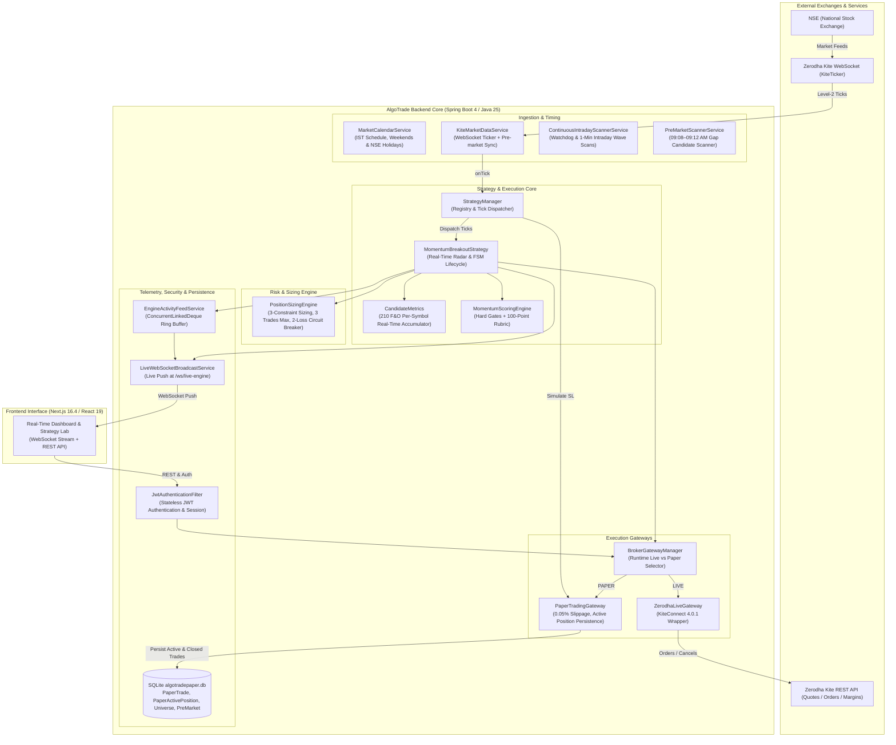
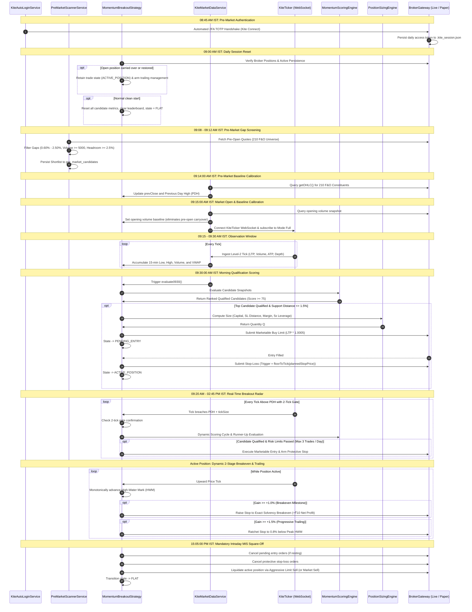
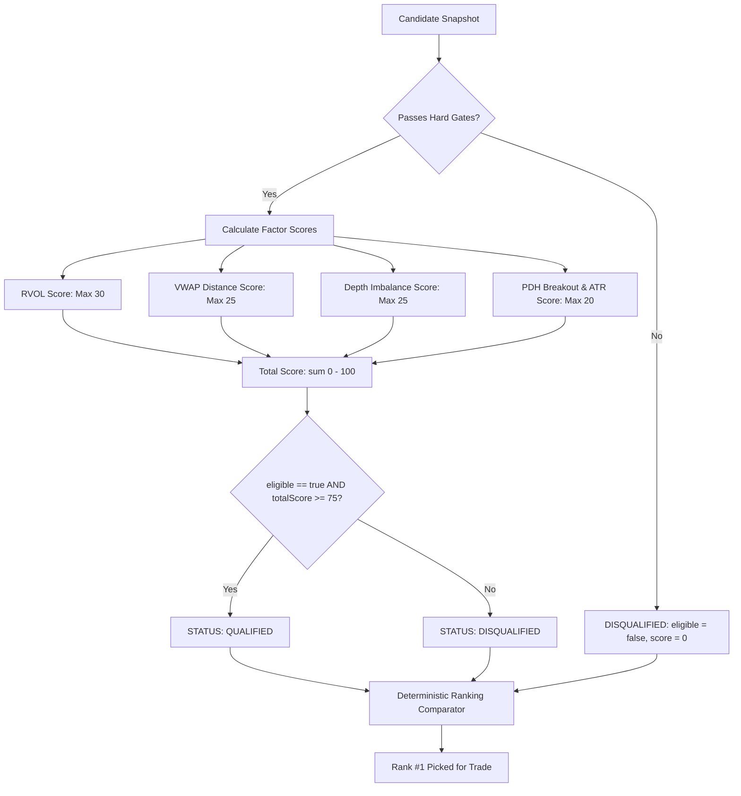
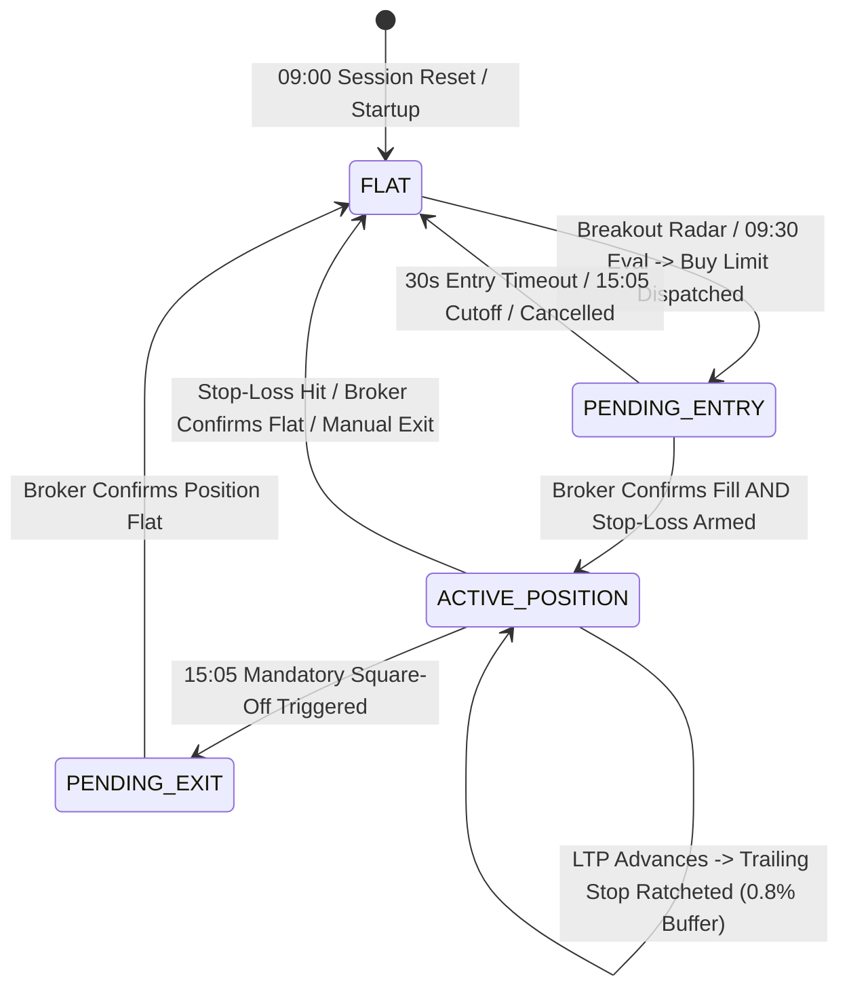

# AlgoTrade Architecture & Engine Specification: `working.md`

> **Document Version:** 3.0.0 (Production Verified & Codebase Aligned)  
> **Target Environment:** Java 25 / Spring Boot 4.1.x / Zerodha KiteConnect 4.0.1 / SQLite 3 / Next.js 16.4 (React 19, Tailwind CSS 4)  
> **Market:** National Stock Exchange of India (NSE) — Cash Equity Intraday (MIS)  
> **Timezone Reference:** Indian Standard Time (IST, UTC+05:30)

---

## Table of Contents
1. [Executive System Architecture & Topology](#1-executive-system-architecture--topology)
2. [End-to-End Market Day Timeline & Scheduled Automation](#2-end-to-end-market-day-timeline--scheduled-automation)
3. [Market Data Ingestion Pipeline & Tick Streaming](#3-market-data-ingestion-pipeline--tick-streaming)
4. [Candidate Metrics & Mathematical Computation Engine](#4-candidate-metrics--mathematical-computation-engine)
5. [Momentum Scoring Matrix & Qualification Pipeline](#5-momentum-scoring-matrix--qualification-pipeline)
6. [Dynamic Position Sizing & Three-Tier Risk Engine](#6-dynamic-position-sizing--three-tier-risk-engine)
7. [Finite State Machine (FSM) & Trade Lifecycle Engine](#7-finite-state-machine-fsm--trade-lifecycle-engine)
8. [Broker Gateways & Order Execution Mechanics](#8-broker-gateways--order-execution-mechanics)
9. [Statutory Taxation, Transaction Fees & Slippage Accounting](#9-statutory-taxation-transaction-fees--slippage-accounting)
10. [Zero-Latency Telemetry & Real-Time WebSocket Streaming](#10-zero-latency-telemetry--real-time-websocket-streaming)
11. [REST API Surface & Data Transfer Schema](#11-rest-api-surface--data-transfer-schema)
12. [Backtesting Engine & Real Historical Data Simulation](#12-backtesting-engine--real-historical-data-simulation)
13. [Security, Authentication & Failure Protection Guardrails](#13-security-authentication--failure-protection-guardrails)

---

## 1. Executive System Architecture & Topology

AlgoTrade is an institutional-grade, low-latency automated trading platform designed specifically for intraday equity momentum strategies on the National Stock Exchange of India (NSE). It bridges real-time market feeds from Zerodha Kite with an automated quantitative evaluation and order execution engine.

### High-Level Architectural Diagram



### Component Inventory & Responsibilities

| Class | Package | Primary Responsibility |
| :--- | :--- | :--- |
| `MarketCalendarService` | `core.service` | Official NSE calendar: enforces 09:15 open, 09:15–09:30 observation window, 15:05 square-off cutoff, 15:30 close, weekend filters, and official NSE holidays. |
| `KiteMarketDataService` | `broker.zerodha` | Manages the `KiteTicker` WebSocket connection, token mapping across the 210 F&O universe, pre-market reference data syncing, and scheduled 09:30 evaluations. |
| `ContinuousIntradayScannerService` | `scanner` | 5-second tick watchdog timer and 1-minute recurring wave scanner across 210 F&O constituents between 09:20 AM and 02:45 PM IST. |
| `PreMarketScannerService` | `scanner` | Scans 210 F&O constituents at 09:12 AM IST for opening gap-ups ($0.60\% - 2.50\%$), pre-open volume ($\ge 5,000$), and circuit headroom ($\ge 2.50\%$). |
| `StrategyManager` | `strategy` | Central strategy registry and tick router. Dispatches ticks to the active strategy and to `PaperTradingGateway` for real-time stop-loss checking. |
| `MomentumBreakoutStrategy` | `strategy.momentum_breakout` | Finite state machine orchestrating 09:00 daily resets, 09:30 scoring, real-time breakout radar (09:20–14:45), dynamic breakeven locks, trailing stops, and 15:05 square-off. |
| `CandidateMetrics` | `strategy.momentum_breakout` | Per-symbol metrics accumulator: tracks 15-minute low/high, window volume, exchange ATP/VWAP, opening baseline, structural support distance, and Level-2 depth. |
| `MomentumScoringEngine` | `strategy.momentum_breakout` | Pure quantitative evaluator: checks hard eligibility gates (LTP $\ge$ VWAP & LTP $\ge$ PDH) and calculates multi-factor composite scores (0–100). |
| `PositionSizingEngine` | `risk` | Institutional sizing: calculates $\min(Q_{\text{risk}}, Q_{\text{margin}}, Q_{\text{exposure}})$, enforces stop distance filters ($0.35\% - 2.0\%$), 3-trade daily limit, and 2-loss circuit breaker. |
| `ZerodhaLiveGateway` | `broker.zerodha` | Live KiteConnect wrapper: places regular MIS limit and SL-M orders, checks broker positions, and executes emergency liquidation. |
| `PaperTradingGateway` | `broker.paper` | Zero-risk execution simulator: applies 0.05% adverse slippage, persists active positions across restarts, checks stops on incoming ticks, calculates statutory taxes, and logs to SQLite. |
| `EngineActivityFeedService` | `core.service` | High-speed, lock-free 200-event ring buffer (< 1 µs write time) emitting structured telemetry for the UI decision terminal. |
| `LiveWebSocketBroadcastService` | `websocket` | Bi-directional WebSocket service at `/ws/live-engine` streaming real-time telemetry, market ticks, position updates, and leaderboard snapshots. |

---

## 2. End-to-End Market Day Timeline & Scheduled Automation

All operations run deterministically against Indian Standard Time (IST, UTC+05:30):



---

## 3. Market Data Ingestion Pipeline & Tick Streaming

Live market data enters through `KiteMarketDataService.java` using Zerodha's official WebSocket library (`KiteTicker`):

1. **210 F&O Constituent Universe:**
   The engine monitors the complete high-liquidity National Stock Exchange (NSE) Futures & Options (F&O) equity segment constituents loaded dynamically from SQLite (`market_universe` table).
2. **Token Resolution:**
   Tokens are mapped dynamically via `kiteConnect.getQuote(keys)` or synced directly into `market_universe` during startup.
3. **Tick Unpacking:**
   Incoming ticks arriving in `modeFull` provide:
   - `lastTradedPrice` (LTP)
   - `volumeTradedToday` (Cumulative session volume)
   - `totalBuyQuantity` and `totalSellQuantity` (Level-2 market depth)
   - `averageTradePrice` (Exchange ATP / official daily VWAP)
4. **Watchdog Timer & REST Fallback:**
   Every 5 seconds, `ContinuousIntradayScannerService.watchdogTickCheck()` inspects the tick stream. If zero ticks have arrived for > 5,000 ms during active market hours, it automatically initiates batched REST quote recovery and triggers a clean WebSocket reconnection.
5. **Fan-Out Dispatch:**
   `StrategyManager.onTick()` dispatches each tick to:
   - `MomentumBreakoutStrategy.onTick()` for real-time candidate metrics accumulation, breakout radar detection, and trailing stop management.
   - `PaperTradingGateway.onTick()` to immediately check whether resting paper stop-loss triggers have been breached.

---

## 4. Candidate Metrics & Mathematical Computation Engine

Inside `CandidateMetrics.java`, incoming ticks update real-time state:

### 1. Observation Window Boundary Enforcement (09:15:00 – 09:30:00 IST)
- During the observation window (`inObservationWindow == true`):
  - `low15` tracks the minimum tick price: $\min(\text{low15}, \text{price})$
  - `high15` tracks the maximum tick price: $\max(\text{high15}, \text{price})$
  - Incremental volume updates internal price-volume sum $\sum (P_i \times V_i)$
  - Official exchange ATP (`averageTradePrice`) updates `exchangeVwap`
- **Post 09:30:00 IST:**
  `low15` and `high15` remain locked to the initial 15-minute range to preserve the structural swing floor. Subsequent ticks update `ltp`, `exchangeVwap`, `totalBuyQty`, and `totalSellQty`.

### 2. Opening Volume Baseline Calibration
To eliminate pre-open uncrossing volume:
$$\text{Window Volume} = \max\left(0, \text{Current Volume} - \text{Opening Baseline Volume}_{09:15:00}\right)$$

### 3. Level-2 Order Book Imbalance Ratio
$$\text{Depth Imbalance} = \frac{\text{Total Buy Qty} - \text{Total Sell Qty}}{\text{Total Buy Qty} + \text{Total Sell Qty}}$$
- $\text{Depth Imbalance} \in [-1.0, +1.0]$
- Positive values indicate net buying pressure in the order book.

### 4. Structural Support Distance Filter
$$\text{Support Distance \%} = \frac{\text{LTP} - \text{Low15}}{\text{LTP}} \times 100$$
- If $\text{Support Distance \%} > 1.50\%$, the candidate is flagged as **Overextended**. The engine skips the candidate and evaluates the runner-up in rank order to prevent buying into an exhaustion trap.

---

## 5. Momentum Scoring Matrix & Qualification Pipeline

Evaluated by `MomentumScoringEngine.java`:



### 1. Mandatory Hard Eligibility Gates
A candidate must satisfy **all** gate conditions (`passesHardGates(s) == true`):
1. `ltp > 0` and `vwap > 0` and `previousDayHigh > 0`
2. **Above VWAP Gate:** `ltp >= vwap` (Buying at or above fair institutional value)
3. **PDH Breakout Gate:** `ltp >= previousDayHigh + tickSize` with 2-tick confirmation (True momentum breakout above yesterday's high)
4. **Volume Gate:** `windowVolume > 0` and `avgDailyVolume10Day > 0`

### 2. Multi-Factor Scoring Rubric (100 Points Total)

| Factor | Metric Definition | Scoring Bands | Max Points |
| :--- | :--- | :--- | :---: |
| **RVOL** | $\text{RVOL} = \frac{\text{Window Volume}}{10\text{-Day Avg Volume} \times 0.10}$ | $\begin{aligned} &\text{RVOL} \ge 3.00 \rightarrow 30\text{ pts} \\ &2.00 \le \text{RVOL} < 3.00 \rightarrow 20\text{ pts} \\ &1.50 \le \text{RVOL} < 2.00 \rightarrow 10\text{ pts} \\ &\text{RVOL} < 1.50 \rightarrow 0\text{ pts} \end{aligned}$ | **30** |
| **VWAP Distance** | $\text{VD\%} = \frac{\text{LTP} - \text{VWAP}}{\text{VWAP}} \times 100$ | $\begin{aligned} &0.30\% \le \text{VD\%} \le 1.80\% \rightarrow 25\text{ pts (Ideal)} \\ &0.00\% < \text{VD\%} < 0.30\% \rightarrow 10\text{ pts (Weak)} \\ &1.80\% < \text{VD\%} \le 2.20\% \rightarrow 10\text{ pts (Stretched)} \\ &\text{VD\%} > 2.20\% \rightarrow 0\text{ pts (Overextended trap)} \end{aligned}$ | **25** |
| **Depth Imbalance** | $\text{DI} = \frac{\text{BuyQty} - \text{SellQty}}{\text{BuyQty} + \text{SellQty}}$ | $\begin{aligned} &\text{DI} \ge +0.35 \rightarrow 25\text{ pts (Buyers } \ge 2\times \text{Sellers)} \\ &+0.15 \le \text{DI} < +0.35 \rightarrow 15\text{ pts} \\ &0.00 \le \text{DI} < +0.15 \rightarrow 5\text{ pts} \\ &\text{DI} < 0.00 \rightarrow 0\text{ pts} \end{aligned}$ | **25** |
| **PDH & ATR** | $\text{LTP} \ge \text{PDH}$ check with ATR | $\begin{aligned} &\text{LTP} \ge \text{PDH} \text{ and } \text{ATR\%} \ge 1.80\% \rightarrow 20\text{ pts} \\ &\text{LTP} \ge \text{PDH} \text{ and } \text{ATR\%} < 1.80\% \rightarrow 10\text{ pts} \\ &\text{LTP} < \text{PDH} \rightarrow 0\text{ pts} \end{aligned}$ | **20** |

### 3. Absolute Qualification Rule
```java
public boolean isQualified() {
    return eligible && totalScore >= 75;
}
```

### 4. Runner-Up Evaluation Mechanism
When the top-ranked candidate is disqualified due to excessive support distance ($> 1.5\%$), the engine does not abort the cycle. Instead, it iterates down the leaderboard in rank order (Rank 2, Rank 3...), executing the first qualified runner-up whose support distance is safely within limits.

---

## 6. Dynamic Position Sizing & Three-Tier Risk Engine

Governed by `PositionSizingEngine.java`:

### 1. Three-Constraint Formula
$$Q_{\text{final}} = \min\left(Q_{\text{risk}},\, Q_{\text{margin}},\, Q_{\text{exposure}}\right)$$

Where:
- **Risk-Based Sizing ($Q_{\text{risk}}$):** Caps potential loss at exactly $2.0\%$ of capital:
  $$Q_{\text{risk}} = \left\lfloor \frac{\text{Capital} \times 0.020}{\text{Entry Price} - \text{Initial Stop Price}} \right\rfloor$$
- **Available Margin Sizing ($Q_{\text{margin}}$):** Based on broker's intraday requirement (20% margin / $5\times$ leverage):
  $$Q_{\text{margin}} = \left\lfloor \frac{\text{Available Cash}}{\text{Margin Per Share}} \right\rfloor$$
- **Exposure Cap ($Q_{\text{exposure}}$):** Caps maximum total notional value at $5.0\times$ capital (full SEBI MIS leverage):
  $$Q_{\text{exposure}} = \left\lfloor \frac{\text{Capital} \times 5.0}{\text{Entry Price}} \right\rfloor$$

### 2. Volatility Guards (Stop Distance Bounds)
$$\text{Stop Distance \%} = \frac{\text{Entry Price} - \text{Initial Stop Price}}{\text{Entry Price}} \times 100$$
- **Minimum Stop Distance:** $0.35\%$. Trades below $0.35\%$ are rejected as vulnerable to market noise.
- **Maximum Stop Distance:** $2.00\%$. Trades above $2.00\%$ are rejected as over-extended.

### 3. Session Limits & Dual Circuit Breaker
- **Daily Trade Limit:** Maximum **3 trades per day** (`max-daily-trades: 3`).
- **Daily Loss Circuit Breaker:** Trading is halted immediately if **2 losses** occur today (`max-daily-losses: 2`) OR if **cumulative daily net drawdown exceeds ₹400** (`max-daily-loss-rupees: 400.00`).
- **Realized P&L Accounting:** Losses are tracked strictly against realized post-tax Net PnL calculated via `ChargesBreakdown.calculate()`. Trailed stops executing in net profit do not count as losses.
- **Mode Isolation:** Paper trading executions and losses are tracked in SQLite `paper_trades`; Live trading executions and losses are tracked via live broker counters. Paper tests never lock real-money Live trading.
- **High-Frequency In-Memory Caching (2s TTL):** `canTradeToday()` results are cached in memory for 2 seconds to eliminate database queries on KiteTicker's high-frequency tick thread.
- **Debounced Logging:** Warning messages are logged strictly upon state transitions (and at most once every 5 minutes if persistent), completely silencing log flooding.
- **Manual Reset Endpoint:** Administrative endpoint `POST /api/dashboard/risk/reset` clears daily limits on demand for continuous testing.

---

## 7. Finite State Machine (FSM) & Trade Lifecycle Engine

Implemented in `MomentumBreakoutStrategy.java` via `TradeLifecycleState`:



### State Behavior Details
- `FLAT`: No active position held. Real-time Breakout Radar evaluates candidate ticks.
- `PENDING_ENTRY`: Marketable limit buy order resting (`LTP * 1.0005`). Has a **30-second TTL**. If unfilled after 30 seconds, the order is cancelled and state returns to `FLAT`. Once filled, the engine arms the protective stop-loss (`trigger = floorToTick(plannedStopPrice)`, `limit = floorToTick(trigger * 0.9985)`). **State remains `PENDING_ENTRY` until the stop order is acknowledged by the broker.**
- `ACTIVE_POSITION`: Fully hedged active position.
  - **Partial Fill Protection:** Automatically resizes resting stop-loss if filled position quantity expands.
  - **Stage 1 (Breakeven Lock):** Triggered when price gains $\ge +1.0\%$. Stop is raised to the exact breakeven price covering all statutory taxes, STT, exchange fees, and brokerage, plus a guaranteed $+₹10.00$ net profit buffer.
  - **Stage 2 (Progressive Trailing Stop):** Triggered when gain reaches $\ge +1.5\%$. Trailing stop ratchets upward maintaining a **0.8% buffer** below peak High-Water Mark:
    $$\text{Trail Target} = \lfloor \text{High-Water Mark} \times (1.0 - 0.008) \rfloor_{\text{tick}}$$
    Stop modifies only when the new target exceeds both current armed stop and planned stop, with a strict Price Inversion Guard ($\text{Target} < \text{LTP}$).
- `PENDING_EXIT`: Square-off limit order dispatched. If unfilled during 15:05 square-off, falls back to market liquidation.

---

## 8. Broker Gateways & Order Execution Mechanics

Orders route through `BrokerGatewayManager.java`:

### 1. `ZerodhaLiveGateway.java` (Real Production Route)
- Uses Zerodha `KiteConnect 4.0.1`.
- Configured for NSE Cash Intraday MIS (`Constants.PRODUCT_MIS`).
- Entry order type: `LIMIT` at marketable price ($\lceil \text{LTP} \times 1.0005 \rceil_{\text{tick}}$).
- Stop-loss order type: `SL` with limit protection buffer ($0.15\%$) to prevent execution spikes.
- Live position synchronization with 2.5s TTL cache.

### 2. `PaperTradingGateway.java` (Simulation Route)
- Applies **0.05% adverse slippage** on market and stop fills.
- **Active Position Persistence:** Open paper positions are persisted to SQLite table `paper_active_positions`. On server restarts, the active trade, trailing stop, and peak high-water mark are re-hydrated seamlessly.
- Evaluates stop triggers on every incoming tick via `onTick(symbol, ltp)`.
- Calculates Indian statutory charges upon trade close and logs completed trades to `algotradepaper.db` (`paper_trades` table).

### 3. `KiteAutoLoginService.java` (Headless 2FA Login)
Automates daily morning 08:45 AM authentication:
1. `POST https://kite.zerodha.com/api/login` with User ID & Password $\rightarrow$ obtains `request_id`.
2. Computes 6-digit TOTP code via RFC 6238 HMAC-SHA1 using Base32 secret.
3. `POST https://kite.zerodha.com/api/twofa` with `request_id` & TOTP $\rightarrow$ sets session cookies.
4. Follows OAuth redirect chain to capture `request_token`.
5. Exchanges `request_token` with `KiteConnect.generateSession()` $\rightarrow$ obtains daily `access_token`.

---

## 9. Statutory Taxation, Transaction Fees & Slippage Accounting

Accurately modeled in `ChargesBreakdown.java`:

| Charge | Applied Rate / Formula |
| :--- | :--- |
| **Brokerage** | $\min(₹20.00,\, 0.03\% \times \text{Turnover})$ per executed leg (Buy and Sell). |
| **STT (Securities Transaction Tax)** | **0.025%** applied strictly to the **Sell Turnover** for intraday equity. |
| **Exchange Transaction Fee** | **0.00307%** on total combined turnover (Buy + Sell). |
| **SEBI Turnover Charges** | ₹10 per crore (**0.0001%**) on total combined turnover. |
| **Stamp Duty** | **0.003%** applied strictly to the **Buy Turnover**. |
| **GST (Goods & Services Tax)** | **18.0%** on `(Brokerage + Exchange Charges + SEBI Charges)`. |

$$\text{Net P\&L} = (\text{Sell Turnover} - \text{Buy Turnover}) - \text{Total Charges}$$

### Exact Breakeven Price Solver
`ChargesBreakdown.calculateExactBreakevenPrice(quantity, buyPrice, tickSize)` algebraically computes the exact exit price required to settle all statutory charges and achieve a positive net gain ($\ge +₹10.00$), eliminating breakeven estimation errors.

---

## 10. Zero-Latency Telemetry & Real-Time WebSocket Streaming

Managed by `EngineActivityFeedService.java` and `LiveWebSocketBroadcastService.java`:
- **In-Memory Ring Buffer:** `ConcurrentLinkedDeque<EngineActivityEvent>` bounded to **200 events** (< 1 µs write time).
- **Bi-Directional WebSocket (`/ws/live-engine`):**
  - **Outbound Broadcasts:** Emits real-time state snapshots, market ticks, position updates, and leaderboard rankings directly to connected clients without HTTP polling.
  - **Inbound Commands:** Supports `SUBSCRIBE_SYMBOL` for live Level-2 depth and `PING`/`PONG` heartbeat monitoring.
  - **Exponential Reconnect:** Frontend client implements exponential backoff reconnection (1s, 1.5s, 2.25s, max 10s).

---

## 11. REST API Surface & Data Transfer Schema

Controller: `TradingDashboardController.java` (`/api/dashboard`):

| Method | Endpoint | Description |
| :--- | :--- | :--- |
| `GET` | `/api/dashboard/overview` | Active trade, unrealized PnL, capital, market open status. |
| `GET` | `/api/dashboard/leaderboard` | Top 10 scored candidates from latest evaluation cycle. |
| `GET` | `/api/dashboard/analytics` | Financial breakdown: Gross vs Net PnL, statutory taxes paid, win rate. |
| `GET` | `/api/dashboard/activity-feed` | Telemetry event stream (`?sinceId=...&limit=50`). |
| `POST`| `/api/dashboard/mode` | Hot-swap between `PAPER` and `LIVE` trading venues. |
| `POST`| `/api/dashboard/manual-exit` | Immediate market exit of active position (Sell button). |
| `POST`| `/api/dashboard/emergency-exit`| Emergency kill-switch: squares off all open positions immediately. |
| `POST`| `/api/dashboard/risk/reset` | Resets daily trade limits and loss circuit breaker counters. |
| `POST`| `/api/dashboard/strategy/manual-entry` | Places discretionary limit entry with automated stop attachment. |
| `POST`| `/api/dashboard/scan/trigger` | Triggers on-demand evaluation cycle. |
| `POST`| `/api/dashboard/zerodha/auto-login` | Triggers headless 2FA login via JSON request body. |
| `GET` | `/api/dashboard/zerodha/status`| Live Kite connection status and available margin. |
| `GET` | `/api/dashboard/stock-quote` | Level-2 market depth and live quotes for any NSE stock. |
| `GET` | `/api/dashboard/stock-chart` | Intraday time-series price trajectory. |
| `GET` | `/api/dashboard/popular-stocks` | High-liquidity constituent quick-select chips. |
| `GET` | `/api/scanner/latest` | Pre-market gap scanner results and shortlist. |
| `POST`| `/api/scanner/trigger` | Manually runs pre-market scanner. |
| `POST`| `/api/scanner/universe/sync` | Synchronizes 210 F&O constituents from NSE. |
| `POST`| `/api/auth/login` | Authenticates dashboard user and issues JWT. |
| `POST`| `/api/auth/refresh` | Refreshes active JWT session. |
| `POST`| `/api/auth/logout` | Revokes JWT session. |

---

## 12. Backtesting Engine & Real Historical Data Simulation

Implemented in `BacktestEngineService.java` & `HistoricalMarketDataService.java`:
- **Real Market Data Ingestion & Caching:**
  - Ingests real historical daily and intraday candles for the NIFTY universe directly from official feeds.
  - Persists downloaded historical candles to local disk cache (`.cache/historical_market_data/{symbol}_daily.json`) for instant sub-50ms repeat backtests without hitting external rate limits.
  - Automatically calculates true 20-day Average Daily Volume (ADV), 14-day ATR%, and Previous Day High (PDH) from real historical sessions.
- **100% Strategy & Risk Parity:**
  - Evaluates candidate metrics using the production `MomentumScoringEngine` (100-point model with hard qualification gates).
  - Reuses `PositionSizingEngine.calculateSizingQuantity` to enforce user-configured leverage ($1.0\times$ cash up to $5.0\times$ SEBI MIS) and $0.35\% - 2.00\%$ stop distance boundaries.
  - Risk Budget is calculated directly on total leveraged position capacity ($\text{Capital} \times \text{Leverage} \times \text{Risk\%}$).
- **Zero Lookahead Next-Bar Open Execution:**
  - Evaluates candidate breakout confirmation on completed candle $t$ close (`09:25` candle) and queues `PendingSignal`.
  - Fills entry order at the **Open of candle $t+1$** (`09:30` candle) with slippage and over-extension checks, completely eliminating bar-peeking bias.
- **Strict Zero Synthetic Depth Wicks:**
  - Disables artificial bid/ask synthesis from candle bodies. Normalizes the 75 non-depth points (RVOL, VWAP distance, PDH breakout, ATR expansion) to 100 points in `isBacktestMode`.
- **Directional Microstructure Path Modeling:**
  - Bullish candles ($C \ge O$): models path $O \to L \to H \to C$. Tests low against stop first; only updates HWM and ratchets trailing stop if low survives; checks intra-candle retracement at close.
  - Bearish candles ($C < O$): models path $O \to H \to L \to C$. Ratchets trailing stop to high first, then tests low against ratcheted stop.
- **Dynamic Date-Range Ingestion & Chunking:**
  - Accepts user-specified `startDate` and `endDate`. Queries Zerodha Kite Historical Data API in 60-day chunks and validates Yahoo Finance 60-day boundaries.
- **Institutional Financial Analytics:**
  - Net Profit Factor computed strictly on post-tax Net PnL via `ChargesBreakdown`.
  - Annualized Sharpe Ratio ($\sqrt{252}$) adjusted with the 6.5% Indian benchmark repo rate.
  - Max Drawdown (Rupees & %) and consecutive loss counters.

---

## 13. Security, Authentication & Failure Protection Guardrails

1. **Stateless JWT Security Architecture:**
   Dashboard authentication is secured via HMAC-SHA256 JWT tokens. REST routes and WebSockets require authenticated Bearer tokens or verified HTTP-only cookies.
2. **Environment-Driven CORS:**
   Origins are loaded dynamically from environment variables (`ALGOTRADE_CORS_ALLOWED_ORIGINS` / `FRONTEND_URL`), eliminating wildcards (`*`) when credentials are enabled.
3. **Active Position Restart Resiliency:**
   Open paper positions are persisted in `paper_active_positions`. On backend restarts, the active trade and stop orders are re-hydrated into memory, preventing lost positions.
4. **Circuit Breaker Cache & DB Protection:**
   High-frequency tick threads check in-memory cached circuit breaker state (2s TTL), preventing database connection exhaustion on KiteTicker's `ReadingThread`.
5. **Anti-Naked Exposure Guard:**
   `MomentumBreakoutStrategy` remains in `PENDING_ENTRY` until the broker acknowledges placement of the protective stop-loss order.
6. **NSE Trading Holiday Guard:**
   `MarketCalendarService` cross-references official NSE holiday schedules, blocking automated order placement on market holidays.
7. **Dynamic NSE Tick Size Compliance:**
   Adheres to NSE circular `CMTR62174`: dynamically applies ₹0.01 tick size for stocks $\le$ ₹250 and ₹0.05 for stocks > ₹250 via `TickMath.getExchangeTickSize()`.
8. **Atomic In-Place Stop Modification:**
   Updates active stop orders via broker native `modifyOrder` with new trigger and limit prices, eliminating cancel-before-replace execution exposure gaps during trailing stop adjustments.
9. **Accurate Manual Exit Synchronization:**
   Manual sell actions transition the FSM to `PENDING_EXIT` and verify true zero position from broker feeds before reporting `FLAT` state.
10. **Zero Plaintext Fallback & Ephemeral Dev Passwords:**
    Master password requires `ALGOTRADE_AUTH_PASSWORD` in production; generates ephemeral 16-character dev passwords when running locally without hardcoded plaintext strings in code.
11. **Granular Auth Route Protection & /me Hardening:**
    `/api/auth/me` and `/api/auth/logout` require verified JWT authentication via Spring Security, returning 401 Unauthorized for unauthenticated callers.
12. **HttpOnly & Strict Cookie Isolation:**
    Refresh tokens are never returned in JSON response bodies, and cookies use dynamic `Secure` (under HTTPS), `HttpOnly`, and `SameSite=Strict`.
13. **In-Band WebSocket Authentication (RFC 6750):**
    Frontend connects cleanly to `/ws/live` without exposing sensitive JWTs in URL query strings, authenticating via a first-frame `AUTH` message within a 3-second grace window.
14. **Dynamic Margin Multicache & Conservative Fallback:**
    Caches verified per-symbol Kite margin percentages, defaulting to a conservative 40% margin (2.5x leverage max) rather than blind 20% (5x) on API timeouts to avoid RMS rejections.
