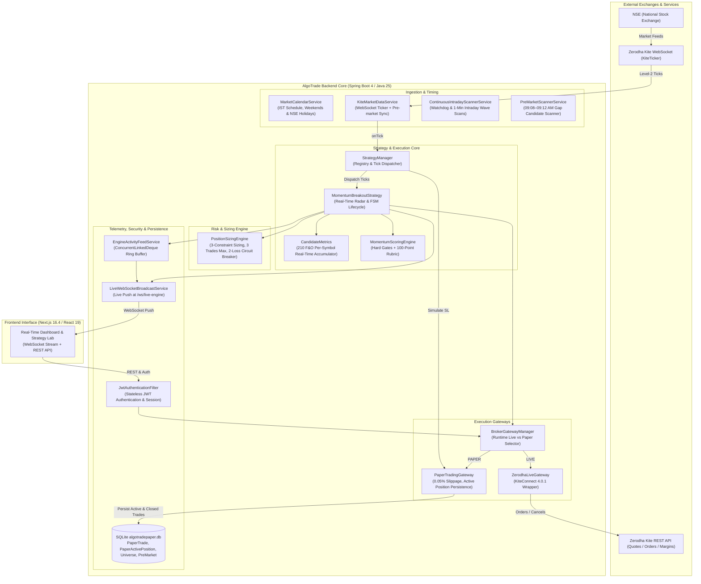
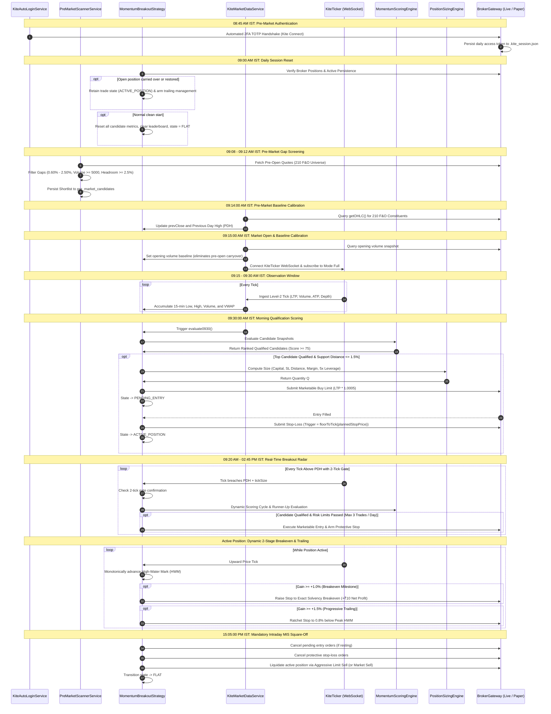
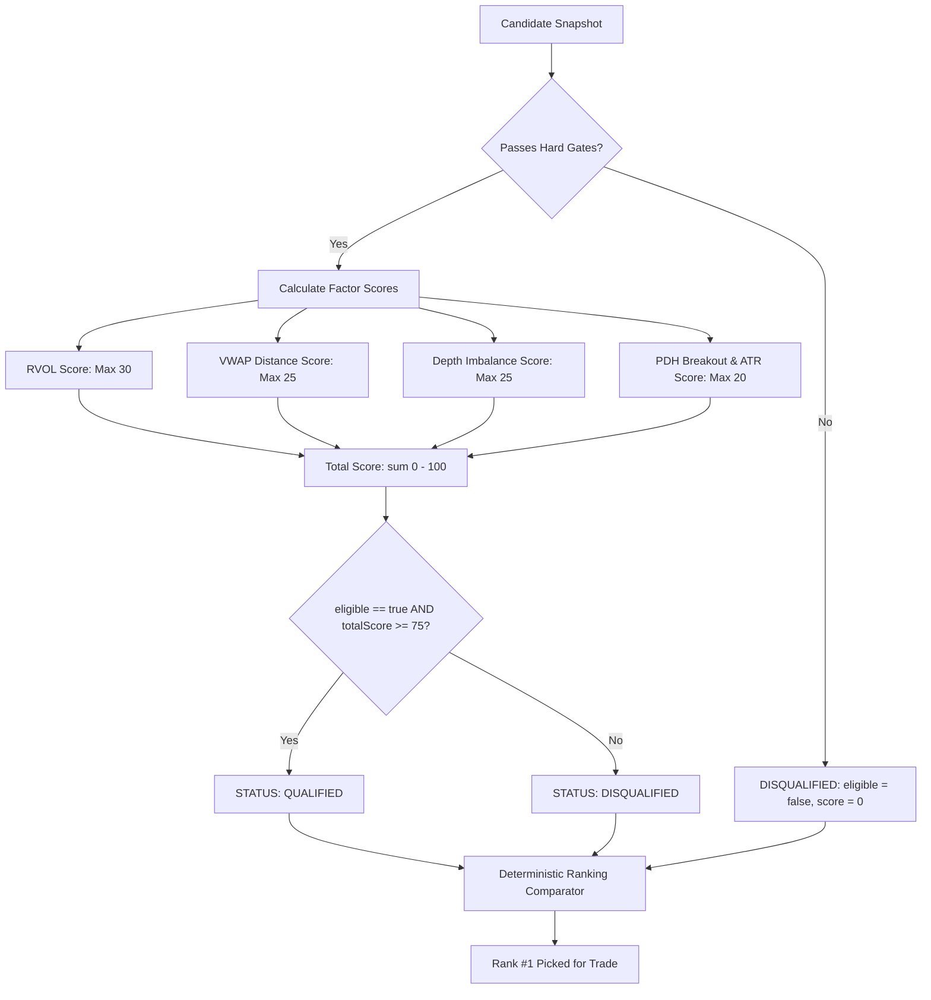
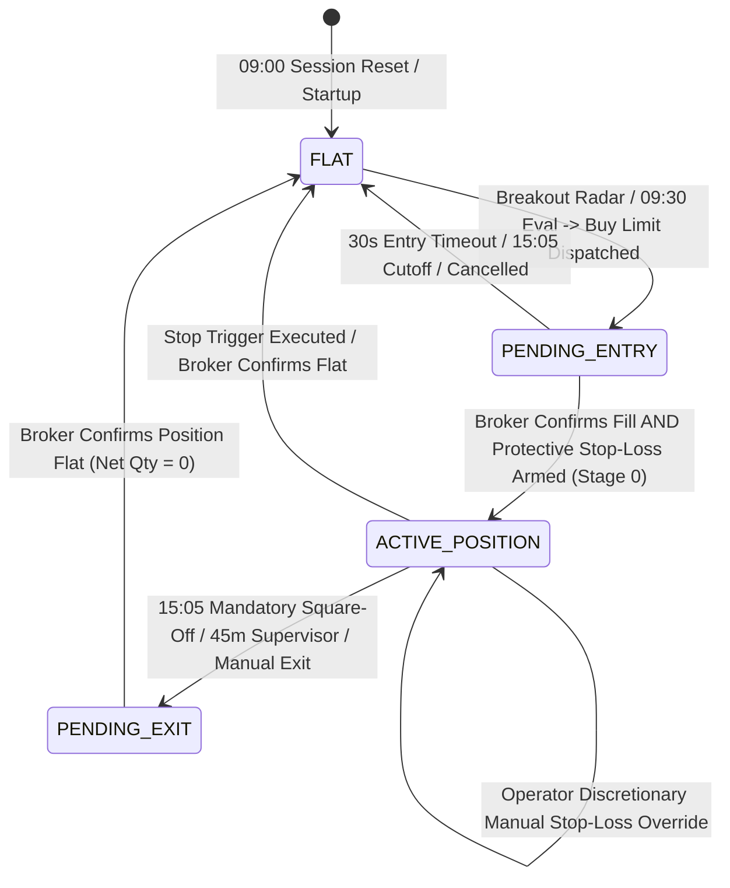
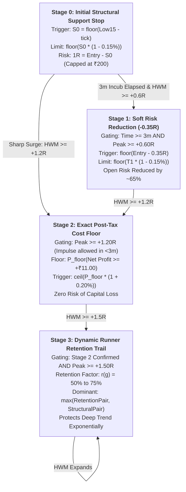
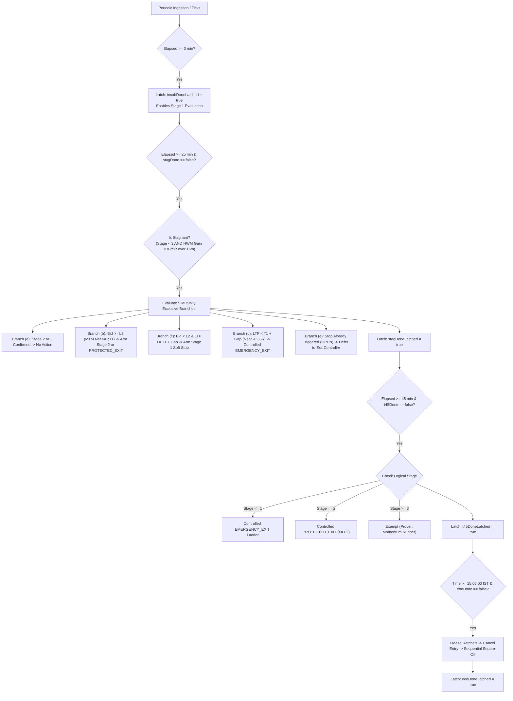

# AlgoTrade Architecture & Engine Specification: `working.md`

> **Document Version:** 3.0.0 (Production Verified & Codebase Aligned)  
> **Target Environment:** Java 25 / Spring Boot 4.1.x / Zerodha KiteConnect 4.0.1 / SQLite 3 / Next.js 16.4 (React 19, Tailwind CSS 4)  
> **Market:** National Stock Exchange of India (NSE) — Cash Equity Intraday (MIS)  
> **Timezone Reference:** Indian Standard Time (IST, UTC+05:30)

---

## Table of Contents
1. [Executive System Architecture & Topology](#1-executive-system-architecture--topology)
2. [End-to-End Market Day Timeline & Scheduled Automation](#2-end-to-end-market-day-timeline--scheduled-automation)
3. [Market Data Ingestion Pipeline & Tick Streaming](#3-market-data-ingestion-pipeline--tick-streaming)
4. [Candidate Metrics & Mathematical Computation Engine](#4-candidate-metrics--mathematical-computation-engine)
5. [Momentum Scoring Matrix & Qualification Pipeline](#5-momentum-scoring-matrix--qualification-pipeline)
6. [Dynamic Position Sizing & Three-Tier Risk Engine](#6-dynamic-position-sizing--three-tier-risk-engine)
7. [Finite State Machine (FSM) & Trade Lifecycle Engine](#7-finite-state-machine-fsm--trade-lifecycle-engine)
8. [Multi-Stage Intraday Stop Ladder & Dynamic Risk Management Engine](#8-multi-stage-intraday-stop-ladder--dynamic-risk-management-engine)
9. [Broker Gateways & Order Execution Mechanics](#9-broker-gateways--order-execution-mechanics)
10. [Statutory Taxation, Transaction Fees & Slippage Accounting](#10-statutory-taxation-transaction-fees--slippage-accounting)
11. [Zero-Latency Telemetry & Real-Time WebSocket Streaming](#11-zero-latency-telemetry--real-time-websocket-streaming)
12. [REST API Surface & Data Transfer Schema](#12-rest-api-surface--data-transfer-schema)
13. [Backtesting Engine & Real Historical Data Simulation](#13-backtesting-engine--real-historical-data-simulation)
14. [Security, Authentication & Failure Protection Guardrails](#14-security-authentication--failure-protection-guardrails)

---


## 1. Executive System Architecture & Topology

AlgoTrade is an institutional-grade, low-latency automated trading platform designed specifically for intraday equity momentum strategies on the National Stock Exchange of India (NSE). It bridges real-time market feeds from Zerodha Kite with an automated quantitative evaluation and order execution engine.

### High-Level Architectural Diagram



### Component Inventory & Responsibilities

| Class | Package | Primary Responsibility |
| :--- | :--- | :--- |
| `MarketCalendarService` | `core.service` | Official NSE calendar: enforces 09:15 open, 09:15–09:30 observation window, 15:05 square-off cutoff, 15:30 close, weekend filters, and official NSE holidays. |
| `KiteMarketDataService` | `broker.zerodha` | Manages the `KiteTicker` WebSocket connection, token mapping across the 210 F&O universe, pre-market reference data syncing, and scheduled 09:30 evaluations. |
| `ContinuousIntradayScannerService` | `scanner` | 5-second tick watchdog timer and 1-minute recurring wave scanner across 210 F&O constituents between 09:20 AM and 02:45 PM IST. |
| `PreMarketScannerService` | `scanner` | Scans 210 F&O constituents at 09:12 AM IST for opening gap-ups ($0.60\% - 2.50\%$), pre-open volume ($\ge 5,000$), and circuit headroom ($\ge 2.50\%$). |
| `StrategyManager` | `strategy` | Central strategy registry and tick router. Dispatches ticks to the active strategy and to `PaperTradingGateway` for real-time stop-loss checking. |
| `MomentumBreakoutStrategy` | `strategy.momentum_breakout` | Finite state machine orchestrating 09:00 daily resets, 09:30 scoring, real-time breakout radar (09:20–14:45), dynamic breakeven locks, trailing stops, and 15:05 square-off. |
| `CandidateMetrics` | `strategy.momentum_breakout` | Per-symbol metrics accumulator: tracks 15-minute low/high, window volume, exchange ATP/VWAP, opening baseline, structural support distance, and Level-2 depth. |
| `MomentumScoringEngine` | `strategy.momentum_breakout` | Pure quantitative evaluator: checks hard eligibility gates (LTP $\ge$ VWAP & LTP $\ge$ PDH) and calculates multi-factor composite scores (0–100). |
| `PositionSizingEngine` | `risk` | Institutional sizing: calculates $\min(Q_{\text{risk}}, Q_{\text{margin}}, Q_{\text{exposure}})$, enforces stop distance filters ($0.35\% - 2.0\%$), 3-trade daily limit, and 2-loss circuit breaker. |
| `ZerodhaLiveGateway` | `broker.zerodha` | Live KiteConnect wrapper: places regular MIS limit and SL-M orders, checks broker positions, and executes emergency liquidation. |
| `PaperTradingGateway` | `broker.paper` | Zero-risk execution simulator: applies 0.05% adverse slippage, persists active positions across restarts, checks stops on incoming ticks, calculates statutory taxes, and logs to SQLite. |
| `EngineActivityFeedService` | `core.service` | High-speed, lock-free 200-event ring buffer (< 1 µs write time) emitting structured telemetry for the UI decision terminal. |
| `LiveWebSocketBroadcastService` | `websocket` | Bi-directional WebSocket service at `/ws/live-engine` streaming real-time telemetry, market ticks, position updates, and leaderboard snapshots. |

---

## 2. End-to-End Market Day Timeline & Scheduled Automation

All operations run deterministically against Indian Standard Time (IST, UTC+05:30):



---

## 3. Market Data Ingestion Pipeline & Tick Streaming

Live market data enters through `KiteMarketDataService.java` using Zerodha's official WebSocket library (`KiteTicker`):

1. **210 F&O Constituent Universe:**
   The engine monitors the complete high-liquidity National Stock Exchange (NSE) Futures & Options (F&O) equity segment constituents loaded dynamically from SQLite (`market_universe` table).
2. **Token Resolution:**
   Tokens are mapped dynamically via `kiteConnect.getQuote(keys)` or synced directly into `market_universe` during startup.
3. **Tick Unpacking:**
   Incoming ticks arriving in `modeFull` provide:
   - `lastTradedPrice` (LTP)
   - `volumeTradedToday` (Cumulative session volume)
   - `totalBuyQuantity` and `totalSellQuantity` (Level-2 market depth)
   - `averageTradePrice` (Exchange ATP / official daily VWAP)
4. **Watchdog Timer & REST Fallback:**
   Every 5 seconds, `ContinuousIntradayScannerService.watchdogTickCheck()` inspects the tick stream. If zero ticks have arrived for > 5,000 ms during active market hours, it automatically initiates batched REST quote recovery and triggers a clean WebSocket reconnection.
5. **Fan-Out Dispatch:**
   `StrategyManager.onTick()` dispatches each tick to:
   - `MomentumBreakoutStrategy.onTick()` for real-time candidate metrics accumulation, breakout radar detection, and trailing stop management.
   - `PaperTradingGateway.onTick()` to immediately check whether resting paper stop-loss triggers have been breached.

---

## 4. Candidate Metrics & Mathematical Computation Engine

Inside `CandidateMetrics.java`, incoming ticks update real-time state:

### 1. Observation Window Boundary Enforcement (09:15:00 – 09:30:00 IST)
- During the observation window (`inObservationWindow == true`):
  - `low15` tracks the minimum tick price: $\min(\text{low15}, \text{price})$
  - `high15` tracks the maximum tick price: $\max(\text{high15}, \text{price})$
  - Incremental volume updates internal price-volume sum $\sum (P_i \times V_i)$
  - Official exchange ATP (`averageTradePrice`) updates `exchangeVwap`
- **Post 09:30:00 IST:**
  `low15` and `high15` remain locked to the initial 15-minute range to preserve the structural swing floor. Subsequent ticks update `ltp`, `exchangeVwap`, `totalBuyQty`, and `totalSellQty`.

### 2. Opening Volume Baseline Calibration
To eliminate pre-open uncrossing volume:
$$\text{Window Volume} = \max\left(0, \text{Current Volume} - \text{Opening Baseline Volume}_{09:15:00}\right)$$

### 3. Level-2 Order Book Imbalance Ratio
$$\text{Depth Imbalance} = \frac{\text{Total Buy Qty} - \text{Total Sell Qty}}{\text{Total Buy Qty} + \text{Total Sell Qty}}$$
- $\text{Depth Imbalance} \in [-1.0, +1.0]$
- Positive values indicate net buying pressure in the order book.

### 4. Structural Support Distance Filter
$$\text{Support Distance \%} = \frac{\text{LTP} - \text{Low15}}{\text{LTP}} \times 100$$
- If $\text{Support Distance \%} > 1.50\%$, the candidate is flagged as **Overextended**. The engine skips the candidate and evaluates the runner-up in rank order to prevent buying into an exhaustion trap.

---

## 5. Momentum Scoring Matrix & Qualification Pipeline

Evaluated by `MomentumScoringEngine.java`:



### 1. Mandatory Hard Eligibility Gates
A candidate must satisfy **all** gate conditions (`passesHardGates(s) == true`):
1. `ltp > 0` and `vwap > 0` and `previousDayHigh > 0`
2. **Above VWAP Gate:** `ltp >= vwap` (Buying at or above fair institutional value)
3. **PDH Breakout Gate:** `ltp >= previousDayHigh + tickSize` with 2-tick confirmation (True momentum breakout above yesterday's high)
4. **Volume Gate:** `windowVolume > 0` and `avgDailyVolume10Day > 0`

### 2. Multi-Factor Scoring Rubric (100 Points Total)

| Factor | Metric Definition | Scoring Bands | Max Points |
| :--- | :--- | :--- | :---: |
| **RVOL** | $\text{RVOL} = \frac{\text{Window Volume}}{10\text{-Day Avg Volume} \times 0.10}$ | $\begin{aligned} &\text{RVOL} \ge 3.00 \rightarrow 30\text{ pts} \\ &2.00 \le \text{RVOL} < 3.00 \rightarrow 20\text{ pts} \\ &1.50 \le \text{RVOL} < 2.00 \rightarrow 10\text{ pts} \\ &\text{RVOL} < 1.50 \rightarrow 0\text{ pts} \end{aligned}$ | **30** |
| **VWAP Distance** | $\text{VD\%} = \frac{\text{LTP} - \text{VWAP}}{\text{VWAP}} \times 100$ | $\begin{aligned} &0.30\% \le \text{VD\%} \le 1.80\% \rightarrow 25\text{ pts (Ideal)} \\ &0.00\% < \text{VD\%} < 0.30\% \rightarrow 10\text{ pts (Weak)} \\ &1.80\% < \text{VD\%} \le 2.20\% \rightarrow 10\text{ pts (Stretched)} \\ &\text{VD\%} > 2.20\% \rightarrow 0\text{ pts (Overextended trap)} \end{aligned}$ | **25** |
| **Depth Imbalance** | $\text{DI} = \frac{\text{BuyQty} - \text{SellQty}}{\text{BuyQty} + \text{SellQty}}$ | $\begin{aligned} &\text{DI} \ge +0.35 \rightarrow 25\text{ pts (Buyers } \ge 2\times \text{Sellers)} \\ &+0.15 \le \text{DI} < +0.35 \rightarrow 15\text{ pts} \\ &0.00 \le \text{DI} < +0.15 \rightarrow 5\text{ pts} \\ &\text{DI} < 0.00 \rightarrow 0\text{ pts} \end{aligned}$ | **25** |
| **PDH & ATR** | $\text{LTP} \ge \text{PDH}$ check with ATR | $\begin{aligned} &\text{LTP} \ge \text{PDH} \text{ and } \text{ATR\%} \ge 1.80\% \rightarrow 20\text{ pts} \\ &\text{LTP} \ge \text{PDH} \text{ and } \text{ATR\%} < 1.80\% \rightarrow 10\text{ pts} \\ &\text{LTP} < \text{PDH} \rightarrow 0\text{ pts} \end{aligned}$ | **20** |

### 3. Absolute Qualification Rule
```java
public boolean isQualified() {
    return eligible && totalScore >= 75;
}
```

### 4. Runner-Up Evaluation Mechanism
When the top-ranked candidate is disqualified due to excessive support distance ($> 1.5\%$), the engine does not abort the cycle. Instead, it iterates down the leaderboard in rank order (Rank 2, Rank 3...), executing the first qualified runner-up whose support distance is safely within limits.

---

## 6. Dynamic Position Sizing & Three-Tier Risk Engine

Governed by `PositionSizingEngine.java`:

### 1. Institutional All-Inclusive Sizing Formula
$$Q_{\text{final}} = \min\left(Q_{\text{all\_inclusive}},\, Q_{\text{margin}},\, Q_{\text{exposure}}\right)$$

Where:
- **All-Inclusive Risk Capacity ($Q_{\text{all\_inclusive}}$):**
  Iterative fail-closed calculation in `PositionSizingEngine.calculateAllInclusiveSizingQuantity()` that factors in:
  1. Technical price distance: $\text{Entry Price} - \text{Stop Price}$
  2. Adverse exit slippage buffer: $0.15\%$ below trigger price
  3. Indian equity statutory transaction costs: STT (0.025% sell), Brokerage (₹20/leg cap), Exchange Turnover (0.00307%), SEBI (₹10/crore), Stamp Duty (0.003% buy), and GST (18%)
  $$\text{Total Realized Loss}(Q) \le \text{Capital} \times 0.020 \quad (\le ₹200.00 \text{ on } ₹10,000 \text{ capital})$$
- **Available Margin Sizing ($Q_{\text{margin}}$):**
  Dynamically checks gateway margin requirement via `gateway.calculateOrderMargin(symbol, 1, entryPrice)`. For Zerodha, utilizes live scrip-specific margin requirements (20% to 50%):
  $$Q_{\text{margin}} = \left\lfloor \frac{\text{Available Cash}}{\text{Margin Per Share}} \right\rfloor$$
- **Exposure Cap ($Q_{\text{exposure}}$):** Caps maximum total notional value at $5.0\times$ capital (full SEBI MIS leverage):
  $$Q_{\text{exposure}} = \left\lfloor \frac{\text{Capital} \times 5.0}{\text{Entry Price}} \right\rfloor$$

### 2. Volatility Guards (Stop Distance Bounds)
$$\text{Stop Distance \%} = \frac{\text{Entry Price} - \text{Initial Stop Price}}{\text{Entry Price}} \times 100$$
- **Minimum Stop Distance:** $0.35\%$. Trades below $0.35\%$ are rejected as vulnerable to market noise.
- **Maximum Stop Distance:** $2.00\%$. Trades above $2.00\%$ are rejected as over-extended.

### 3. Session Limits & Dual Circuit Breaker Persistence
- **Daily Trade Limit:** Maximum **3 trades per day** (`max-daily-trades: 3`).
- **Daily Loss Circuit Breaker:** Trading is halted immediately if **2 losses** occur today (`max-daily-losses: 2`) OR if **cumulative daily net drawdown exceeds ₹400** (`max-daily-loss-rupees: 400.00`).
- **Realized P&L Accounting:** Losses are tracked strictly against realized post-tax Net PnL calculated via `ChargesBreakdown.calculate()`. Trailed stops executing in net profit do not count as losses.
- **Dual SQLite Persistence:**
  - **Paper Mode:** Tracked in SQLite table `paper_trades` via `PaperTradeRepository`.
  - **Live Mode:** Tracked in SQLite table `live_trades` via `LiveTradeRepository` (`LiveTradeEntity`).
  - **Crash Resilience:** Upon application restart or crash, `canTradeToday()` queries the database and restores today's trade count, loss count, and cumulative rupee loss, preventing circuit breaker state wipe.
- **High-Frequency In-Memory Caching (2s TTL):** `canTradeToday()` results are cached in memory for 2 seconds to eliminate database queries on KiteTicker's high-frequency tick thread.
- **Debounced Logging:** Warning messages are logged strictly upon state transitions (and at most once every 5 minutes if persistent), completely silencing log flooding.
- **Manual Reset Endpoint:** Administrative endpoint `POST /api/dashboard/risk/reset` clears daily limits on demand for continuous testing.

---

## 7. Finite State Machine (FSM) & Trade Lifecycle Engine

Implemented in `MomentumBreakoutStrategy.java` via `TradeLifecycleState`:



### State Behavior Details
- `FLAT`: No active position held. Real-time Breakout Radar evaluates candidate ticks across the NIFTY universe.
- `PENDING_ENTRY`: Marketable limit buy order resting at worst-case limit price (`ceilToTick(LTP * 1.0005, tickSize)`). Has a **30-second TTL**.
  - **Cancel-Fill Race Reconciliation:** At 30s timeout, the engine dispatches `gateway.cancelOrder(activeEntryOrderId)` and queries `gateway.getOrderStatus(activeEntryOrderId)`.
  - If the broker confirms the order was already `COMPLETE` or an open position is detected, the engine **does not reset to FLAT**. It transitions directly to `ACTIVE_POSITION` and arms the protective Stage 0 stop-loss for the confirmed filled shares.
  - State only returns to `FLAT` once the broker confirms cancellation (`CANCELLED` or `REJECTED`).
  - **Anti-Naked Exposure Guard:** State remains `PENDING_ENTRY` until the broker acknowledges placement of the protective stop-loss order.
- `ACTIVE_POSITION`: Fully hedged active position governed by the Multi-Stage Stop Ladder (Section 8).
  - **Partial Fill Protection:** Automatically resizes resting stop-loss if filled position quantity expands.
  - **Stage 0 (Initial Structural Stop):** Armed immediately at fill: $S_0 = \lfloor \min(\text{Low}_{15}) - \tau \rfloor_{\tau}$ with $0.15\%$ limit buffer, guaranteeing max all-in loss $\le ₹200.00$.
  - **Stage 1 (Soft Risk Reduction):** Triggered once $\Delta t \ge 3\text{m}$ AND $H \ge E + 0.60R$. Reduces open risk to $-0.35R$.
  - **Stage 2 (Exact Post-Tax Cost Floor):** Triggered when $H \ge E + 1.20R$. Locks in an exact minimum exit price $P_{\text{floor}}$ ensuring net take-home profit $\ge +₹11.00$ after all taxes and brokerage.
  - **Stage 3 (Dynamic Runner Retention Trail):** Triggered when $H \ge E + 1.50R$. Continuously ratchets up, retaining $50\%$ to $75\%$ of peak unrealized profit via piecewise linear curve $r(g)$.
  - **Manual Stop Override:** Operator may manually adjust the stop loss via the dashboard; the engine updates the broker order in-place and seamlessly trails above the new price floor as market price rallies.
  - **Authoritative Fill Settlement:** Exit price is resolved strictly from broker trade settlement (`averagePrice`) rather than naked tick LTP.
- `PENDING_EXIT`: Square-off or emergency exit limit order dispatched.
  - **Single-Working-Sell Invariant:** Reuses and modifies the existing resting stop order in-place into an aggressive limit exit, eliminating cancel-before-replace exposure gaps.
  - Polls fill status to capture `averagePrice` and routes execution through `handleTradeCompleted()` to persist the trade and update circuit breakers.

---

## 8. Multi-Stage Intraday Stop Ladder & Dynamic Risk Management Engine

### 8.1 The Structural Problem with Naive Intraday Trailing Stops
Conventional intraday equity trading systems typically rely on static percentage trailing stops (e.g., trailing 0.80% or 1.00% behind market price) or naive breakeven rules (moving the stop to entry price $E$). In institutional Indian equity markets (NSE MIS), this naive approach causes catastrophic structural failure:
1. **The Friction Trap (Breakeven Fallacy):**
   - Setting an intraday stop to the gross entry price ($P_{\text{exit}} = E$) guarantees an immediate **net loss**.
   - Under Indian taxation laws (Section 10), every round-trip transaction incurs Securities Transaction Tax (STT, 0.025% on sell), exchange transaction fees (0.00307%), SEBI turnover charges (0.0001%), stamp duty (0.003% on buy), two legs of brokerage ($\min(₹20, 0.03\%)$), and 18% GST.
   - For an average ₹20,000 turnover trade, transaction friction totals ₹35.00 to ₹45.00. A "breakeven" exit at $E$ is an actual $-₹40.00$ net loss.
2. **Price-Scale & Tick-Size Inelasticity:**
   - A rigid 0.8% stop distance behaves wildly differently across price regimes: on a ₹150 stock (₹0.01 tick size), 0.8% represents ₹1.20 (120 ticks of structural room); on a ₹3,500 stock (₹0.05 tick size), 0.8% represents ₹28.00 (560 ticks).
   - Fixed-percentage trails fail to adapt to instrument volatility, causing premature stop-outs during opening order-book retests on low-priced stocks while surrendering massive open profits on high-priced runners.
3. **The Premature Shakeout vs Profit-Forfeiture Dilemma:**
   - Trailing too early suffocates the trade during the critical post-breakout consolidation (retest of the breakout level).
   - Trailing too loosely allows a $+2.0\%$ unrealized winner to turn into a full $-1.0R$ loser on sudden mean-reversion wicks.
4. **Exchange Market Order Restrictions & Slippage Disasters:**
   - Naive systems submit `"MARKET"` orders or `SL-M` orders upon stop breach.
   - Indian exchanges (NSE) restrict retail algorithmic market orders, and `SL-M` order types on illiquid or high-momentum breakouts suffer massive execution slippage (sometimes 0.5%–1.5% below trigger).

AlgoTrade eliminates these failure modes via a **mathematically formal, multi-stage, tick-quantized, post-tax stop ladder** implemented in `StopLadder.java` and orchestrated by `MomentumBreakoutStrategy.java`.

---

### 8.2 Pure Mathematical Framework & Order-Pair Primitive (`StopLadder.java`)

#### 1. The Atomic Order-Pair Primitive: `StopOrderPair`
An immutable Java record representing the physical exchange stop order parameters:
```java
public record StopOrderPair(double triggerPrice, double limitPrice)
```
- **Strict Class Invariant:** $\text{triggerPrice} \ge \text{limitPrice} > 0.0$. An `IllegalArgumentException` is immediately thrown if this condition is violated.
- **NSE Stop-Loss Limit (`SL`) Mechanics:** The order rests in the exchange order book in `TRIGGER PENDING` status. When an incoming tick satisfies $\text{LTP} \le \text{triggerPrice}$, the exchange matching engine activates the order as an active sell limit order with a limit price of $\text{limitPrice}$. The buffer between trigger and limit ensures execution during fast downward momentum without suffering market order slippage.

#### 2. Component-Wise Maximum Monotonic Merge
To guarantee that trailing adjustments never regress (lower the stop or widen the risk), any proposed candidate pair $(T_c, L_c)$ is merged with the currently active confirmed pair $(T_a, L_a)$ via component-wise maximum:
$$T_{\text{merged}} = \max(T_a, T_c), \quad L_{\text{merged}} = \max(L_a, L_c)$$
- **Mathematical Invariant Proof:**
  $$\because T_a \ge L_a \quad \text{and} \quad T_c \ge L_c$$
  $$\implies \max(T_a, T_c) \ge \max(L_a, L_c)$$
  $$\therefore T_{\text{merged}} \ge L_{\text{merged}}$$
- **Monotonicity Guarantee:** For any sequence of price ticks $t_1 < t_2 < \dots < t_n$, the armed trigger and limit prices satisfy $T_{t_{k+1}} \ge T_{t_k}$ and $L_{t_{k+1}} \ge L_{t_k}$. Downward regression is mathematically impossible.

#### 3. Dual Anchoring Mechanics
Candidate pairs are generated according to two distinct economic anchoring principles:
- **Trigger-Anchored (Risk & Structure):** Proposes a trigger price $T_c$ based on support or risk units ($1R$). The limit price $L_c$ is calculated downward using the limit buffer $b$ (default $0.15\%$):
  $$L_c = \lfloor T_c \times (1.0 - b) \rfloor_{\tau}$$
  where $\lfloor \cdot \rfloor_{\tau}$ denotes flooring to the instrument's exchange tick size $\tau$.
- **Limit-Anchored (Profit Floor & Cost Protection):** Proposes a protective limit floor $L_c$ (rounded up via $\lceil \cdot \rceil_{\tau}$). The trigger price $T_c$ is placed above the limit using the profit buffer $b_{\text{profit}}$ (default $0.20\%$):
  $$T_c = \max\Big(\lceil L_c \times (1.0 + b_{\text{profit}}) \rceil_{\tau},\, L_c\Big)$$
  This guarantees that when the trigger is breached, the market price has headroom above the limit floor to fill before crashing through the limit.

---

### 8.3 The 4-Stage Stop Progression Lifecycle ($S_0 \to S_1 \to S_2 \to S_3$)



#### Detailed Stage Specifications:

#### 1. Stage 0: Initial Structural Support Stop ($S_0$)
- **Structural Discovery:** Anchored strictly 1 tick below the lowest low of the morning consolidation / 15-minute opening base:
  $$S_0 = \lfloor \min(\text{Low}_{15}) - \tau \rfloor_{\tau}$$
- **Boundary Clamping:** The initial structural distance $\frac{E - S_0}{E}$ is evaluated against system risk parameters:
  - Noise floor minimum: $0.45\%$ (`minStopLossPct`)
  - Maximum allowable risk: $0.80\%$ (`maxStopLossPct`)
  - *Hard-Gate Rule:* If the natural structural stop is $< 0.45\%$, it is clamped up to $0.45\%$; if it exceeds $0.80\%$, the candidate setup is hard-rejected during trade qualification. The system **never** arbitrarily pulls a wide stop inward just to force trade qualification.
- **Unit Risk Definition:**
  $$1R = \text{EntryPrice} - S_0$$
  This value is computed once upon broker fill confirmation, persisted to SQLite, and remains permanently immutable throughout the trade.
- **Worst-Case Execution Sizing:**
  - Sizing in `PositionSizingEngine.java` computes position quantity $q$ against the **marketable buy limit price** ($E_{\text{worst}} = \lceil \text{LTP} \times 1.0005 \rceil_{\tau}$) and the worst-case Stage 0 limit exit ($L_0 = \lfloor S_0 \times (1.0 - 0.0015) \rfloor_{\tau}$).
  - All statutory taxes, STT, turnover charges, and brokerages at $L_0$ are deducted inside an exact mathematical convergence loop to ensure:
    $$\text{TotalNetLoss}(q, E_{\text{worst}}, L_0) \le ₹200.00 \quad (\text{Max Risk Budget})$$

#### 2. Stage 1: Soft Risk Reduction Stop ($-0.35R$)
- **Purpose:** Drastically reduces capital exposure from $1.0R$ to $0.35R$ (a $\sim 65\%$ reduction in open dollar risk) once momentum demonstrates follow-through, while granting sufficient breathing room for opening retest volatility.
- **Dual Gating Criteria (AND Logic):**
  1. *Time Incubation Window:* $\Delta t \ge 3\text{ minutes}$ (`ladderIncubationMinutes: 3`). Protects against post-breakout liquidity hunts and order book jitter during the initial 180 seconds.
  2. *Momentum High-Water Mark Latch:* Price must have demonstrated positive expansion by reaching $H \ge E + 0.60R$ (`ladderStage1TriggerR: 0.6`). Once reached, the boolean latch `peak06Latched` is permanently set.
- **Candidate Calculation:**
  $$\text{RawTrigger}_1 = E - (0.35 \times 1R)$$
  $$T_1 = \lfloor \text{RawTrigger}_1 \rfloor_{\tau}, \quad L_1 = \lfloor T_1 \times (1.0 - 0.0015) \rfloor_{\tau}$$

#### 3. Stage 2: Exact Post-Tax Cost Floor ($P_{\text{floor}}$ with Guaranteed Net Profit)
- **Purpose:** Eliminates all downside risk and guarantees a positive net take-home profit by establishing an impenetrable price floor that fully covers all statutory exchange charges, taxes, brokerages, and slippage.
- **Activation Gate:** High-water mark reaches $H \ge E + 1.20R$ (`ladderStage2TriggerR: 1.20`). *Note:* Stage 2 is permitted to activate during the 3-minute incubation window if a strong momentum surge occurs ($H \ge E + 1.20R$), ensuring fast windfall gains are never left unprotected.
- **Exact Breakeven Solver (`ChargesBreakdown.calculateExactBreakevenPrice`):**
  - Uses an exact closed-loop analytical solver that models all Indian transaction costs:
    $$\text{Charges}(q, E, P) = \text{Brokerage} + \text{STT} + \text{ExchangeCharges} + \text{SEBITurnover} + \text{StampDuty} + \text{GST}$$
    $$\text{NetPnL}(P) = q \times (P - E) - \text{Charges}(q, E, P)$$
  - **The $+₹11.00$ Net Target Guarantee:** The solver searches for the lowest valid tick price $P_{\text{floor}}$ where:
    $$\text{NetPnL}(P_{\text{floor}}) \ge +₹11.00$$
    The $+₹11.00$ target includes a deliberate $+₹1.00$ safety cushion above the $+₹10.00$ mandate to absorb Zerodha/NSE integer rupee rounding on STT and stamp duty.
  - **Two-Tier Fail-Safe Degradation Matrix:**
    1. *Attempt 1 (Optimal):* Solves for $P_{\text{floor}}$ securing $\ge +₹11.00$ net profit within a $+1.5\%$ price delta cap.
    2. *Degrade 1 (Cost-Only Floor):* If $+₹11.00$ cannot be achieved within $+1.5\%$ (e.g. low quantity $q=1$ or $q=2$ on a lower-priced stock where flat ₹20 brokerage dominates percentage gains), the solver automatically degrades target to $\ge +₹1.00$ net profit.
    3. *Degrade 2 (Graceful Skip):* If $+₹1.00$ net profit is also unattainable within $+1.5\%$, Stage 2 is safely skipped without throwing an exception. Stage 1 remains active until Stage 3 criteria are satisfied.
- **Candidate Calculation:**
  $$L_2 = P_{\text{floor}}, \quad T_2 = \lceil L_2 \times (1.0 + 0.0020) \rceil_{\tau}$$
  The $0.20\%$ trigger buffer ensures that when the trigger is breached, the market retains positive momentum above the limit floor.

#### 4. Stage 3: Smooth Dynamic Runner Retention Trail
- **Purpose:** Once a breakout matures into a major runner ($H \ge E + 1.50R$), Stage 3 captures the bulk of the trend by dynamically locking in an increasing percentage of accumulated peak profits.
- **Activation Gate:** Stage 2 must be confirmed armed AND high-water mark must reach $H \ge E + 1.50R$ (`ladderStage3TriggerR: 1.50`).
- **Dynamic Retention Factor Curve $r(g)$:**
  The percentage of peak unrealized gain $(H - E)$ retained is defined by the continuous piecewise linear function:
  $$g = \frac{H - E}{E} \times 100 \quad (\text{Peak Gain in Percentage Points})$$
  $$r(g) = 0.50 + 0.25 \times \text{clamp}\left(\frac{g - 1.0\%}{1.5\%},\, 0.0,\, 1.0\right)$$
  - For $g \le 1.0\%$: $r(g) = 0.50$ ($50.0\%$ profit retention)
  - For $g = 1.75\%$: $r(g) = 0.625$ ($62.5\%$ profit retention)
  - For $g \ge 2.5\%$: $r(g) = 0.75$ ($75.0\%$ profit retention)
- **Retention Candidate Pair:**
  $$\text{RawFloor} = E + r(g) \times (H - E)$$
  $$L_{\text{ret}} = \lceil \text{RawFloor} \rceil_{\tau}, \quad T_{\text{ret}} = \max\Big(\lceil \text{RawFloor} \times (1.0 + 0.0020) \rceil_{\tau},\, L_{\text{ret}}\Big)$$
- **Structural Swing Support Candidate:**
  To prevent exiting during healthy trend pullbacks, the engine simultaneously monitors completed 5-minute intraday candles:
  $$T_{\text{struct}} = \lfloor \min(\text{Low}_{t-1}, \text{Low}_{t-2}) - \tau \rfloor_{\tau}, \quad L_{\text{struct}} = \lfloor T_{\text{struct}} \times (1.0 - 0.0015) \rfloor_{\tau}$$
  *Rule:* Structural candidate requires two completed session bars; if unavailable, it gracefully yields to retention.
- **Dominant Pair Synthesis:**
  $$\text{Candidate}_3 = \text{RetentionPair} \oplus \text{StructuralPair} = \Big(\max(T_{\text{ret}}, T_{\text{struct}}),\, \max(L_{\text{ret}}, L_{\text{struct}})\Big)$$

---

### 8.4 Executability Gate & Minimum Price Inversion Gap Guard

#### The Microstructure Inversion Vulnerability
In exchange matching engines (NSE), submitting or modifying a sell stop-loss limit order where $\text{triggerPrice} \ge \text{LTP}$ causes an immediate **HTTP 400 / RMS order rejection** (`Trigger price cannot be greater than or equal to last traded price`). If a stop trail attempts to ratchet up while price is experiencing a momentary pullback, naive systems repeatedly fail and flood the broker gateway with rejections.

#### Minimum Inversion Gap Formula
AlgoTrade enforces an executability gate before dispatching any order modification:
$$\text{MinTickGap} = 5 \times \tau$$
$$\text{PctGap} = \lceil \text{LTP} \times 0.20\% \rceil_{\tau}$$
$$\text{InversionGap} = \max(\text{MinTickGap},\, \text{PctGap})$$
$$\text{isExecutable}(T_c, \text{LTP}) \iff T_c \le (\text{LTP} - \text{InversionGap})$$

#### Dual-Track Instruction Dispatching:
1. **Opportunistic Instructions (Price Ratchets):**
   - Evaluated on every price tick in `ACTIVE_POSITION`.
   - If `isExecutable` returns `false`, the modification is **safely skipped** without modifying broker state or corrupting stage tracking. The engine quietly retains the active confirmed stop and retries on subsequent incoming ticks.
2. **Mandatory Instructions (Time Supervisors):**
   - Issued by time-based watchdogs (stagnation, 45-min duration, 15:05 cutoff).
   - If `isExecutable` returns `false`, the instruction **cannot be skipped**. It immediately converts into an active execution exit (`PROTECTED_EXIT` or `EMERGENCY_EXIT`).

---

### 8.5 Safety Watchdogs & Time Supervisors (One-Shot Latches)

To prevent holding stagnant capital, AlgoTrade employs supervisory background watchdogs. All supervisors operate on monotonic elapsed time $\Delta t = \text{now}_{\text{UTC}} - \text{entryFillTime}_{\text{UTC}}$ and enforce strict one-shot latching via atomic bitmasks (`latchesMask`), guaranteeing that no watchdog can fire more than once per trade.



#### Detailed Supervisor Specifications:

#### 1. 25-Minute Stagnation Supervisor (`stagDoneLatched`)
- **Evaluation Criteria:** $\Delta t \ge 25\text{ minutes}$, `logicalStage < 3`, and $H_{\text{current}} - H_{15\text{m ago}} < (0.25 \times 1R)$.
- **Deterministic 5-Branch Execution Matrix (Evaluated Top-Down):**
  - **Branch a (Already Protected):** `logicalStage >= 2` $\implies$ No action required; runner protection handles exit.
  - **Branch b (Profitable Stagnation):** $\text{bestBid} \ge L_2$ ($MTM_{\text{net}} \ge +₹11.00$). Arms Stage 2 immediately. If the $T_2$ executability check fails due to tight spread, initiates a `PROTECTED_EXIT` at $\max(L_2, \text{bestBid})$ securing the net gain.
  - **Branch c (Mild Consolidation):** $\text{bestBid} < L_2$ and $\text{LTP} \ge T_1 + \text{InversionGap}$. Arms Stage 1 soft stop to cap downside risk.
  - **Branch d (Adverse Stagnation):** $\text{LTP} < T_1 + \text{InversionGap}$ (trade is stagnating near the $-0.35R$ boundary). Converts immediately to a controlled `EMERGENCY_EXIT` ladder. Rather than letting the position slowly bleed out to the initial structural stop, the trade is liquidated at $\approx -0.35R$, preserving capital.
  - **Branch e (Order Already Triggered):** Stop order status is `OPEN` with pending shares $\implies$ Defers handling directly to the Exit Controller.

#### 2. 45-Minute Maximum Duration Supervisor (`t45DoneLatched`)
- **Evaluation Criteria:** $\Delta t \ge 45\text{ minutes}$.
- **Stage-Based Policy:**
  - `logicalStage <= 1`: Trade has failed to achieve escape velocity within 45 minutes. Liquidates immediately via `EMERGENCY_EXIT` ladder.
  - `logicalStage == 2`: Trade has covered costs but failed to trigger runner expansion. Liquidates via `PROTECTED_EXIT` at $\ge L_2$.
  - `logicalStage >= 3`: **Exempt.** Proven momentum runners are granted full freedom to ride intraday trend extensions until 15:05 or until the dynamic retention stop triggers.

#### 3. 15:05:00 IST Mandatory Square-Off Supervisor (`eodDoneLatched`)
- All trailing stop ratchets are immediately suspended.
- Resting pending entry orders are cancelled.
- Triggers the sequential square-off protocol to flatten positions before Zerodha's broker auto-square-off cutoff (15:20 IST), avoiding exchange penalty fees.

#### 4. Triggered-Stop Gap Escalation Watchdog
- Continuously monitors exchange stop orders in `OPEN` status (triggered, but pending quantity $> 0$).
- If the market gaps down past the limit price ($\text{bestBid} < \text{limitPrice}$), resting shares will not fill.
- The watchdog initiates a strict grace period:
  - **3 Seconds:** For Stage 0 and Stage 1 stops (capital protection priority).
  - **5 Seconds:** For Stage 2 and Stage 3 stops (gives the bid depth time to absorb the block).
- If the order remains unfilled upon grace expiry, it escalates in-place to the `EMERGENCY_EXIT` ladder.

---

### 8.6 Exit Controller & The Single-Working-Sell Invariant

#### 1. The Single-Working-Sell Invariant
To eliminate the risk of duplicate sell fills, short exposures, or order collisions:
- At any instant, there can exist **at most ONE working SELL order** per active trade across the entire broker account.
- Every exit operation **modifies the existing working sell order** in-place rather than cancelling and creating a new order.
- A new sell order is submitted if and only if authoritative broker reconciliation verifies that zero working sell orders exist.

#### 2. Regulatory Compliance: Zero `"MARKET"` Orders
Per NSE automated trading circulars and retail algorithmic guidelines, AlgoTrade completely prohibits the dispatch of unpriced `"MARKET"` sell orders. All liquidations route strictly as marketable `LIMIT` orders.

#### 3. PROTECTED_EXIT Engine
- Used for Stage 2, Stage 3, and profitable stagnation exits.
- Formula:
  $$\text{LimitPrice} = \max(L_{\text{floor}},\, \text{bestBid})$$
  $$\text{ExitLimit} = \max(\text{lowerCircuitLimit},\, \text{LimitPrice})$$
- Holds a hard guarantee that if filled, the execution settles at or above the designated cost floor.

#### 4. EMERGENCY_EXIT Ladder Engine
Used for loss-side exits, duration timeouts, manual emergency exits, and gap-down escalations. Uses Level-2 `bestBid` (falling back to LTP only if depth feeds are interrupted):

| Escalation Step | Elapsed Window | Limit Price Calculation |
| :--- | :--- | :--- |
| **Step 1** | $t = 0\text{ s}$ | $\lfloor \text{bestBid} - \max(2\tau,\, 0.05\% \times \text{bestBid}) \rfloor_{\tau}$ |
| **Step 2** | $t + 2\text{ s}$ (unfilled) | $\lfloor \text{bestBid} \times (1.0 - 0.0025) \rfloor_{\tau}$ |
| **Step 3** | $t + 4\text{ s}$ (unfilled) | $\lfloor \text{bestBid} \times (1.0 - 0.0050) \rfloor_{\tau}$ |
| **Step 4+** | Every $3\text{ s}$ thereafter | $\lfloor \text{bestBid} \times (1.0 - 0.0100) \rfloor_{\tau}$ |

- **Lower Circuit Clamping:** Every step is strictly bounded by $\max(\text{lowerCircuitLimit},\, \text{CalculatedLimit})$.
- **Alert Escalation:** If unfilled after 30 seconds, a `CRITICAL` telemetry alert is dispatched to the dashboard while the ladder continues stepping aggressively down to the circuit limit.

---

### 8.7 Exchange Rate-Limiting & Order Modification Budget Management

Zerodha KiteConnect and Indian exchanges enforce strict rate limits on order modifications (typically capping total modifications at 25 per order). An unrestricted tick trailing engine on a strong trending stock could exhaust this limit within minutes.

AlgoTrade implements a three-tier throttle and modification budget manager:
1. **Time-Based Throttle:** Minimum 10 seconds between consecutive broker modifications (`ladderThrottleSeconds: 10`).
2. **Tick Quantization Threshold:** A proposed stop adjustment must improve the active trigger price by at least 3 ticks:
   $$T_{\text{new}} - T_{\text{active}} \ge 3 \times \tau$$
3. **The 25-Modification Budget Ladder:**
   - **Modifications 0 – 10:** Standard dynamic ratcheting ($3\tau$ threshold).
   - **Modifications 11 – 20:** Threshold widens to $\max(3\tau,\, 0.25R)$, filtering out sub-trend noise.
   - **Modifications 21 – 23:** Trailing within the same stage is locked. Only major stage transitions ($S_1 \to S_2 \to S_3$) are permitted to modify the order.
   - **Modification 24+:** All upward ratchets are completely frozen. The final remaining modifications are reserved exclusively for the Exit Controller to execute `EMERGENCY_EXIT` or 15:05 square-off.

---

### 8.8 Crash Rehydration & Resilient Recovery Matrix

#### Persisted Position Schema (`paper_active_positions` / SQLite)
Every active trade state is continuously mirrored to persistent storage in integer paise:
- **Identity & Time:** `trade_id`, `symbol`, `quantity`, `entry_avg_price`, `entry_fill_time_utc`
- **Structural Risk:** `s0_trigger_price`, `s0_limit_price`, `unit_risk`
- **Active Protection:** `logical_stage`, `armed_trigger_price`, `armed_limit_price`, `sl_order_id`, `sl_mod_count`
- **High-Water Mark & Progress:** `strategy_high_water_mark`, `hwm_updated_time_utc`, `hwm_15m_ago`
- **Latches Mask:** Bitmask representing `{ incubDone, peak06, stagDone, t45Done, eodDone }`

#### Cold-Start Recovery Workflow:
1. **Clock Re-basing:** Restores monotonic clock elapsed time from the persisted UTC fill timestamp ($\Delta t = \text{now}_{\text{UTC}} - \text{entryFillTime}_{\text{UTC}}$).
2. **HWM Backfill:** Ingests 1-minute historical candles from Kite for the downtime period and backfills `strategyHighWaterMark`. The backfill can only increase $H$, never decrease it.
3. **Broker Reconciliation Matrix:**
   - *Broker Net Quantity $= 0$:* Trade has closed during downtime. Settle fill price from broker trade history, record trade in journal, transition to `FLAT`.
   - *Broker Net Quantity $> 0$ and Matching Stop Order Found:* Validates order prices against `armedPair` (broker order book is authoritative), syncs `slOrderId`, and resumes trailing.
   - *Broker Net Quantity $> 0$ but Stop Order Missing:* Detects orphaned exposure. Immediately calculates an emergency protective stop ($S_0$ or persisted `armedPair`) and submits a fresh SL-L order tagged with `"RA"` (Re-Armed).
   - *Broker Net Quantity $\ne$ Persisted Quantity:* Position was partially filled or altered. Resizes stop order quantity to match broker net quantity and logs `WARN` telemetry.

---

### 8.9 Manual Stop-Loss Override & Interactive Dashboard Integration

#### Operator Discretionary Control
AlgoTrade provides operators with direct manual intervention capabilities via the Dashboard Active Position card:
- Clicking the **"Stop Loss"** button transforms the view into an inline price editor with an input field, instant tick validation, and an abort (`X`) button.
- Submitting a price sends `POST /api/dashboard/update-stop-loss` with payload `{ symbol, stopLossPrice }`.

#### Multi-Tier Backend Validation Guardrails:
1. **Instrument Tick Alignment:** Stop price must be positive, non-zero, and aligned to $\tau$ (`TickMath.isTickAligned`).
2. **Inversion Gap Guard:** Stop price cannot exceed $\text{LTP} - \text{InversionGap}$, preventing immediate exchange rejection.
3. **Floor Protection Guard:** Stop price cannot be lower than the original structural stop $S_0$ (operator can only tighten risk, never widen it).
4. **Circuit Band Guard:** Stop price must be strictly $\ge \text{lowerCircuitLimit}$.
5. **Budget Check:** Verifies modification count $< 24$ to avoid broker rejection.

#### Continuous Engine Integration
When an operator sets a manual stop:
1. The engine dispatches an atomic in-place `modifyOrder` to the broker gateway with the new trigger price and corresponding buffered limit price.
2. `currentArmedStopPrice` and `armedPair` are updated in memory and persisted to SQLite.
3. **The engine does not halt:** The manual stop becomes the new active protection floor. If market price continues to rally and the automated ladder reaches higher stages ($S_2$ breakeven or $S_3$ runner trail), the automated ladder smoothly takes over and trails above the manual stop!

---

### 8.10 End-to-End Mathematical Walkthrough: Reference Trade Verification

To verify all formulas against actual production numbers, consider the reference test trade:
- **Symbol:** `TECHM`
- **Tick Size ($\tau$):** ₹0.05
- **Entry Fill Price ($E$):** ₹1,763.30
- **Session Consolidation Low:** ₹1,748.35
- **Initial Structural Stop ($S_0$):** ₹1,748.30 (1 tick below low)
- **Position Quantity ($q$):** 10 shares
- **Unit Risk ($1R$):** $E - S_0 = ₹1,763.30 - ₹1,748.30 = ₹15.00$ ($0.851\%$)

| Event / Milestone | High-Water Mark ($H$) | Stage | Formula Applied | Trigger Price ($T$) | Limit Price ($L$) | Net Post-Tax P&L Outcome |
| :--- | :--- | :--- | :--- | :--- | :--- | :--- |
| **Fill Confirmation** | ₹1,763.30 | **0** | $T_0 = S_0, \quad L_0 = \lfloor S_0 \times (1 - 0.0015) \rfloor_{0.05}$ | **₹1,748.30** | **₹1,745.65** | If stopped at limit: **−₹195.14** (Fully within ₹200 budget) |
| **Momentum Advance ($+0.6R$)** | ₹1,772.30 ($E + 0.6R$) | **0 $\to$ 1** | $\Delta t \ge 3\text{m}$, `peak06` latches. $T_1 = \lfloor E - 0.35R \rfloor_{0.05}$ | **₹1,758.05** | **₹1,755.40** | If stopped at trigger: **−₹57.75**; at limit: **−₹86.90** |
| **Breakout Impulse ($+1.2R$)** | ₹1,781.30 ($E + 1.2R$) | **1 $\to$ 2** | `calculateExactBreakevenPrice(10, 1763.30, 0.05, 11.00)` | **₹1,769.75** | **₹1,766.20** | If stopped at limit floor: **+₹11.26** Net Take-Home Gain |
| **Runner Expansion ($+1.5R$)** | ₹1,785.80 ($E + 1.5R$) | **2 $\to$ 3** | $g = 1.276\% \implies r(g) = 54.60\%$. Raw floor: ₹1,775.58 | **₹1,779.15** | **₹1,775.60** | If stopped at limit floor: **+₹101.48** Net Take-Home Gain |
| **Deep Trend Runner ($+2.5R$)** | ₹1,800.80 ($E + 2.5R$) | **3** | $g = 2.127\% \implies r(g) = 68.78\%$. Raw floor: ₹1,789.11 | **₹1,792.70** | **₹1,789.15** | If stopped at limit floor: **+₹230.15** Net Take-Home Gain |
| **Peak Exhaustion ($+3.5R$)** | ₹1,815.80 ($E + 3.5R$) | **3** | $g = 2.977\% \implies r(g) = 75.00\%$. Raw floor: ₹1,802.68 | **₹1,806.30** | **₹1,802.70** | If stopped at limit floor: **+₹358.92** Net Take-Home Gain |

---

## 9. Broker Gateways & Order Execution Mechanics

Orders route through `BrokerGatewayManager.java`:

### 1. `ZerodhaLiveGateway.java` (Real Production Route)
- Uses Zerodha `KiteConnect 4.0.1`.
- Configured for NSE Cash Intraday MIS (`Constants.PRODUCT_MIS`).
- Entry order type: `LIMIT` at marketable price ($\lceil \text{LTP} \times 1.0005 \rceil_{\text{tick}}$).
- Stop-loss order type: `SL` with limit protection buffer ($0.15\%$) to prevent execution spikes.
- Live position synchronization with 2.5s TTL cache and **Single-Flight Concurrency Guard** (`syncInProgress.compareAndSet`) to prevent virtual thread stampedes and HTTP 429 rate limit errors.
- Exposes `averagePrice` from `latest.averagePrice` for exact executed trade fill accounting.

### 2. `PaperTradingGateway.java` (Simulation Route)
- Applies **0.05% adverse slippage** on market and stop fills.
- **Active Position Persistence:** Open paper positions are persisted to SQLite table `paper_active_positions`. On server restarts, the active trade, trailing stop, and peak high-water mark are re-hydrated seamlessly.
- Evaluates stop triggers on every incoming tick via `onTick(symbol, ltp)`.
- Calculates Indian statutory charges upon trade close and logs completed trades to `algotradepaper.db` (`paper_trades` table).

### 3. `BrokerGatewayManager.java` (Mode Switching & Execution Guards)
- Switches between `PAPER` and `LIVE` dynamically.
- **Four Strict Switching Guards:** Rejects mode changes if:
  1. Strategy lifecycle state is not strictly `FLAT` (`PENDING_ENTRY`, `ACTIVE_POSITION`, `PENDING_EXIT`).
  2. Active gateway holds an open position.
  3. Any resting/open orders exist on either gateway.
  4. Zerodha session is disconnected or in an unverified state when switching away from LIVE.

### 3. `KiteAutoLoginService.java` (Headless 2FA Login)
Automates daily morning 08:45 AM authentication:
1. `POST https://kite.zerodha.com/api/login` with User ID & Password $\rightarrow$ obtains `request_id`.
2. Computes 6-digit TOTP code via RFC 6238 HMAC-SHA1 using Base32 secret.
3. `POST https://kite.zerodha.com/api/twofa` with `request_id` & TOTP $\rightarrow$ sets session cookies.
4. Follows OAuth redirect chain to capture `request_token`.
5. Exchanges `request_token` with `KiteConnect.generateSession()` $\rightarrow$ obtains daily `access_token`.

---

## 10. Statutory Taxation, Transaction Fees & Slippage Accounting

Accurately modeled in `ChargesBreakdown.java`:

| Charge | Applied Rate / Formula |
| :--- | :--- |
| **Brokerage** | $\min(₹20.00,\, 0.03\% \times \text{Turnover})$ per executed leg (Buy and Sell). |
| **STT (Securities Transaction Tax)** | **0.025%** applied strictly to the **Sell Turnover** for intraday equity. |
| **Exchange Transaction Fee** | **0.00307%** on total combined turnover (Buy + Sell). |
| **SEBI Turnover Charges** | ₹10 per crore (**0.0001%**) on total combined turnover. |
| **Stamp Duty** | **0.003%** applied strictly to the **Buy Turnover**. |
| **GST (Goods & Services Tax)** | **18.0%** on `(Brokerage + Exchange Charges + SEBI Charges)`. |

$$\text{Net P\&L} = (\text{Sell Turnover} - \text{Buy Turnover}) - \text{Total Charges}$$

### Exact Breakeven Price Solver
`ChargesBreakdown.calculateExactBreakevenPrice(quantity, buyPrice, tickSize)` algebraically computes the exact exit price required to settle all statutory charges and achieve a positive net gain ($\ge +₹10.00$), eliminating breakeven estimation errors.

---

## 11. Zero-Latency Telemetry & Real-Time WebSocket Streaming

Managed by `EngineActivityFeedService.java` and `LiveWebSocketBroadcastService.java`:
- **In-Memory Ring Buffer:** `ConcurrentLinkedDeque<EngineActivityEvent>` bounded to **200 events** (< 1 µs write time).
- **Bi-Directional WebSocket (`/ws/live-engine`):**
  - **Outbound Broadcasts:** Emits real-time state snapshots, market ticks, position updates, and leaderboard rankings directly to connected clients without HTTP polling.
  - **Inbound Commands:** Supports `SUBSCRIBE_SYMBOL` for live Level-2 depth and `PING`/`PONG` heartbeat monitoring.
  - **Exponential Reconnect:** Frontend client implements exponential backoff reconnection (1s, 1.5s, 2.25s, max 10s).

---

## 12. REST API Surface & Data Transfer Schema

Controller: `TradingDashboardController.java` (`/api/dashboard`):

| Method | Endpoint | Description |
| :--- | :--- | :--- |
| `GET` | `/api/dashboard/overview` | Active trade, unrealized PnL, capital, market open status. |
| `GET` | `/api/dashboard/leaderboard` | Top 10 scored candidates from latest evaluation cycle. |
| `GET` | `/api/dashboard/analytics` | Financial breakdown: Gross vs Net PnL, statutory taxes paid, win rate. |
| `GET` | `/api/dashboard/activity-feed` | Telemetry event stream (`?sinceId=...&limit=50`). |
| `POST`| `/api/dashboard/mode` | Hot-swap between `PAPER` and `LIVE` trading venues. |
| `POST`| `/api/dashboard/manual-exit` | Immediate market exit of active position (Sell button). |
| `POST`| `/api/dashboard/emergency-exit`| Emergency kill-switch: squares off all open positions immediately. |
| `POST`| `/api/dashboard/update-stop-loss` | Discretionary stop-loss modification with boundary validation and continuous ladder sync. |
| `POST`| `/api/dashboard/risk/reset` | Resets daily trade limits and loss circuit breaker counters. |
| `POST`| `/api/dashboard/strategy/manual-entry` | Places discretionary limit entry with automated stop attachment. |
| `POST`| `/api/dashboard/scan/trigger` | Triggers on-demand evaluation cycle. |
| `POST`| `/api/dashboard/zerodha/auto-login` | Triggers headless 2FA login via JSON request body. |
| `GET` | `/api/dashboard/zerodha/status`| Live Kite connection status and available margin. |
| `GET` | `/api/dashboard/stock-quote` | Level-2 market depth and live quotes for any NSE stock. |
| `GET` | `/api/dashboard/stock-chart` | Intraday time-series price trajectory. |
| `GET` | `/api/dashboard/popular-stocks` | High-liquidity constituent quick-select chips. |
| `GET` | `/api/scanner/latest` | Pre-market gap scanner results and shortlist. |
| `POST`| `/api/scanner/trigger` | Manually runs pre-market scanner. |
| `POST`| `/api/scanner/universe/sync` | Synchronizes 210 F&O constituents from NSE. |
| `POST`| `/api/auth/login` | Authenticates dashboard user and issues JWT. |
| `POST`| `/api/auth/refresh` | Refreshes active JWT session. |
| `POST`| `/api/auth/logout` | Revokes JWT session. |

---

## 13. Backtesting Engine & Real Historical Data Simulation

Implemented in `BacktestEngineService.java` & `HistoricalMarketDataService.java`:
- **Real Market Data Ingestion & Caching:**
  - Ingests real historical daily and intraday candles for the NIFTY universe directly from official feeds.
  - Persists downloaded historical candles to local disk cache (`.cache/historical_market_data/{symbol}_daily.json`) for instant sub-50ms repeat backtests without hitting external rate limits.
  - Automatically calculates true 20-day Average Daily Volume (ADV), 14-day ATR%, and Previous Day High (PDH) from real historical sessions.
- **100% Strategy & Risk Parity:**
  - Evaluates candidate metrics using the production `MomentumScoringEngine` (100-point model with hard qualification gates).
  - Uses `PositionSizingEngine.calculateAllInclusiveSizingQuantity` to enforce user-configured leverage ($1.0\times$ cash up to $5.0\times$ SEBI MIS), $0.4\% - 2.0\%$ stop distance boundaries, and all-inclusive fee/slippage buffers within the risk budget.
  - Strictly enforces the ₹400 daily rupee loss circuit breaker (`dailyRupeeLoss < maxDailyLossRupees`, default ₹400.00) alongside 3 max trades and 2 max losses, immediately halting wave scanning and dropping pending signals when breached.
- **Pure Typical-Price VWAP (Zero Double-Counting):**
  - Accumulates VWAP solely through `aggregateCandle` using standard typical price $(H + L + C) / 3$ and true bar volume, strictly eliminating tick double-counting.
- **Calibrated Backtest Qualification & Extension Ceilings:**
  - In `isBacktestMode`, the qualification threshold is calibrated to 80 points (requiring $\ge 60$ raw non-depth points, e.g. RVOL $\ge 2.0$, ideal VWAP expansion, and ATR breakout), rejecting low-conviction signals.
  - Enforces a hard $\le 2.20\%$ VWAP extension ceiling in `passesHardGates`, automatically disqualifying overextended mean-reversion traps.
- **Zero Lookahead Next-Bar Open Execution & 15:05 Open Square-Off:**
  - Evaluates candidate breakout confirmation on completed candle $t$ close (`09:25` candle) and queues `PendingSignal`.
  - Fills entry order at the **Open of candle $t+1$** (`09:30` candle) with slippage and over-extension checks, completely eliminating bar-peeking bias.
  - Mandatory 15:05 square-off fills at `bar.open()` of the 15:05 candle with market sell slippage, evaluated at 15:05:00 prior to intrabar traversal.
- **Strict Zero Synthetic Depth Wicks:**
  - Disables artificial bid/ask synthesis from candle bodies. Normalizes the 75 non-depth points (RVOL, VWAP distance, PDH breakout, ATR expansion) to 100 points in `isBacktestMode`.
- **Directional Microstructure Path Modeling:**
  - Bullish candles ($C \ge O$): models path $O \to L \to H \to C$. Tests low against stop first; only updates HWM and ratchets trailing stop if low survives; checks intra-candle retracement at close.
  - Bearish candles ($C < O$): models path $O \to H \to L \to C$. Ratchets trailing stop to high first, then tests low against ratcheted stop.
- **Dynamic Date-Range Ingestion, Caching & Holiday Boundaries:**
  - `preloadUniverse` propagates `startDate` and `endDate` directly into `intradayBarsCache` and disk caching.
  - Employs interval boundary coverage (`hasDateCoverage`: `minDate <= start && maxDate >= end`) to handle weekends and exchange holidays without false cache misses.
  - Queries Zerodha Kite Historical Data API in 60-day chunks and validates Yahoo Finance 60-day boundaries.
- **Institutional Financial Analytics:**
  - Net Profit Factor computed strictly on post-tax Net PnL via `ChargesBreakdown`.
  - Annualized Sharpe Ratio ($\sqrt{252}$) adjusted with the 6.5% Indian benchmark repo rate.
  - Max Drawdown (Rupees & %) and consecutive loss counters.

---

## 14. Security, Authentication & Failure Protection Guardrails

1. **Stateless JWT Security Architecture:**
   Dashboard authentication is secured via HMAC-SHA256 JWT tokens. REST routes and WebSockets require authenticated Bearer tokens or verified HTTP-only cookies.
2. **Environment-Driven CORS:**
   Origins are loaded dynamically from environment variables (`ALGOTRADE_CORS_ALLOWED_ORIGINS` / `FRONTEND_URL`), eliminating wildcards (`*`) when credentials are enabled.
3. **Active Position Restart Resiliency:**
   Open paper positions are persisted in `paper_active_positions`. On backend restarts, the active trade and stop orders are re-hydrated into memory, preventing lost positions.
4. **Circuit Breaker Cache & DB Protection:**
   High-frequency tick threads check in-memory cached circuit breaker state (2s TTL), preventing database connection exhaustion on KiteTicker's `ReadingThread`.
5. **Anti-Naked Exposure Guard:**
   `MomentumBreakoutStrategy` remains in `PENDING_ENTRY` until the broker acknowledges placement of the protective stop-loss order.
6. **NSE Trading Holiday Guard:**
   `MarketCalendarService` cross-references official NSE holiday schedules, blocking automated order placement on market holidays.
7. **Dynamic NSE Tick Size Compliance:**
   Adheres to NSE circular `CMTR62174`: dynamically applies ₹0.01 tick size for stocks $\le$ ₹250 and ₹0.05 for stocks > ₹250 via `TickMath.getExchangeTickSize()`.
8. **Atomic In-Place Stop Modification:**
   Updates active stop orders via broker native `modifyOrder` with new trigger and limit prices, eliminating cancel-before-replace execution exposure gaps during trailing stop adjustments.
9. **Accurate Manual Exit Synchronization:**
   Manual sell actions transition the FSM to `PENDING_EXIT` and verify true zero position from broker feeds before reporting `FLAT` state.
10. **Zero Plaintext Fallback & Ephemeral Dev Passwords:**
    Master password requires `ALGOTRADE_AUTH_PASSWORD` in production; generates ephemeral 16-character dev passwords when running locally without hardcoded plaintext strings in code.
11. **Granular Auth Route Protection & /me Hardening:**
    `/api/auth/me` and `/api/auth/logout` require verified JWT authentication via Spring Security, returning 401 Unauthorized for unauthenticated callers.
12. **HttpOnly & Strict Cookie Isolation:**
    Refresh tokens are never returned in JSON response bodies, and cookies use dynamic `Secure` (under HTTPS), `HttpOnly`, and `SameSite=Strict`.
13. **In-Band WebSocket Authentication (RFC 6750):**
    Frontend connects cleanly to `/ws/live` without exposing sensitive JWTs in URL query strings, authenticating via a first-frame `AUTH` message within a 3-second grace window.
14. **Dynamic Margin Multicache & Conservative Fallback:**
    Caches verified per-symbol Kite margin percentages, defaulting to a conservative 40% margin (2.5x leverage max) rather than blind 20% (5x) on API timeouts to avoid RMS rejections.
