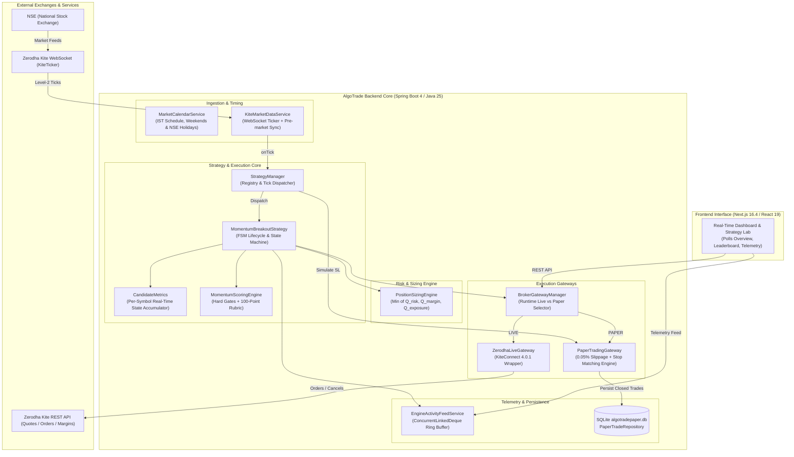
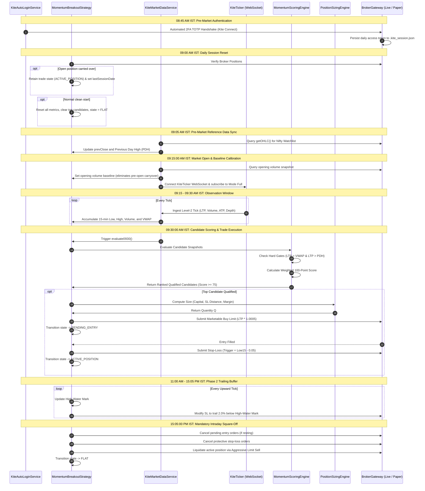
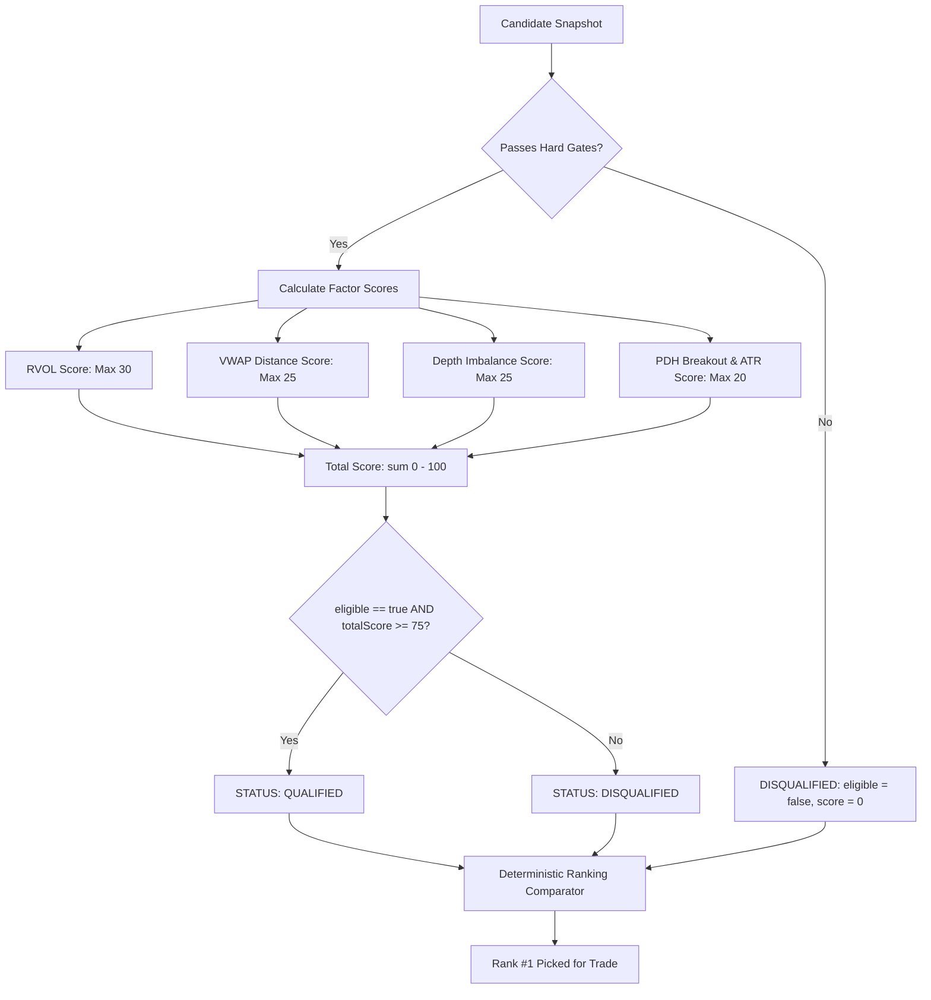
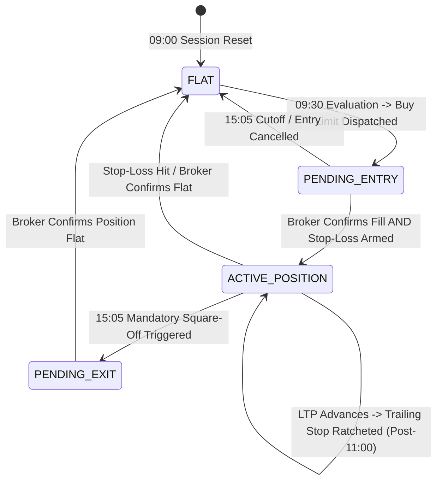

# AlgoTrade Architecture & Engine Specification: `working.md`

> **Document Version:** 2.0.0 (Production Verified)  
> **Target Environment:** Java 25 / Spring Boot 4.1.x / Zerodha KiteConnect 4.0.1 / SQLite 3 / Next.js 16.4 (React 19, Tailwind CSS 4)  
> **Market:** National Stock Exchange of India (NSE) — Cash Equity Intraday (MIS)  
> **Timezone Reference:** Indian Standard Time (IST, UTC+05:30)

---

## Table of Contents
1. [Executive System Architecture & Topology](#1-executive-system-architecture--topology)
2. [End-to-End Market Day Timeline & Scheduled Automation](#2-end-to-end-market-day-timeline--scheduled-automation)
3. [Market Data Ingestion Pipeline & Tick Streaming](#3-market-data-ingestion-pipeline--tick-streaming)
4. [Candidate Metrics & Mathematical Computation Engine](#4-candidate-metrics--mathematical-computation-engine)
5. [Momentum Scoring Matrix & Qualification Pipeline](#5-momentum-scoring-matrix--qualification-pipeline)
6. [Dynamic Position Sizing & Three-Tier Risk Engine](#6-dynamic-position-sizing--three-tier-risk-engine)
7. [Finite State Machine (FSM) & Trade Lifecycle Engine](#7-finite-state-machine-fsm--trade-lifecycle-engine)
8. [Broker Gateways & Order Execution Mechanics](#8-broker-gateways--order-execution-mechanics)
9. [Statutory Taxation, Transaction Fees & Slippage Accounting](#9-statutory-taxation-transaction-fees--slippage-accounting)
10. [Zero-Latency Telemetry & In-Memory Ring Buffer](#10-zero-latency-telemetry--in-memory-ring-buffer)
11. [REST API Surface & Data Transfer Schema](#11-rest-api-surface--data-transfer-schema)
12. [Backtesting Engine & Historical Candle Simulation](#12-backtesting-engine--historical-candle-simulation)
13. [Security, CORS & Failure Protection Guardrails](#13-security-cors--failure-protection-guardrails)

---

## 1. Executive System Architecture & Topology

AlgoTrade is an institutional-grade, low-latency automated trading platform designed specifically for intraday equity momentum strategies on the National Stock Exchange of India (NSE). It bridges real-time market feeds from Zerodha Kite with an automated quantitative evaluation and order execution engine.

### High-Level Architectural Diagram



### Component Inventory & Responsibilities

| Class | Package | Primary Responsibility |
| :--- | :--- | :--- |
| `MarketCalendarService` | `core.service` | Official NSE calendar: enforces 09:15 open, 09:15–09:30 observation window, 15:05 square-off cutoff, 15:30 close, weekend filters, and official NSE holidays. |
| `KiteMarketDataService` | `broker.zerodha` | Manages the `KiteTicker` WebSocket connection, token mapping for the liquid watchlist, pre-market reference data syncing, and scheduled 09:30 evaluations. |
| `StrategyManager` | `strategy` | Central strategy registry and tick router. Dispatches ticks to the active strategy and to `PaperTradingGateway` for real-time stop-loss checking. |
| `MomentumBreakoutStrategy` | `strategy.momentum_breakout` | Finite state machine orchestrating 09:00 daily resets, 09:30 qualification scoring, entry limit placement, stop-loss arming, and 15:05 square-off. |
| `CandidateMetrics` | `strategy.momentum_breakout` | Per-symbol metrics accumulator: tracks 15-minute low/high, window volume, exchange ATP/VWAP, opening baseline, and Level-2 depth. |
| `MomentumScoringEngine` | `strategy.momentum_breakout` | Pure mathematical evaluator: checks hard eligibility gates (LTP > VWAP & LTP > PDH) and calculates multi-factor composite scores (0–100). |
| `PositionSizingEngine` | `risk` | Institutional sizing: calculates $\min(Q_{\text{risk}}, Q_{\text{margin}}, Q_{\text{exposure}})$, enforces stop distance filters ($0.4\% - 2.0\%$), and caps daily trades to 1. |
| `ZerodhaLiveGateway` | `broker.zerodha` | Live KiteConnect wrapper: places regular MIS limit and SL-M orders, checks positions, and executes emergency liquidation. |
| `PaperTradingGateway` | `broker.paper` | Zero-risk execution simulator: applies 0.05% adverse slippage, checks stops on incoming ticks, calculates statutory taxes, and logs to SQLite. |
| `EngineActivityFeedService` | `core.service` | High-speed, lock-free 200-event ring buffer (< 1 µs write time) emitting structured telemetry for the UI decision terminal. |

---

## 2. End-to-End Market Day Timeline & Scheduled Automation

All operations run deterministically against Indian Standard Time (IST, UTC+05:30):



---

## 3. Market Data Ingestion Pipeline & Tick Streaming

Live market data enters through `KiteMarketDataService.java` using Zerodha's official WebSocket library (`KiteTicker`):

1. **Constituent Watchlist:**
   The engine monitors high-liquidity Nifty constituents:
   `"NTPC", "RELIANCE", "INFY", "TCS", "HDFCBANK", "ICICIBANK", "SBIN", "BHARTIARTL", "LT", "AXISBANK"`
2. **Token Resolution:**
   Tokens are mapped dynamically via `kiteConnect.getQuote(keys)` or fallback to static NSE instrument tokens (e.g. RELIANCE: `738561`, INFY: `408065`).
3. **Tick Unpacking:**
   Incoming ticks arriving in `modeFull` provide:
   - `lastTradedPrice` (LTP)
   - `volumeTradedToday` (Cumulative day volume)
   - `totalBuyQuantity` and `totalSellQuantity` (Level-2 market depth)
   - `averageTradePrice` (Exchange ATP / official daily VWAP)
4. **Fan-Out Dispatch:**
   `StrategyManager.onTick()` dispatches each tick to:
   - `MomentumBreakoutStrategy.onTick()` for real-time candidate metrics accumulation and trailing stop management.
   - `PaperTradingGateway.onTick()` to immediately check whether resting paper stop-loss triggers have been breached.

---

## 4. Candidate Metrics & Mathematical Computation Engine

Inside `CandidateMetrics.java`, incoming ticks update real-time state:

### 1. Observation Window Boundary Enforcement (09:15:00 – 09:30:00 IST)
- During the observation window (`inObservationWindow == true`):
  - `low15` tracks the minimum tick price: $\min(\text{low15}, \text{price})$
  - `high15` tracks the maximum tick price: $\max(\text{high15}, \text{price})$
  - Incremental volume updates internal price-volume sum $\sum (P_i \times V_i)$
  - Official exchange ATP (`averageTradePrice`) updates `exchangeVwap`
- **Post 09:30:00 IST:**
  `low15`, `high15`, window volume, and `exchangeVwap` are **frozen**. Subsequent ticks only update `ltp`, `totalBuyQty`, and `totalSellQty`.

### 2. Opening Volume Baseline Calibration
To eliminate pre-open uncrossing volume:
$$\text{Window Volume} = \max\left(0, \text{Current Volume} - \text{Opening Baseline Volume}_{09:15:00}\right)$$

### 3. Level-2 Order Book Imbalance Ratio
$$\text{Depth Imbalance} = \frac{\text{Total Buy Qty} - \text{Total Sell Qty}}{\text{Total Buy Qty} + \text{Total Sell Qty}}$$
- $\text{Depth Imbalance} \in [-1.0, +1.0]$
- Positive values indicate net buying pressure in the order book.

---

## 5. Momentum Scoring Matrix & Qualification Pipeline

Evaluated by `MomentumScoringEngine.java` at 09:30:00 AM IST:



### 1. Mandatory Hard Eligibility Gates
A candidate must satisfy **all** gate conditions (`passesHardGates(s) == true`):
1. `ltp > 0` and `vwap > 0` and `previousDayHigh > 0`
2. **Above VWAP Gate:** `ltp > vwap` (Buying above fair institutional value)
3. **PDH Breakout Gate:** `ltp > previousDayHigh` (True momentum breakout above yesterday's high)
4. **Volume Gate:** `windowVolume > 0` and `avgDailyVolume10Day > 0`

### 2. Multi-Factor Scoring Rubric (100 Points Total)

| Factor | Metric Definition | Scoring Bands | Max Points |
| :--- | :--- | :--- | :---: |
| **RVOL** | $\text{RVOL} = \frac{\text{Window Volume}}{10\text{-Day Avg Volume} \times 0.10}$ | $\begin{aligned} &\text{RVOL} \ge 3.00 \rightarrow 30\text{ pts} \\ &2.00 \le \text{RVOL} < 3.00 \rightarrow 20\text{ pts} \\ &1.50 \le \text{RVOL} < 2.00 \rightarrow 10\text{ pts} \\ &\text{RVOL} < 1.50 \rightarrow 0\text{ pts} \end{aligned}$ | **30** |
| **VWAP Distance** | $\text{VD\%} = \frac{\text{LTP} - \text{VWAP}}{\text{VWAP}} \times 100$ | $\begin{aligned} &0.30\% \le \text{VD\%} \le 1.80\% \rightarrow 25\text{ pts (Ideal)} \\ &0.00\% < \text{VD\%} < 0.30\% \rightarrow 10\text{ pts (Weak)} \\ &1.80\% < \text{VD\%} \le 2.20\% \rightarrow 10\text{ pts (Stretched)} \\ &\text{VD\%} > 2.20\% \rightarrow 0\text{ pts (Overextended trap)} \end{aligned}$ | **25** |
| **Depth Imbalance** | $\text{DI} = \frac{\text{BuyQty} - \text{SellQty}}{\text{BuyQty} + \text{SellQty}}$ | $\begin{aligned} &\text{DI} \ge +0.35 \rightarrow 25\text{ pts (Buyers } \ge 2\times \text{Sellers)} \\ &+0.15 \le \text{DI} < +0.35 \rightarrow 15\text{ pts} \\ &0.00 \le \text{DI} < +0.15 \rightarrow 5\text{ pts} \\ &\text{DI} < 0.00 \rightarrow 0\text{ pts} \end{aligned}$ | **25** |
| **PDH & ATR** | $\text{LTP} > \text{PDH}$ check with ATR | $\begin{aligned} &\text{LTP} > \text{PDH} \text{ and } \text{ATR\%} \ge 1.80\% \rightarrow 20\text{ pts} \\ &\text{LTP} > \text{PDH} \text{ and } \text{ATR\%} < 1.80\% \rightarrow 10\text{ pts} \\ &\text{LTP} \le \text{PDH} \rightarrow 0\text{ pts} \end{aligned}$ | **20** |

### 3. Absolute Qualification Rule
```java
public boolean isQualified() {
    return eligible && totalScore >= 75;
}
```

### 4. Deterministic Tie-Breaker Comparator
To prevent an ineligible stock from blocking an eligible candidate:
1. `eligible` candidates sort before ineligible candidates.
2. Higher `totalScore` sorts first.
3. Higher `rvolScore` breaks ties.
4. Higher `depthImbalanceScore` breaks secondary ties.
5. Alphabetical symbol name breaks tertiary ties.

---

## 6. Dynamic Position Sizing & Three-Tier Risk Engine

Governed by `PositionSizingEngine.java`:

### 1. Three-Constraint Formula
$$Q_{\text{final}} = \min\left(Q_{\text{risk}},\, Q_{\text{margin}},\, Q_{\text{exposure}}\right)$$

Where:
- **Risk-Based Sizing ($Q_{\text{risk}}$):** Caps potential loss at exactly $1.0\%$ of capital:
  $$Q_{\text{risk}} = \left\lfloor \frac{\text{Capital} \times 0.010}{\text{Entry Price} - \text{Initial Stop Price}} \right\rfloor$$
- **Available Margin Sizing ($Q_{\text{margin}}$):** Based on broker's intraday requirement (20% margin / $5\times$ leverage):
  $$Q_{\text{margin}} = \left\lfloor \frac{\text{Available Cash}}{\text{Margin Per Share}} \right\rfloor$$
- **Exposure Cap ($Q_{\text{exposure}}$):** Caps maximum total notional value at $1.0\times$ capital:
  $$Q_{\text{exposure}} = \left\lfloor \frac{\text{Capital} \times 1.0}{\text{Entry Price}} \right\rfloor$$

### 2. Volatility Guards (Stop Distance Bounds)
$$\text{Stop Distance \%} = \frac{\text{Entry Price} - \text{Initial Stop Price}}{\text{Entry Price}} \times 100$$
- **Minimum Stop Distance:** $0.40\%$. Trades below $0.40\%$ are rejected as vulnerable to market noise.
- **Maximum Stop Distance:** $2.00\%$. Trades above $2.00\%$ are rejected as over-extended.

### 3. Single Daily Trade Limit
- Atomic limit: Exactly **1 trade per day**.
- Enforced across both paper executions (`PaperTradeRepository.countByEntryTimeBetween(...)`) and live dispatches (`liveTradesToday.get()`).

---

## 7. Finite State Machine (FSM) & Trade Lifecycle Engine

Implemented in `MomentumBreakoutStrategy.java` via `TradeLifecycleState`:



### State Behavior Details
- `FLAT`: No active position, candidate metrics accumulating.
- `PENDING_ENTRY`: Limit buy order resting. If entry order is filled, the engine arms the protective stop-loss (`trigger = floorToTick(Low15 - 0.05)`, `limit = floorToTick(trigger * 0.998)`). **The state remains `PENDING_ENTRY` until the stop-loss order is confirmed placed**, preventing naked exposure.
- `ACTIVE_POSITION`: Protected position.
  - **Phase 1 (09:30 – 11:00 AM):** Retains initial structural stop at `Low15 - 0.05`.
  - **Phase 2 (11:00 AM – 15:05 PM):** Trailing stop ratchets upward:
    $$\text{Target Trail Stop} = \lfloor \text{High Water Mark} \times 0.980 \rfloor_{\text{tick}}$$
    The order is modified only when target trail stop exceeds both the currently armed stop and initial stop.
- `PENDING_EXIT`: Square-off limit order dispatched (`pos.quantity()` sold at $\text{LTP} - 0.1\%$).

---

## 8. Broker Gateways & Order Execution Mechanics

Orders route through `BrokerGatewayManager.java`:

### 1. `ZerodhaLiveGateway.java` (Real Production Route)
- Uses Zerodha `KiteConnect 4.0.1`.
- Configured for NSE Cash Intraday MIS (`Constants.PRODUCT_MIS`).
- Entry order type: `LIMIT` at marketable price ($\lceil \text{LTP} \times 1.0005 \rceil_{\text{tick}}$).
- Stop-loss order type: `SL` with limit protection buffer to prevent execution above trigger.

### 2. `PaperTradingGateway.java` (Simulation Route)
- Applies **0.05% adverse slippage** on market and stop fills.
- Maintains in-memory positions and resting stop-loss triggers.
- Evaluates stop triggers on every incoming tick via `onTick(symbol, ltp)`.
- Calculates Indian statutory charges upon trade close and logs completed trades to `algotradepaper.db`.

### 3. `KiteAutoLoginService.java` (Headless 2FA Login)
Automates daily morning 08:45 AM authentication:
1. `POST https://kite.zerodha.com/api/login` with User ID & Password $\rightarrow$ obtains `request_id`.
2. Computes 6-digit TOTP code via RFC 6238 HMAC-SHA1 using Base32 secret.
3. `POST https://kite.zerodha.com/api/twofa` with `request_id` & TOTP $\rightarrow$ sets session cookies.
4. Follows OAuth redirect chain to capture `request_token`.
5. Exchanges `request_token` with `KiteConnect.generateSession()` $\rightarrow$ obtains daily `access_token`.

---

## 9. Statutory Taxation, Transaction Fees & Slippage Accounting

Accurately modeled in `ChargesBreakdown.java`:

| Charge | Applied Rate / Formula |
| :--- | :--- |
| **Brokerage** | $\min(₹20.00,\, 0.03\% \times \text{Turnover})$ per executed leg (Buy and Sell). |
| **STT (Securities Transaction Tax)** | **0.025%** applied strictly to the **Sell Turnover** for intraday equity. |
| **Exchange Transaction Fee** | **0.00307%** on total combined turnover (Buy + Sell). |
| **SEBI Turnover Charges** | ₹10 per crore (**0.0001%**) on total combined turnover. |
| **Stamp Duty** | **0.003%** applied strictly to the **Buy Turnover**. |
| **GST (Goods & Services Tax)** | **18.0%** on `(Brokerage + Exchange Charges + SEBI Charges)`. |

$$\text{Net P\&L} = (\text{Sell Turnover} - \text{Buy Turnover}) - \text{Total Charges}$$

---

## 10. Zero-Latency Telemetry & In-Memory Ring Buffer

Managed by `EngineActivityFeedService.java`:
- Structure: `ConcurrentLinkedDeque<EngineActivityEvent>` bounded to **200 events**.
- Write performance: Non-blocking, $< 1\,\mu\text{s}$ latency.
- Categories: `STRATEGY`, `RISK`, `ORDERS`, `LIFECYCLE`, `SYSTEM`, `MARKET_DATA`.
- Severity levels: `INFO`, `SUCCESS`, `WARN`, `ERROR`.
- Consumed by Next.js frontend `DecisionFeedTerminal.tsx` via polling `sinceId`.

---

## 11. REST API Surface & Data Transfer Schema

Controller: `TradingDashboardController.java` (`/api/dashboard`):

| Method | Endpoint | Description |
| :--- | :--- | :--- |
| `GET` | `/api/dashboard/overview` | Active trade, unrealized PnL, capital, market open status. |
| `GET` | `/api/dashboard/leaderboard` | Top 10 scored candidates from 09:30 evaluation. |
| `GET` | `/api/dashboard/analytics` | Financial breakdown: Gross vs Net PnL, statutory taxes paid, win rate. |
| `GET` | `/api/dashboard/activity-feed` | Telemetry event stream (`?sinceId=...&limit=50`). |
| `POST`| `/api/dashboard/mode` | Hot-swap between `PAPER` and `LIVE` trading venues. |
| `POST`| `/api/dashboard/emergency-exit`| Emergency kill-switch: squares off all open positions immediately. |
| `POST`| `/api/dashboard/zerodha/auto-login` | Triggers headless 2FA login via JSON request body. |
| `GET` | `/api/dashboard/zerodha/status`| Live Kite connection status and available margin. |
| `GET` | `/api/dashboard/stock-quote` | Level-2 market depth and live quotes for any NSE stock. |
| `GET` | `/api/dashboard/stock-chart` | Intraday time-series price trajectory. |
| `POST`| `/api/backtest/run` | Executes backtest simulation over historical date ranges. |
| `GET` | `/api/backtest/presets` | Quick 1-click preset periods (30D, 90D, 180D, YTD). |

---

## 12. Backtesting Engine & Real Historical Data Simulation

Implemented in `BacktestEngineService.java` & `HistoricalMarketDataService.java`:
- **Real Market Data Ingestion & Caching:**
  - Ingests real historical daily and intraday candles for the NIFTY universe directly from official NSE feeds (`SYMBOL.NS`).
  - Persists downloaded historical candles to local disk cache (`.cache/historical_market_data/{symbol}_daily.json`) for instant sub-50ms repeat backtests without hitting external rate limits.
  - Automatically calculates true 20-day Average Daily Volume (ADV), 14-day ATR%, and Previous Day High (PDH) from real historical sessions.
- **100% Strategy & Risk Parity with Dynamic Leveraged Risk Capacity:**
  - Evaluates candidate metrics using the production `MomentumScoringEngine` (100-point model with hard qualification gates).
  - Reuses `PositionSizingEngine.calculateSizingQuantity` to enforce user-configured leverage ($1.0\times$ cash up to $5.0\times$ SEBI MIS) and $0.40\% - 2.00\%$ stop distance boundaries.
  - Risk Budget is calculated directly on total leveraged position capacity ($\text{Capital} \times \text{Leverage} \times \text{Risk\%}$), e.g., $₹10,000 \times 5.0\times \times 2.0\% = ₹1,000$ risk budget, allowing full utilization of intraday buying power.
  - Anchors structural stop strictly to `floorToTick(Low15 - 0.05)`.
- **Realistic Intrabar Sequencing (No Peeking Bias):**
  - Models candle direction realistically: on bullish candles ($C \ge O$, $O \to L \to H \to C$), checks the Low against existing stops before updating high-water marks. On bearish candles ($C < O$, $O \to H \to L \to C$), models High before Low.
  - Post-11:00 AM trailing stop ratchets 2.0% below the high-water mark.
  - Mandatory 15:05 PM EOD square-off if stop-loss is not hit.
- **Institutional Financial Analytics:**
  - Net Profit Factor computed strictly on post-tax Net PnL via `ChargesBreakdown`.
  - Annualized Sharpe Ratio ($\sqrt{252}$) adjusted with the 6.5% Indian benchmark repo rate.
  - Max Drawdown (Rupees & %) and consecutive loss counters.

---

## 13. Security, CORS & Failure Protection Guardrails

1. **Environment-Driven CORS:**
   Origins are loaded dynamically from environment variables (`ALGOTRADE_CORS_ALLOWED_ORIGINS` / `FRONTEND_URL`), eliminating wildcards (`*`) when credentials are enabled.
2. **Credential Privacy:**
   Authentication credentials (`password`, `totpSecret`) are accepted exclusively via JSON `@RequestBody` DTOs, keeping secrets out of web server access logs and browser query strings.
3. **Repository Secret Hygiene:**
   `.kite_session.json` and `algotradepaper.db` are explicitly untracked in Git and excluded via `.gitignore`.
4. **Session Reset Loop Immunity:**
   `lastSessionDate` is assigned at the start of `resetDailySession()`, guaranteeing carried-over positions never trigger infinite session reset loops on subsequent ticks.
5. **Anti-Naked Exposure Guard:**
   `MomentumBreakoutStrategy` remains in `PENDING_ENTRY` until the broker acknowledges placement of the protective stop-loss order.
6. **NSE Trading Holiday Guard:**
   `MarketCalendarService` cross-references official NSE holiday schedules, blocking accidental automated order placement on market holidays.
